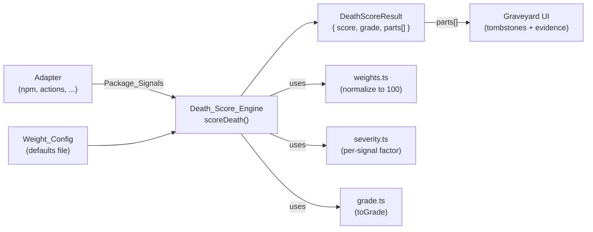

# Design

## Overview

The Death_Score_Engine is the scoring component of the reusable `/skeleton` kit. An Adapter (npm, GitHub Actions, and others) collects `Package_Signals` from data sources and hands them to the engine, which returns a `Death_Score` plus a transparent breakdown of parts. The graveyard UI renders the breakdown as evidence. The engine is the first skeleton component to be built, so this design also establishes the module layout conventions other skeleton components will follow.

The engine is pure: it never fetches data, reads the clock, or calls an LLM. All time-relative values (months since last publish, months since last commit) arrive already computed as integer inputs from the Adapter, so the engine has no time dependency and tests are deterministic without clock mocking.

## Goals

- Produce a 0-to-100 death score from seven adapter-supplied signals.
- Return a transparent breakdown where the parts always add up to the total.
- Treat missing signals as unknown (never as the most-alive value).
- Keep weights configurable with sensible defaults in one file.
- Verify all five named correctness properties with fast-check, plus a sabotage check per the proof rules.

## Non-Goals

- Fetching data or computing "months since" from dates (the Adapter's job).
- Choosing or ranking replacements (handled by the replacement stage).
- Rendering the graveyard UI (a separate skeleton component).
- Ecosystem-specific weighting policy beyond providing configurable defaults.

## Architecture



`/skeleton` never imports from an app. The engine depends only on its own modules (`weights.ts`, `severity.ts`, `grade.ts`, `types.ts`) and on `fast-check` at test time.

## Components and Interfaces

- `skeleton/src/death-score/types.ts` — TypeScript interfaces (no runtime code).
- `skeleton/src/death-score/weights.ts` — default `Weight_Config` and weight normalization.
- `skeleton/src/death-score/severity.ts` — pure per-signal severity factor mapping (raw value to a `[0,1]` factor).
- `skeleton/src/death-score/grade.ts` — `toGrade(score): GradeBand`.
- `skeleton/src/death-score/score.ts` — `scoreDeath(signals, config?): DeathScoreResult`; the only public entry point.
- `skeleton/src/death-score/index.ts` — re-exports the public API.
- `skeleton/src/death-score/__fixtures__/` — recorded signal fixtures (never network).
- `skeleton/src/death-score/score.prop.ts`, `grade.test.ts`, `weights.test.ts` — tests.

## Data Models

```ts
// A signal value is either known or unknown (missing). Unknown is never the alive value.
export type SignalValue<T> =
  | { kind: "known"; value: T }
  | { kind: "unknown" };

export type SignalName =
  | "deprecated"
  | "repoArchived"
  | "monthsSinceLastPublish"
  | "monthsSinceLastCommit"
  | "maintainerCount"
  | "openVulnsNoFix"
  | "knownReplacementExists";

// All seven signals, each independently known or unknown. Source URLs are optional per signal.
export interface PackageSignals {
  deprecated: SignalValue<boolean>;
  repoArchived: SignalValue<boolean>;
  monthsSinceLastPublish: SignalValue<number>; // >= 0
  monthsSinceLastCommit: SignalValue<number>;  // >= 0
  maintainerCount: SignalValue<number>;        // >= 0
  openVulnsNoFix: SignalValue<number>;         // >= 0
  knownReplacementExists: SignalValue<boolean>;
  sourceUrls?: Partial<Record<SignalName, string>>;
}

export interface WeightConfig {
  // Raw max-point weights. Normalized so their sum is 100 before scoring.
  weights: Record<SignalName, number>;
  // Thresholds for numeric signal mappings.
  monthsSinceLastPublishFullDead: number; // months at/above which the signal is fully dead (default 24)
  monthsSinceLastCommitFullDead: number;  // default 36
  maintainerCountFullAlive: number;       // maintainers at/above which the signal is fully alive (default 5)
  openVulnsFullDead: number;               // vuln count at/above which fully dead (default 1)
  // Factor applied to unknown signals, in (0, 1]. Strictly greater than 0 so unknown is never alive.
  unknownFactor: number; // default 0.5
}

export interface SignalPart {
  signal: SignalName;
  rawValue: string;             // human-readable, or "unknown"
  weight: number;               // normalized weight (max points for this signal)
  points: number;               // integer contribution; 0 <= points <= weight
  status: "known" | "unknown";
  sourceUrl?: string;
}

export type GradeBand = "alive" | "ailing" | "dying" | "dead";

export interface DeathScoreResult {
  score: number;   // integer 0..100, equal to sum(parts[].points)
  grade: GradeBand;
  parts: SignalPart[]; // one per Signal, in a stable order
}
```

## Scoring Model

For each signal the engine computes a **severity factor** `f in [0,1]` (1 = fully dead for that signal's weight, 0 = fully alive), then:

```
points_i = round_to_int(normalizedWeight_i * f_i)
```

`Death_Score = sum(points_i)`, with `sum(normalizedWeight_i) = 100`, so the score is naturally bounded in `[0,100]` without clamping that would break transparency.

### Severity factor per signal

| Signal | known, most-alive (`f=0`) | known, fully-dead (`f=1`) | mapping | unknown |
|---|---|---|---|---|
| `deprecated` | `false` | `true` | boolean | `unknownFactor` |
| `repoArchived` | `false` | `true` | boolean | `unknownFactor` |
| `monthsSinceLastPublish` | `0` months | `>= fullDead` | `clamp(months / fullDead, 0, 1)` | `unknownFactor` |
| `monthsSinceLastCommit` | `0` months | `>= fullDead` | `clamp(months / fullDead, 0, 1)` | `unknownFactor` |
| `maintainerCount` | `>= fullAlive` | `0` | `count <= 0 ? 1 : clamp(1 - count/fullAlive, 0, 1)` (fewer = deader) | `unknownFactor` |
| `openVulnsNoFix` | `0` | `>= fullDead` | `clamp(count / fullDead, 0, 1)` | `unknownFactor` |
| `knownReplacementExists` | `false` | `true` | boolean (presence = death signal) | `unknownFactor` |

Every mapping is monotonic non-decreasing in the Death_Direction: making a signal worse (more months, fewer maintainers, a flag becoming true) only increases `f`, so `points` and the `Death_Score` never decrease.

### Why `knownReplacementExists` counts as a death signal

A package that the ecosystem has already produced a known living replacement for is one the maintainers have effectively moved past; the presence of a successor is evidence of being superseded. It is weighted lightly by default so it can tip a borderline package but cannot alone declare a healthy package dead. This direction is the only one consistent with the monotonic property, and it is called out here as an explicit, reviewable decision.

### Weight normalization

Raw weights are authored as "max points." Before scoring, the engine normalizes them so `sum(normalizedWeight) = 100`, preserving relative ratios. With defaults authored to sum to exactly 100, normalization is a no-op for the default config; for any custom config it guarantees the score stays in `[0,100]` and the parts still sum to the total. A zero-weight signal contributes 0 points and still appears in the breakdown (points 0, weight 0).

### Integer transparency

`Death_Score` and every `SignalPart.points` are integers. To guarantee `sum(parts[].points) == score` exactly, the engine rounds the float parts to integers and assigns any rounding drift (the difference between `round(sum(floats))` and `sum(round(floats))`) to the part with the largest fractional remainder. The score itself is `round(sum(floats))`, which is monotonic non-decreasing in the inputs because `round` is monotonic and each float part is non-decreasing in its signal.

## Correctness Properties

All properties run with fast-check `numRuns: 100` (internal module, per the tech rules), a fixed seed in CI, and record-on-failure. Generators are shaped by the real signal domains plus edge cases (all-alive, all-dead, all-unknown, zero maintainers, boundary months, unicode-free URLs). A sabotage check is required for every property (proof-rules.md): swap in a deliberately wrong implementation and confirm the property fails.

### Property 1: Bounded

**Validates: Requirements 1.2, 1.3**

For any `Package_Signals` and any `Weight_Config` with non-negative weights and `unknownFactor in (0,1]`:

- Arbitrary: `fc.record` of the seven signals (each known-with-realistic-domain or unknown) and a `Weight_Config` with positive weights.
- Assert: `0 <= result.score && result.score <= 100`.
- Sabotage: an implementation that sums raw (unnormalized) points fails for a config whose weights sum above 100.

### Property 2: Transparent (parts add up)

**Validates: Requirements 2.3**

For any `Package_Signals`:

- Arbitrary: the same signals arbitrary as Property 1, default config.
- Assert: `result.parts.reduce((s, p) => s + p.points, 0) === result.score` (exact integer equality), and there is exactly one part per signal.
- Sabotage: an implementation that rounds each part independently (leaving drift) fails the equality.

### Property 3: Deterministic

**Validates: Requirements 6.2**

For any `Package_Signals` and `Weight_Config`:

- Arbitrary: same as Property 1.
- Assert: `scoreDeath(signals, config)` deep-equals `scoreDeath(signals, config)` on a second call, and two structurally equal inputs produce structurally equal results.
- Sabotage: an implementation that injects `Math.random()` or `Date.now()` into the score fails.

### Property 4: Monotonic in the death direction

**Validates: Requirements 7.1**

For any pair `(A, B)` of fully-specified `Package_Signals` (no unknowns) where `B` is at least as dead as `A` on every signal:

- Arbitrary: generate `A` with all signals known; generate `B` by independently worsening-or-equaling each signal (more months, fewer maintainers, a flag true instead of false).
- Assert: `scoreDeath(B).score >= scoreDeath(A).score`.
- Sabotage: an implementation that inverts a signal (e.g., more maintainers increases the score) fails.

### Property 5: Unknown is not alive

**Validates: Requirements 4.3**

For any fully-known `Package_Signals` and any single signal index `i`:

- Arbitrary: known signals; a signal index chosen from the seven.
- Assert: `scoreDeath(signals with signal i set to unknown, DEFAULT_WEIGHT_CONFIG).score > scoreDeath(signals with signal i set to its most-alive value, DEFAULT_WEIGHT_CONFIG).score` (strictly greater), all other signals equal. The precondition is the default weight config, where every weight is at least 3, so every signal's normalized weight is positive and unknown adds at least 1.5 float points, enough to survive rounding.
- Why strict: the earlier `>=` version let the "unknown treated as alive" sabotage pass (equal scores satisfy `>=`); the sabotage suite found this.
- Sabotage: an implementation that treats unknown as the most-alive value (`unknownFactor = 0`) fails because the left side no longer exceeds the right.

### Sabotage harness

`sabotage.ts` wraps each property to run it twice: once against the real `scoreDeath`, once against a configurable wrong implementation (inverted signal, no normalization, independent rounding, nondeterminism, unknown-as-alive). The harness asserts that at least one property fails for each wrong implementation, so a property that can never fail is itself rejected per proof-rules.md.

## Key Design Decisions

1. **Normalize weights to 100.** Guarantees bounded + transparent + monotonic for any config. Defaults are authored to sum to 100 so the default behavior is intuitive and normalization is invisible.
2. **Unknown as a configurable factor strictly greater than 0 (default 0.5).** Satisfies "unknown is not alive" (`unknown >= best`, since best factor is 0) and is reviewable/tunable rather than hard-coded.
3. **Months-since is an integer input, not computed from the clock.** Keeps the engine pure and tests deterministic; no clock/time-zone mocking is needed.
4. **Integer score with drift assigned to the largest-remainder part.** Keeps parts summing exactly to the total while the score stays a monotonic round of the float total.
5. **`knownReplacementExists` is a death signal.** The only direction consistent with monotonicity; weighted lightly by default and documented as a reviewable decision.
6. **Monotonicity is stated over fully-specified inputs.** Unknowns are governed by the separate "unknown is not alive" property; this keeps both properties unambiguous and independently provable.

## Risks

- **Over-punishing unknowns.** A package with many missing signals could score high. Mitigated by the moderate default `unknownFactor = 0.5` and the fact that unknowns only reach half of each signal's weight; tunable per ecosystem.
- **Rounding drift vs. monotonicity.** The largest-remainder assignment could in principle make a single part non-monotonic, but the `Death_Score` (the rounded float total) remains monotonic, and the monotonic property asserts on the score, not individual parts.
- **Threshold sensitivity.** `monthsSinceLastPublishFullDead` and `maintainerCountFullAlive` defaults are judgment calls. Mitigated by making them part of `Weight_Config` and documenting defaults; a future spec can tune them with data.

## Error Handling

- Negative numeric signals (for example, -1 months since last publish) are clamped to 0 before mapping, so they never produce a negative severity factor.
- A `Weight_Config` with a negative weight is treated as 0 for that signal before normalization; a non-positive `unknownFactor` is clamped to a small positive value so unknown is never alive.
- Unknown signals are a first-class status, never an error: a missing `Signal_Value` is represented as `{ kind: "unknown" }` and scored with the unknown factor.
- The engine never throws for well-formed `Package_Signals`. Producing well-formed `Package_Signals` (fetching, parsing, computing months since) is the Adapter's responsibility and is out of scope for the engine.

## Testing Strategy

- `weights.test.ts` — defaults load, normalization sums to 100, zero-weight handling.
- `grade.test.ts` — boundary integers (0, 24, 25, 49, 50, 74, 75, 100) and interior values.
- `score.test.ts` — worked examples from `__fixtures__/` (all-alive, all-dead, mixed-unknown, with/without source URLs).
- `score.prop.ts` — the five properties above, each with a sabotage variant, `numRuns: 100`, fixed seed.
