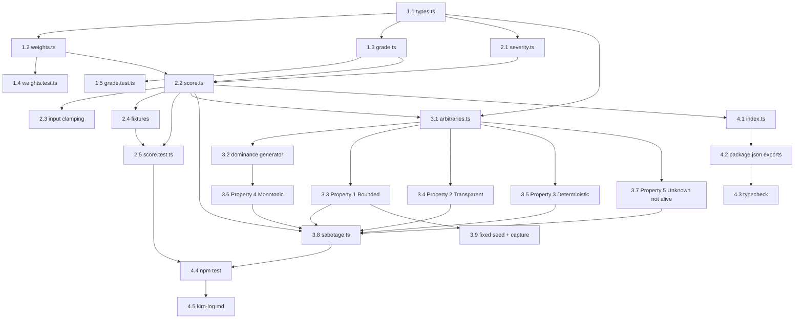

# Implementation Plan: death-score

## Overview

This plan implements the Death_Score_Engine in `/skeleton` per the death-score design: pure TypeScript (ESM, strict), Vitest + fast-check, no network. It delivers types and configuration, the scoring engine, the five correctness properties with sabotage checks, and integration into the `skeleton` package. Phases are sequential; within a phase, tasks are mostly independent.

## Tasks

### Phase 1: Types and configuration

- [x] 1.1 Create `skeleton/src/death-score/types.ts` with `SignalValue<T>`, `SignalName`, `PackageSignals`, `WeightConfig`, `SignalPart`, `GradeBand`, and `DeathScoreResult` exactly as specified in the design Data Models.
- [x] 1.2 Create `skeleton/src/death-score/weights.ts` with the default `WeightConfig` (raw weights summing to 100, default thresholds, `unknownFactor = 0.5`) and a pure `normalizeWeights(config)` that scales weights so they sum to 100.
- [x] 1.3 Create `skeleton/src/death-score/grade.ts` with `toGrade(score): GradeBand` mapping 0-24 alive, 25-49 ailing, 50-74 dying, 75-100 dead.
- [x] 1.4 Write `weights.test.ts`: defaults load, `normalizeWeights` sums to 100, a zero-weight signal yields 0 points and still appears in the breakdown.
- [x] 1.5 Write `grade.test.ts` over boundary integers 0, 24, 25, 49, 50, 74, 75, 100 and a few interior values.

### Phase 2: Scoring engine

- [x] 2.1 Create `skeleton/src/death-score/severity.ts` with a pure `severityFactor(signal, value, config): number` returning a value in `[0,1]` per the design table, where unknown maps to `config.unknownFactor` and the most-alive known value maps to 0.
- [x] 2.2 Implement `skeleton/src/death-score/score.ts` `scoreDeath(signals, config?): DeathScoreResult`: normalize weights, compute float points per signal, round the score to an integer, assign rounding drift to the largest-remainder part so `sum(parts.points) === score`, attach `sourceUrls`, and call `toGrade`.
- [x] 2.3 Clamp negative numeric signals to 0 and clamp non-positive `unknownFactor` to a small positive value per the Error Handling section.
- [x] 2.4 Create `skeleton/src/death-score/__fixtures__/` with recorded fixtures: all-alive, all-dead, all-unknown, mixed, and cases with and without source URLs.
- [x] 2.5 Write `score.test.ts` using the fixtures: assert score range, one part per signal, part fields, parts summing to the score, and source URL presence/absence.

### Phase 3: Property-based tests

- [x] 3.1 Create `skeleton/src/death-score/arbitraries.ts` with fast-check generators for `PackageSignals` (each signal known-with-realistic-domain or unknown, plus edge cases: all-alive, all-dead, all-unknown, zero maintainers, boundary months) and `WeightConfig` (positive weights).
- [x] 3.2 Add a death-dominance generator producing pairs `(A, B)` of fully-known `PackageSignals` where `B` is at least as dead as `A` on every signal.
- [x] 3.3 Implement Property 1 (Bounded): for arbitrary signals and config, assert `0 <= score <= 100`. `numRuns: 100`.
- [x] 3.4 Implement Property 2 (Transparent): for arbitrary signals, assert `sum(parts.points) === score` and one part per signal. `numRuns: 100`.
- [x] 3.5 Implement Property 3 (Deterministic): assert `scoreDeath(x, c)` deep-equals a second call and equal inputs give equal results. `numRuns: 100`.
- [x] 3.6 Implement Property 4 (Monotonic): for death-dominating pairs `(A, B)`, assert `scoreDeath(B).score >= scoreDeath(A).score`. `numRuns: 100`.
- [x] 3.7 Implement Property 5 (Unknown is not alive): for arbitrary known signals and each signal index, assert unknown-score > most-alive-score (strict; see design). `numRuns: 100`.
- [x] 3.8 Create `skeleton/src/death-score/sabotage.ts` running each property against deliberately wrong implementations (no normalization, independent rounding, inverted signal, nondeterminism, unknown-as-alive) and assert at least one property fails for each.
- [x] 3.9 Configure a fixed fast-check seed in CI and record-on-failure; add the seed/counterexample capture to the suite.

### Phase 4: Integration and documentation

- [x] 4.1 Create `skeleton/src/death-score/index.ts` re-exporting `scoreDeath`, `toGrade`, `normalizeWeights`, the default `WeightConfig`, and the public types.
- [x] 4.2 Wire the `death-score` module into the `skeleton` package exports in `package.json` (ESM only).
- [x] 4.3 Run `npm run typecheck` across workspaces and fix any strict-mode errors.
- [x] 4.4 Run `npm test` for the death-score module and confirm all properties and sabotage checks pass with `numRuns: 100`.
- [x] 4.5 Append a dated entry to `docs/kiro-log.md` noting the death-score build, the property suite, and any shrunk counterexamples the sabotage checks or properties surfaced.

## Task Dependency Graph



```json
{
  "waves": [
    { "id": "wave-1", "tasks": ["1.1"] },
    { "id": "wave-2", "tasks": ["1.2", "1.3", "2.1"] },
    { "id": "wave-3", "tasks": ["1.4", "1.5", "2.2"] },
    { "id": "wave-4", "tasks": ["2.3", "2.4", "3.1", "4.1"] },
    { "id": "wave-5", "tasks": ["2.5", "3.2", "3.3", "3.4", "3.5", "3.7", "4.2"] },
    { "id": "wave-6", "tasks": ["3.6", "3.9", "4.3"] },
    { "id": "wave-7", "tasks": ["3.8"] },
    { "id": "wave-8", "tasks": ["4.4"] },
    { "id": "wave-9", "tasks": ["4.5"] }
  ],
  "dependencies": {
    "1.2": ["1.1"],
    "1.3": ["1.1"],
    "1.4": ["1.2"],
    "1.5": ["1.3"],
    "2.1": ["1.1"],
    "2.2": ["1.2", "2.1", "1.3"],
    "2.3": ["2.2"],
    "2.4": ["2.2"],
    "2.5": ["2.2", "2.4"],
    "3.1": ["1.1", "2.2"],
    "3.2": ["3.1"],
    "3.3": ["3.1"],
    "3.4": ["3.1"],
    "3.5": ["3.1"],
    "3.6": ["3.2"],
    "3.7": ["3.1"],
    "3.8": ["2.2", "3.3", "3.4", "3.5", "3.6", "3.7"],
    "3.9": ["3.3"],
    "4.1": ["2.2"],
    "4.2": ["4.1"],
    "4.3": ["4.2"],
    "4.4": ["2.5", "3.8"],
    "4.5": ["4.4"]
  }
}
```

## Notes

- All modules are pure with no network access; tests never hit the network and use recorded fixtures under `__fixtures__/`.
- Per the tech steering, internal properties use `numRuns: 100`; the fast-check seed is fixed in CI and recorded on failure.
- Per `proof-rules.md`, every property has a sabotage check: a property that cannot fail is rejected.
- Commits reference spec task numbers (for example, `death-score 2.2: ...`) per the structure steering file.
