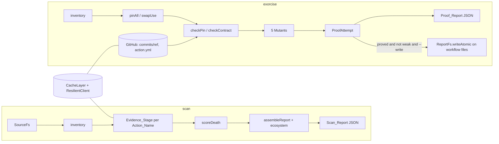

# Design

## Overview

Exorcist_Actions is the second app on the kit, and it is thin on purpose. It finds the third-party GitHub Actions in a repository's workflows, scores each with the unchanged death-score engine, and for a dead or risky action produces a fix (swap or pin) plus a proof. The output is the same Scan_Report and the same Proof_Report that the npm app writes, so the graveyard shows it with no change.

Six pieces, each small:

1. **Inventory** (`src/inventory/`): `yaml` documents with a `LineCounter`; every `uses:` becomes an `ActionUse` with its exact source offset. The YAML is never re-serialized.
2. **Evidence** (`src/evidence/`): the seven signals per `owner/repo`, built on the existing GitHub, OSV and cache code of `exorcist-npm`, plus the action's own `action.yml`.
3. **Replacement_Map** (`src/replacements.ts`): four curated entries, each with an input mapping.
4. **Rewrites** (`src/rewrite/`): `pinUse`/`pinAll` and `swapUse`, pure text edits at offsets that refuse instead of guess.
5. **Proofs** (`src/proof/`): `checkPin` and `checkContract`, five Mutants, and the mapping into the existing `ProofAttempt` and `ProofReport`.
6. **CLI** (`src/scan/cli.ts`, `src/exorcise/cli.ts`): `scan` and `exorcise`, with `--write` as the only way a workflow changes.

The hosted app, the tests and this app make no LLM call. Tests make no network request. One manual task records fixtures and the demo files from live requests (Requirement 16).

## Goals

- A second, genuinely different tool on the same kit: different input (workflow YAML), evidence (GitHub, `action.yml`, OSV `GitHub Actions`), fix (swap and pin) and proof (resolved commit and an input/output contract), with the same `scoreDeath`, `assembleReport`, `parseReport`, `parseProofReport` and `buildGraveyard`.
- Reuse over copy: the cache, the resilient client, the token handling, the OSV client, month arithmetic and the file seams are the npm app's, reached through its programmatic entry; the changes to existing code are five, small and default-preserving (Requirement 1.5).
- A rewrite changes exactly what it says it changes, byte for byte, and says no when it cannot.
- A proof can fail, and the sabotage check shows it can: five Mutants, a survivor makes the proof weak.
- A demo that loads instantly: three committed files from one recorded run, replayed byte for byte offline.

## Non-Goals

- Running workflows, `actionlint`, Docker actions, other CI systems, automatic pull requests, composite actions inside the scanned repository (Requirement 18.3).
- A `run:` swap. The `actions-rs/cargo` entry is evidence only; the swap refuses it with `unsupported_replacement_kind`.
- Changing scoring, the graveyard, the proof harness, the MCP server, the power or the web app. The UI findings are follow-ups (Requirement 18.4).
- Moving code into `skeleton`. Nothing here is trivially generic enough yet; the second app is the evidence that a third would reveal what is.

## Research Findings

What was checked in this repository on 2026-11-14 (not assumed):

- **Existing report codec** (`apps/exorcist-npm/src/scan/report.ts`): strict, canonical (`serializeReport(parse(x)) === x` is enforced), no `ecosystem` field today, `kinds` limited to the four npm kinds, `versionSource` `lockfile|range`, `SkipReason` closed to seven values. The actions report therefore uses `kinds: ["dependencies"]`, `versionSource: "range"` and skip reason `other`; only the optional `ecosystem` key is new.
- **Proof report** (`skeleton/src/proof/report.ts`): `checkConsistency` requires `weak === (status === "proved" && (applied === 0 || survivors.length > 0))`, `applied === caught + survivors.length`, `applied === 0` unless `proved`, a non-empty `callSites` for `proved`, a counterexample record exactly when `counterexample`, and an `error` object exactly when `error`. Statuses are `proved | counterexample | no-call-sites | error`; `weak` is a flag on `proved`. Error codes are a closed set; `recipe_failure` is the one used for an unavailable source.
- **Existing test** `exorcise/demo-proofs.test.ts` requires, for every `demo/proofs/<repo>/<file>.json`, Proof_Name folder and file names and `report.package === file name`. Hence `package` is the Action_Proof_Name, and `repo` (a free string) carries `owner/name`.
- **Proof names** (`PROOF_NAME_PATTERN`): lower case, digits, `-`, at most 64 characters. An action name `actions-rs/toolchain` is not one, so a derived name is needed (Requirement 14.7).
- **Evidence code**: `fetchGithub` reads the repository metadata and the latest commit, with the token handled in a closure that is not exported; `fetchOsv` hard-codes ecosystem `npm` in the request and in `countOpenVulnsNoFix`; `CacheLayer` keys TTL by a closed `Source` union (`npm | github | osv | e18e | depsdev`), so every request here uses `github` or `osv`; `assembleResult` builds messages with a private `reasonMessage`.
- **Test support**: `FakeHttp` replays `FixtureEntry` files and throws `UnmatchedFixtureRequest` for any request without a fixture; `loadFixtureCase(caseName, root)` accepts a root, so fixtures can live in this app; `programmatic-testing.ts` already re-exports `FakeHttp`, the fake clock, the fake sleep and `memoryFiles`.
- **File seams**: `SourceFs` (`readDir`, `readText`; never follows symbolic links) and `ReportFs` (`readText`, `writeAtomic`) are exported by the programmatic entry and are enough for the inventory, the report and the workflow writes.
- **The hero repo clone** (`../lastrites-work/nixpacks` at `144b4f9ab1c3943af4dfe76d3c79d91263f5b465`): seven workflow files; `actions-rs/toolchain@v1` 6 times (5 in `ci.yml`, 1 in `release.yml`), `actions-rs/cargo@v1` 7 times (6 and 1), `actions/checkout` 11 times, 20 distinct actions in all. 20 distinct repositories need about 3 to 4 API calls each; without a token the unauthenticated GitHub limit (60 per hour) is below that, which is why the Recorder should run with a token the user supplies in the environment, and why the recorded fixtures exist. (Counted with `grep` on the clone; the tests recount from the committed copies.)
- **Unverified until the Recorder runs**: whether `dtolnay/rust-toolchain` declares the inputs the mapping names (`toolchain`, `targets`, `components`) and which of them is required; whether `actions/create-release`, `actions/upload-release-asset`, `actions-rs/toolchain` and `actions-rs/cargo` are archived at recording time; whether `master` is the ref to write for `dtolnay/rust-toolchain` (its README uses `@master` with a `toolchain:` input and `@stable` without one). Requirement 7.4 turns each of these into an offline test over the recorded fixtures: an entry that does not hold is removed, not adjusted to pass.

## Architecture



Data flow of one pin: `inventory` gives the uses with offsets; every distinct `owner/repo@ref` is resolved through the cache (`GET /repos/{o}/{r}/commits/{ref}`); `pinAll` edits the text at the offsets; `checkPin` compares the original and rewritten texts line by line and the resolved sha with the written one; the five Mutants are fed to the same check; the result becomes one `ProofAttempt`; only then may `--write` touch a file.

Data flow of one swap: the uses of the action come from the inventory; the replacement's `action.yml` is fetched at `toRef`; `swapUse` edits each use; `checkContract` checks inputs and outputs; Mutants; attempt; write.

## Components and Interfaces

### Layout

```
apps/exorcist-actions/
  package.json  tsconfig.json
  src/
    index.ts                     public re-exports
    inventory/
      types.ts                   ActionUse, SkippedUse, InventoryResult, WithKey
      uses.ts                    parseUses, formatUses, refKindOf, URL-safe guards
      output-refs.ts             outputRefsFor(stepId, laterStepsText)
      inventory.ts               inventoryWorkflows(fs, root): Promise<InventoryResult>
      index.ts
    replacements.ts              REPLACEMENTS, findReplacement, Replacement types
    evidence/
      urls.ts                    every request URL, one builder each (used by the Recorder too)
      manifest.ts                parseActionManifest, runtimeSignal (Runtime_Rule)
      sources.ts                 fetchPublish, fetchManifest, resolveCommit, fetchActionsOsv
      assemble.ts                assembleActionEvidence (pure)
      stage.ts                   createActionEvidenceStage
      index.ts
    rewrite/
      lines.ts                   line table, EOL-preserving helpers, tail check
      pin.ts                     pinUse, pinAll
      swap.ts                    swapUse
      index.ts
    proof/
      pin-check.ts               checkPin
      contract-check.ts          checkContract
      mutants.ts                 PIN_MUTANTS, CONTRACT_MUTANTS, runSabotage
      names.ts                   actionProofName, repoProofName
      attempt.ts                 buildPinAttempt, buildContractAttempt, buildProofReport, callSitesOf
      index.ts
    scan/
      report.ts                  buildScanReport (pure)
      scan.ts                    runScan(deps)
      cli-args.ts  cli.ts        parseScanArgs; the entry (reads env and argv)
    exorcise/
      cli-args.ts  run.ts  cli.ts
    test-support/
      arbitraries/ workflow.ts manifest.ts replacement.ts attempt.ts
      properties/  actions-p1.ts ... actions-p13.ts
      sabotage/    actions-p1.ts ... actions-p13.ts
      fc-runner.ts harness.ts record-fixtures.ts
    __fixtures__/  README.md  nixpacks/ (repo/.github/workflows/*, http/*.json)  <small cases>/
```

Suffixes of test files follow the npm app (`*.p3.test.ts` for a property, `sabotage.test.ts` central).

### Inventory types (`inventory/types.ts`)

```ts
export type RefKind = "sha" | "mutable";

export interface WithKey {
  name: string;
  /** Offset and length of the key text. */
  offset: number;
  length: number;
  /** Whole-line range (without the line ending) when the entry is a single-line `key: value` line. */
  line?: { start: number; end: number; eolEnd: number };
}

export interface ActionUse {
  file: string;            // repository-relative, "/" separators
  line: number;            // 1-based
  column: number;          // 1-based
  offset: number;          // Source_Offset of the Uses_String content
  length: number;
  owner: string;
  repo: string;
  path?: string;
  ref: string;
  refKind: RefKind;
  with: Record<string, string>;
  withKeys: WithKey[];     // source order
  withLine?: { start: number; end: number; eolEnd: number }; // the `with:` key line, when single-line
  jobId: string;
  site: "step" | "job";
  stepIndex?: number;
  stepId?: string;
  outputRefs: string[];    // sorted, unique
}

export type SkipReasonActions = "docker" | "local" | "no_ref" | "malformed" | "unsupported_value";
export interface SkippedUse { file: string; line: number; column: number; specifier: string; reason: SkipReasonActions }

export interface InventoryResult { uses: ActionUse[]; skipped: SkippedUse[]; warnings: string[]; filesRead: number }
export type Inventory = (fs: SourceFs, root: string) => Promise<InventoryResult>;
```

`inventoryWorkflows` lists `<root>/.github/workflows`, keeps `file` entries ending `.yml|.yaml`, reads each, and for each text calls the pure `inventoryText(file, text)`, which returns `{ uses, skipped, warnings }`. `inventoryText` is the unit that properties call, with no file system. It uses `parseDocument(text, { lineCounter })`, walks `jobs` (a map) in source order, and for each job reads `uses` (Site `job`) and `steps` (a sequence). For a `uses` scalar it checks `scalar.type` is `PLAIN`, `QUOTE_SINGLE` or `QUOTE_DOUBLE`, takes `range[0]` (plus 1 for a quoted scalar) as the content offset, and requires `text.slice(offset, offset + value.length) === value` (else `unsupported_value`). Positions come from `lineCounter.linePos(offset)`. `stepId` is the scalar `id` of the step. `outputRefs` come from `outputsReferencedIn(text.slice(afterThisStep, endOfJob), stepId)`, a regex over `steps\.<id>\.outputs\.([A-Za-z0-9_-]+)` with `<id>` escaped. The final list is sorted by `(file, line, column)` with a UTF-16 comparison.

### Uses grammar (`inventory/uses.ts`)

```ts
export type ParsedUses =
  | { kind: "action"; owner: string; repo: string; path?: string; ref: string; refKind: RefKind }
  | { kind: "skip"; reason: "docker" | "local" | "no_ref" | "malformed" };
export function parseUses(text: string): ParsedUses;       // total, pure
export function formatUses(u: { owner: string; repo: string; path?: string; ref: string }): string;
export const isSha = (ref: string): boolean => /^[0-9a-fA-F]{40}$/.test(ref);
```

Order of decisions: `docker://` prefix, then `./` or `../` prefix, then a string without `@` is `no_ref`, then the grammar of Requirement 3.1 (`malformed` when it fails, and for any `${{`). The URL builders (`evidence/urls.ts`) take an `ActionName` and a ref that already passed this grammar and `encodeURIComponent` every segment.

### Replacement_Map (`src/replacements.ts`)

```ts
export interface ActionReplacement {
  from: string; kind: "action"; to: string; toRef: string;
  sourceUrl: string; replacementUrl: string;
  /** old input -> new input, or null when dropped */
  inputs: Readonly<Record<string, string | null>>;
}
export interface RunReplacement { from: string; kind: "run"; command: string; sourceUrl: string }
export type Replacement = ActionReplacement | RunReplacement;
export const REPLACEMENTS: readonly Replacement[];
export function findReplacement(name: string): Replacement | undefined;   // case-insensitive, total
```

The seed (the four entries are written first with empty `inputs`, which makes every swap refuse with `unmapped_input`, so nothing wrong can ship; task 8.3 fills the `inputs` from the recorded manifests after the Recorder run, never from memory):

| from | kind | to / command | inputs |
|---|---|---|---|
| `actions-rs/toolchain` | action | `dtolnay/rust-toolchain`, `toRef` per the recording check | `toolchain`, `components` kept; `target` renamed to `targets`; `override`, `profile` and `default` `null` (dropped) as the old manifest declares them |
| `actions/create-release` | action | `softprops/action-gh-release` | per the two manifests |
| `actions/upload-release-asset` | action | `softprops/action-gh-release` | per the two manifests |
| `actions-rs/cargo` | run | `cargo` | none (evidence only) |

`sourceUrl` is the `from` repository page (the archived banner; the fixture shows `archived: true`); `replacementUrl` is the `to` repository page.

### Evidence

```ts
export interface ActionEvidenceInput {
  name: string;               // Action_Name
  ref: string; path?: string; // of the first use in inventory order
  site: "step" | "job";
  now: Date | string;
}
export type ActionEvidenceStage = (input: ActionEvidenceInput) => Promise<EvidenceResult>; // npm EvidenceResult type
export function createActionEvidenceStage(config: EvidenceConfig, deps: { http: HttpClient; clock: Clock; sleep: Sleep }): ActionEvidenceStage;
```

`stage.ts` builds one `CacheLayer(config.cacheRoot, new ResilientClient(...), clock, config.ttlSeconds)` as the npm runtime does, then for one input runs, with `Promise.all`:

| source | function | signals |
|---|---|---|
| `fetchGithub` (reused) | repo metadata, latest commit | `repoArchived`, `monthsSinceLastCommit` |
| `fetchPublish` | `releases/latest`, else `tags?per_page=1` then `commits/{sha}` | `monthsSinceLastPublish` |
| `fetchManifest` | raw `action.yml`, then `action.yaml` on 404; skipped for Site `job` | `deprecated` |
| `fetchOsv` (reused, ecosystem `GitHub Actions`) | OSV query, no version | `openVulnsNoFix` |
| `findReplacement` | the map | `knownReplacementExists`, `replacement` |
| none | | `maintainerCount` (unknown, `not_applicable`) |

Every function returns the existing `Outcome<T>` (never throws; the stage wraps each in the same last-resort catch as the npm stage). `assembleActionEvidence(input): EvidenceResult` is pure: it follows the structure of the npm `assembleResult` (`known`, `unknown`, `lift`, `months` helpers over the shared `reasonMessage`), builds the entries by iterating `SIGNAL_NAMES`, and so does not depend on completion order.

`GET /repos/{o}/{r}/commits/{ref}` for pin resolution is `resolveCommit(ctx, owner, repo, ref): Promise<Outcome<string>>` (the `sha` field, required to be 40 hexadecimal characters else `malformed_response`), through `createGithubGet` so the token rules are shared. It is used by `exorcise`, and by the tag fallback of `fetchPublish` for the commit date.

URLs (all in `evidence/urls.ts`, one builder each):

- `https://api.github.com/repos/{o}/{r}/releases/latest`
- `https://api.github.com/repos/{o}/{r}/tags?per_page=1`
- `https://api.github.com/repos/{o}/{r}/commits/{ref-or-sha}`
- `https://raw.githubusercontent.com/{o}/{r}/{ref}/{path/}action.yml` (and `.yaml`)
- OSV: the existing `OSV_QUERY_URL` with the body of `osvRequestBody(name, undefined, token, "GitHub Actions")`
- repository metadata and latest commit: built inside `fetchGithub`.

### Action manifest (`evidence/manifest.ts`)

```ts
export interface ActionManifest {
  inputs: ReadonlyMap<string, { required: boolean; hasDefault: boolean }>;
  outputs: ReadonlySet<string>;
  using?: string;                      // runs.using, when a string
}
export type ManifestParse = { ok: true; manifest: ActionManifest } | { ok: false };
export function parseActionManifest(text: string): ManifestParse;            // total
export function runtimeSignal(using: string | undefined): boolean | undefined; // Runtime_Rule; undefined = unknown
```

`required` is true for the boolean `true` or the string `"true"` (the conservative reading: more required inputs means more violations, never fewer). `hasDefault` is true when the key `default` exists with a non-null value (an empty string counts: it is an explicit default).

### Rewrites

`rewrite/lines.ts` holds the shared helpers: `lineOf(text, offset): { start, end, eolEnd }` (the line containing the offset; `end` excludes the line ending and `eolEnd` includes `\n` or `\r\n`), `tailOk(text, line, scalarEnd)` (after the scalar, only whitespace, or whitespace then `#`). Both are pure and total.

```ts
export type RewriteRefusal = { ok: false; reason: "unsupported_layout" | "not_mutable" | "invalid_sha" | "no_replacement" | "unsupported_replacement_kind" | "unmapped_input"; detail?: string };
export type PinResult = { ok: true; text: string; changed: boolean } | RewriteRefusal;
export function pinUse(text: string, use: ActionUse, sha: string): PinResult;
export function pinAll(text: string, uses: readonly ActionUse[], shas: ReadonlyMap<string, string>): PinResult; // key "owner/repo@ref"
export type SwapResult = { ok: true; text: string } | RewriteRefusal;
export function swapUse(text: string, use: ActionUse, replacement: Replacement): SwapResult;
```

Pin: `text.slice(0, offset + length - ref.length) + sha + text.slice(offset + length, scalarEnd) + " # " + ref + text.slice(scalarEnd)`, where `scalarEnd` is `offset + length` plus 1 when the scalar is quoted. `pinAll` sorts the uses by offset descending and applies each to the text that results from the previous one, so earlier offsets stay valid.

Swap: build the edit list `(start, end, replacement)` from the use (the content range, then the comment insertion at `scalarEnd`, then for each `withKeys` entry a key rename or a whole-line removal), refuse before editing when any refusal applies, sort the edits by `start` descending, apply once. Because dropped lines are removed from `line.start` to `line.eolEnd`, removal keeps the neighboring lines intact. When every entry is dropped and `withLine` exists, the `with:` line is removed as well.

Both rewrites run the Requirement 10.4 `tailOk` check and refuse with `unsupported_layout` when it fails.

### Proofs

```ts
export type PinViolation =
  | { kind: "sha"; file: string; line: number; ref: string; written: string; resolved: string }
  | { kind: "bytes"; file: string; line: number; original: string; rewritten: string }
  | { kind: "parse"; file: string; line: number; detail: string };
export type PinCheck = { ok: true; runs: number } | { ok: false; runs: number; violation: PinViolation };
export interface PinCheckInput {
  originals: ReadonlyMap<string, string>;   // file -> text
  rewritten: ReadonlyMap<string, string>;
  pinned: readonly ActionUse[];             // the uses that were pinned (from the original inventory)
  resolved: ReadonlyMap<string, string>;    // "owner/repo@ref" -> sha
}
export function checkPin(input: PinCheckInput): PinCheck;
```

`checkPin` is written independently of `pinUse`: for each file it splits both texts into lines with their endings, requires equal line counts, and for each line pair requires equality unless that line holds a pinned use; for a pinned line it computes the expected text from the original line by the three pieces `head` (up to the ref), the resolved sha, and `tail` plus the comment ` # <ref>` inserted at the scalar end, and compares. It then re-runs `inventoryText` on the rewritten text (`parse` violation when it does not list the same uses with only the pinned ones changed). `runs` is the number of comparisons made.

```ts
export type ContractViolation =
  | { kind: "input_unmapped" | "input_undeclared" | "input_required" | "output_missing"; name: string };
export interface ContractInput {
  withMap: Readonly<Record<string, string>>;
  replacement: ActionReplacement;
  manifest: ActionManifest;
  outputRefs: readonly string[];
}
export type ContractCheck = { ok: true; runs: number; dropped: string[]; renamed: string[]; required: string[] } | { ok: false; runs: number; violation: ContractViolation };
export function checkContract(input: ContractInput): ContractCheck;
```

The mapped `with` is `{ mapped(k) : v }` over the old keys that are not dropped. Violations are collected in the fixed order of Requirement 13.4 and the first is returned. `dropped`, `renamed` and `required` feed the shape coverage.

Mutants (`proof/mutants.ts`):

```ts
export interface Mutant<I> { id: "wrong-sha" | "extra-line" | "drop-required-input" | "rename-output" | "add-unmapped-input"; applicable(input: I): boolean; apply(input: I): I }
export function runSabotage<I>(shape: string, input: I, check: (i: I) => boolean, mutants: readonly Mutant<I>[]): SabotageSummary; // existing skeleton type
```

`wrong-sha` flips one hexadecimal digit of the first written sha in the rewritten texts (always applicable when something was pinned); `extra-line` appends a space to a rewritten line that holds no pinned use (applicable when such a line exists); `drop-required-input` removes from the old `withMap` the key that supplies a replacement input that is `required` without a default (applicable when the replacement has such an input; in a passing case it is always supplied); `rename-output` appends `_x` to one entry of `outputRefs` (applicable when `outputRefs` is not empty); `add-unmapped-input` adds the key `__unmapped__` to `withMap` (always applicable). `runSabotage` counts a Mutant as applied when applicable, as caught when `check(mutant)` is false (the check rejected it), and as a survivor otherwise, named `<shape>:<id>`.

Attempt building (`proof/attempt.ts`) maps a check result and a sabotage summary to `Omit<ProofAttempt, "attempt">` as in Requirement 14.4, and `buildProofReport(label, commit, name, filesRead, uses)` creates the empty report with `callSites` (Requirement 14.6). Appending uses the existing `appendAttempt`.

### Scan (`scan/`)

```ts
export interface ScanDeps {
  fs: SourceFs;
  evidence: ActionEvidenceStage;
  clock: Clock;
}
export interface ScanInput { root: string; label: string; ref: string }
export function runScan(input: ScanInput, deps: ScanDeps): Promise<ScanReport>;       // never rejects
export function buildScanReport(args: { label: string; ref: string; scannedAt: string; inventory: InventoryResult; evidence: ReadonlyMap<string, EvidenceResult> }): ScanReport; // pure
```

`runScan` reads the clock once, runs the inventory, groups the uses by Action_Name (case-insensitively) keeping the first use's casing, runs the Evidence_Stage for each group with `Promise.all` (the client's semaphore bounds the concurrency), scores with `scoreDeath`, and calls `buildScanReport`, which uses `assembleReport` with `ecosystem: "github-actions"` added. An evidence stage that rejects is replaced by the all-unknown `failedEvidence` result (as `scanOne` does for npm).

### Exorcise (`exorcise/run.ts`)

```ts
export interface ExorciseDeps {
  fs: SourceFs; reports: ReportFs;
  evidence: { resolveCommit(o: string, r: string, ref: string): Promise<Outcome<string>>; fetchManifest(name: string, ref: string): Promise<Outcome<ActionManifest>> };
  print(line: string): void;
}
export type ExorciseOutcome = { exit: 0 | 1; attempt?: ProofAttempt; written: string[] };
export function runExorcise(args: ExorciseArgs, deps: ExorciseDeps): Promise<ExorciseOutcome>; // never rejects
```

Steps follow Requirement 15. The only writes are `deps.reports.writeAtomic(<workflow path>, text)` for changed files (after the attempt is `proved` and not `weak`) and `deps.reports.writeAtomic(out, serializeProofReport(...))`. The seam has no process spawn and no git.

### Programmatic entry additions (re-exports only)

`fetchJson`, `classifyStatus`, `monthsSince`, `parseIsoTimestamp`, `countOpenVulnsNoFix`, `fetchOsv`, `OSV_QUERY_URL`, `osvListUrl`, `osvRequestBody`, `fetchGithub`, `createGithubGet`, `repoPageUrl`, `reasonMessage`, `isRecord`, `ok`, `fail`, the `Outcome` and `SourceContext` types (already exported). `programmatic-testing.ts` adds `loadFixtureCase`, `FixtureEntry`, `UnmatchedFixtureRequest`. The pinned export-list test of the npm app is updated in the same task.

## Data Models

### Evidence unknown reasons used here

| situation | signal(s) | source | category |
|---|---|---|---|
| reusable workflow use | `deprecated` | `github` | `not_applicable` |
| maintainers | `maintainerCount` | `github` | `not_applicable` |
| `action.yml` and `action.yaml` both 404 | `deprecated` | `github` | `not_found` |
| manifest not YAML or not a mapping, `runs.using` odd or missing | `deprecated` | `github` | `malformed_response` |
| no release and no tag | `monthsSinceLastPublish` | `github` | `not_found` |
| release/tag/commit date unparseable | `monthsSinceLastPublish` | `github` | `malformed_response` |
| repository metadata fails | `repoArchived`, `monthsSinceLastCommit` | `github` | as classified by `fetchJson` |
| OSV fails | `openVulnsNoFix` | `osv` | as classified |

### Scan report mapping

| report field | value |
|---|---|
| `repo`, `ref`, `scannedAt` | `--label`, `--ref`, the one Clock reading |
| `ecosystem` | `"github-actions"` (written right after `ref`) |
| `dependencies[].name` | `owner/repo` |
| `dependencies[].kinds` | `["dependencies"]` |
| `dependencies[].declaredRange` | sorted unique refs joined with `, ` |
| `dependencies[].versionSource` | `range` |
| `skipped[]` | `{ name: specifier, kind: "dependencies", specifier, reason: "other" }` plus a warning per skipped use |

### Proof attempt mapping

| `ProofAttempt` field | pin | swap contract |
|---|---|---|
| `shapes[0].id` | `pin` | `contract` |
| `runs`, `numRuns`, `shapes[0].runs` | comparisons made | checks made (4 groups per use) |
| `shapes[0].coverage` | `{ "files": n, "uses": n }` | `{ "dropped.<n>": uses, "renamed.<n>": uses, "required.<n>": uses, "uses": n }`, keys sorted by the serializer |
| `shapes[0].status` | `passed` or `failed` | `passed` or `failed` |
| `candidate.name` | `pin-<Action_Proof_Name>` | `swap-<Action_Proof_Name>` |
| `candidate.source` | the changed lines, `- old` / `+ new`, in file order | the same |
| `counterexample.shape` | `pin` | `contract` |
| `counterexample.input` | `<file>:<line> <owner/repo@ref>` | `<file>:<line> <violation name>` |
| `counterexample.path` | `sha` / `bytes` / `parse` | `input_unmapped` / `input_undeclared` / `input_required` / `output_missing` |
| `counterexample.oldOutput`, `newOutput` | the original and rewritten line, or `-` | `-` for both |
| `counterexample.oldProjected`, `newProjected` | the resolved sha and the written sha (or `-`) | the expected value (`declared` / `mapped` / `supplied`) and the found one (`missing`), or `-` |
| `error` | `recipe_failure`, message `resolve <owner/repo@ref>: <category>` | `recipe_failure`, message `manifest <owner/repo@ref>: <category>` |
| `seed` | `0` (deterministic) | `0` |

The sabotage block is `{ applied, caught, survivors }` for a `proved` attempt and `{ 0, 0, [] }` for every other status.

### Error and exit codes

`exit 0`: a report or an attempt was produced (and written when `--write`). `exit 1`: a refusal (listed in Requirements 9.5 and 15), an unreadable path, `not written`. `exit 2`: usage. Printed messages are plain lines; none contains a token or an environment value.

### Files the app keeps

Only `--out` files and the cache (`.cache/actions/<hash>.json`, public responses). Workflow files change only by `--write`.

## Decisions and Requirement Clarifications

1. **Reuse through the programmatic entry, five default-preserving changes.** Copying `fetchGithub`, the OSV count and the message builder would have been less work and more drift. Each change is guarded by the existing tests staying unchanged plus a new one (Requirement 1.5).
2. **The brief's `yaml` CST is replaced by `parseDocument` ranges plus text edits.** `range` and `LineCounter` give exact offsets; the document is never stringified, so surgical rewrites are by construction, and the proof checks that independently.
3. **`ActionUse` has more fields than the brief's list** (`offset`, `length`, `site`, `stepId`, `withKeys`, `withLine`, `outputRefs`) because the rewrites and the contract proof need them; the brief's fields are all present.
4. **Skipped uses become `skipped` entries with reason `other`**, because the report's `SkipReason` is closed and widening it would be a change to the web app's reading of reports. The raw specifier and a warning carry the real reason.
5. **`kinds: ["dependencies"]` and `versionSource: "range"`** for every action, for the same reason; the ref is the "declared range". Not a pretty fit; the follow-up list records it.
6. **`ecosystem` is written only for `github-actions`.** An absent field means npm, so every committed report keeps its bytes and its canonical form, and `"ecosystem":"npm"` is rejected as non-canonical.
7. **One dependency per `owner/repo`**, scored from the first use's ref and path. Different subpaths of one repository (for example `github/codeql-action/init` and `/analyze`) are one tombstone. Listed as a limit.
8. **Pin comment is the old ref; swap comment is `was <old uses>`.** Both are comments only, so a pinned file means the same to GitHub as the unpinned one at the moment of pinning.
9. **`add-unmapped-input` is a fifth Mutant**, added so that a contract proof is not weak merely because a replacement has no required input or the workflow reads no output. The four from the brief are all present.
10. **A weak or failed proof never writes.** The migration rule "done means proof and sabotage green" applies to `--write`.
11. **Proof `seed` is 0.** The proofs have no random input; `0` is a constant, and the report format needs an integer. The proof report's `numRuns` and `runs` count checks.
12. **`recipe_failure` carries "source unavailable".** The error-code set is closed in `skeleton`; it is the nearest code, and the message says what failed.
13. **The Recorder is the real pipeline behind a recording `HttpClient`.** Fixtures and the demo files come from one set of responses, so the replay test can require byte equality.
14. **Hero fixes are recorded as they come out.** If the swap contract has a counterexample (an output the workflow reads that `dtolnay/rust-toolchain` does not declare, for example), the demo shows the counterexample.
15. **Seed policy** follows the npm `fc-runner.ts`; Sabotage runs use 20261113.

## Risks

- **Rate limits.** 20 repositories need about 60 to 80 API calls; an unauthenticated recording run can be limited. The existing client turns that into `rate_limited` unknowns, which would make the fixtures show unknowns. The recording task says: run with `GITHUB_TOKEN` in the environment (never recorded) and check the fixtures for `rate_limited` before committing.
- **Tag fallback order.** `tags?per_page=1` returns the first tag GitHub lists, which is not guaranteed to be the newest by date. The signal message says nothing more than the source; the fixture check in the recording task looks at the tag cases and the note is in the fixtures README. A wrong guess here moves `monthsSinceLastPublish`, not a safety property.
- **Expression and spelling gaps.** Output references are found only in the form `steps.<id>.outputs.<name>`; `steps['id'].outputs['name']` and `needs.*` are not detected, so a workflow that uses them can pass the contract with an undeclared output. Listed in the follow-ups.
- **Flow style and anchors.** Flow-style steps, anchors and aliases are not rewritten; they are refused (`unsupported_layout`) or skipped (`unsupported_value`), which leaves a use unfixed, never wrongly fixed.
- **Branch refs drift.** A pin to the SHA that `main` points to today is the commit of today; the comment says `# main`, not that the code is reviewed.
- **Swap changes semantics beyond inputs.** The contract proof checks names, requiredness and outputs, not what the replacement does with them. That is stated in the report (`contract`, not `behavior`) and in the CLI output.
- **`raw.githubusercontent.com` caching** may serve a branch ref up to 5 minutes stale; irrelevant for SHAs and tags.
- **The hero swap may be a counterexample or weak.** Accepted and recorded (Decision 14); the spec does not promise green.
- **A hostile workflow.** Every string from a workflow goes through `parseUses` before a URL; `--write` touches only `.github/workflows/*` files that were read from the repository root given by the user.

## Correctness Properties

All properties use `numRuns: 100`, the seed policy of `fc-runner.ts`, print the seed and shrunk counterexample on failure, and are written as `build(impl)` so the central sabotage test (`src/sabotage.test.ts`) can swap the implementation. Each has a Sabotage_List in `src/test-support/sabotage/actions-pN.ts`. Shared generators (`test-support/arbitraries/workflow.ts`) build a workflow text together with the expected `ActionUse` list as a model: random jobs and steps, plain, single- and double-quoted `uses`, uses with and without paths, tag, branch and SHA refs, `with` maps (including empty and unicode values), comments, blank lines, LF and CRLF endings, a last line without a line ending, `docker://` and `./` uses, and a flow-style step `- { uses: a/b@v1 }`. Shared fakes: `FakeHttp`, the fake clock and sleep, an in-memory `SourceFs`, a recording `ReportFs`.

### Property 1: Inventory completeness, order and determinism

*For any* generated set of workflow files (any order of the directory listing): every generated `uses` appears exactly once in `uses` or `skipped`, with the generated `file`, `line`, `column`, `owner`, `repo`, `path`, `ref`, `refKind`, `with`, `jobId`, `site`, `stepIndex`, `stepId` and `outputRefs`; `text.slice(offset, offset + length)` equals the Uses_String; the output is sorted by `(file, line, column)`; a `uses` under `with:`, `env:` or in a `run:` text is not collected; a file with a YAML error yields no use, one warning, and does not change the result for the other files; running twice, or with the listing shuffled, gives deep-equal output.

- **Validates: Requirements 2.1 to 2.9, 3.3 to 3.6**
- Sabotage list `actions-p1.ts`:
  - (a) *drop the last step of every job*;
  - (b) *report 0-based line and column*;
  - (c) *ignore `jobs.<id>.uses`*;
  - (d) *sort by line and column only, ignoring the file*;
  - (e) *collect `uses` from `with:` mappings and `run:` text*;
  - (f) *keep the directory listing order*;
  - (g) *deduplicate equal uses*;
  - (h) *offset one too small for quoted scalars* (required);
  - (i) *let one invalid file throw for the whole inventory*.

### Property 2: The Uses_String grammar and the URL guards

*For any* string built from the alphabet of real and hostile pieces (`actions/`, `@`, `.`, `..`, `%2e`, `${{ matrix.x }}`, `docker://`, `./`, spaces, NUL, newlines, unicode, 39, 40 and 41 hexadecimal characters, very long): `parseUses` never throws and returns exactly one kind; it is an action exactly when Requirement 3.1 holds; for an action, `formatUses(parseUses(s)) === s`; `refKind` is `sha` exactly for 40 hexadecimal characters of either case; `docker://` and `./`, `../` prefixes map to `docker` and `local`; a string without `@` maps to `no_ref`; every URL that a builder produces from an accepted action parses with `new URL`, has the expected host, and has no `.` or `..` segment and no `%2e`.

- **Validates: Requirements 3.1 to 3.4, 3.7**
- Sabotage list `actions-p2.ts`:
  - (a) *accept `..` in the path*;
  - (b) *treat 39 or 41 hexadecimal characters as a sha*;
  - (c) *treat only lower-case hexadecimal as a sha*;
  - (d) *classify `docker://` as `malformed`*;
  - (e) *accept an owner of 40 characters*;
  - (f) *accept `${{` inside the ref*;
  - (g) *build the URL without encoding the path segments* (required).

### Property 3: Pin rewrite surgicality

*For any* generated workflow, any one mutable use of it and any 40-hexadecimal sha: `pinUse` returns `ok`; the line count and every line ending are unchanged; exactly one line differs; on that line the bytes before the ref, and the bytes after the scalar end, are those of the original, the ref became the sha, and ` # <old ref>` sits right after the scalar end (after the closing quote when quoted); the new Uses_String parses to the same `owner`, `repo` and `path` with `ref` equal to the sha; the inventory of the new text lists the same uses with only that one changed (`ref`, `refKind`); `with` and positions of all other uses are equal.

- **Validates: Requirements 10.1, 10.2, 10.6**
- Sabotage list `actions-p3.ts`:
  - (a) *trim trailing whitespace on every line*;
  - (b) *drop the closing quote*;
  - (c) *replace every occurrence of `owner/repo@ref` in the file*;
  - (d) *omit the comment*;
  - (e) *convert CRLF to LF*;
  - (f) *put the comment before the value*;
  - (g) *re-serialize the document with `yaml` instead of editing text* (required);
  - (h) *write the sha upper-cased*.

### Property 4: Pin idempotence, refusal and `pinAll`

*For any* generated workflow and shas: pinning an already pinned use returns `ok` with `changed` false and the same text; `pinUse` applied to its own output for the same use is a no-op; `pinAll` over all mutable uses of a file equals sequential `pinUse` from the last offset to the first, and leaves no `mutable` use in the inventory of the result; for a flow-style step (`- { uses: a/b@v1 }`), a continuation or a trailing `,`, the result is `unsupported_layout` with the text unchanged; for an `invalid_sha` (wrong length, upper case, non-hex) the result is `invalid_sha` with the text unchanged; `not_mutable` applies only where the contract says.

- **Validates: Requirements 10.1, 10.3 to 10.5**
- Sabotage list `actions-p4.ts`:
  - (a) *re-pin a pinned use and add a second comment*;
  - (b) *pin a flow-style step and produce broken YAML*;
  - (c) *apply `pinAll` from the first offset to the last* (the second edit lands in the wrong place);
  - (d) *accept an upper-case sha*;
  - (e) *report `changed: true` for a no-op*;
  - (f) *refuse a quoted use as `unsupported_layout`*.

### Property 5: Swap rewrite and the input mapping

*For any* generated `ActionReplacement` (a generated Input_Mapping with renamed, kept and dropped entries) and any generated use of its `from` with a generated `with` map (some keys mapped, some not): when every key is mapped, `swapUse` returns `ok`, the Uses_String is `<to>@<toRef>` followed by ` # was <old Uses_String>`, the `with` of the new inventory equals `{ mapped(k): v }` without the dropped keys (values unchanged, source order kept), the `with:` line is gone exactly when every entry was dropped, the line count is the old count minus the removed lines, and every line that holds no edit is byte-identical; when some key is not mapped, the result is `unmapped_input` naming the first such key in source order and the text is unchanged; a `kind: "run"` replacement gives `unsupported_replacement_kind`; a use with a `path` or another name gives `no_replacement`; `findReplacement` is total and case-insensitive (every case variation of a seed `from` returns that entry, any other string `undefined`); a dropped key that is not a single-line entry, or a flow-style `with`, gives `unsupported_layout`.

- **Validates: Requirements 7.1, 11.1 to 11.6**
- Sabotage list `actions-p5.ts`:
  - (a) *drop a renamed key instead of renaming it*;
  - (b) *rename a dropped key instead of removing it*;
  - (c) *leave an empty `with:` when every entry is dropped*;
  - (d) *rename values together with keys*;
  - (e) *ignore an unmapped key and keep it*;
  - (f) *remove a dropped line without its line ending* (required);
  - (g) *swap a `run` replacement as if it were an action*;
  - (h) *swap a use that has a `path`*;
  - (i) *a case-sensitive `findReplacement`*.

### Property 6: The Action_Manifest parser and the Runtime_Rule

*For any* generated `action.yml` text (inputs with and without `required` (boolean or the string `"true"`), with and without `default` (including empty and null), outputs, any `runs.using` value, comments, unrelated keys, key order): `parseActionManifest` returns the model's input and output sets with the right `required` and `hasDefault` flags and `using`; for text that is not a YAML mapping (a scalar, a sequence, invalid YAML, the empty string) it returns `ok: false` and never throws. *For any* `runs.using` string: `runtimeSignal` is `true` for `node<N>` with N at most 16, `false` for `node<N>` with N at least 20, for `composite` and for `docker`, and `undefined` for `node17` to `node19`, a missing value, and every other string.

- **Validates: Requirements 5.2, 5.4, 5.6**
- Sabotage list `actions-p6.ts`:
  - (a) *treat `node20` as deprecated*;
  - (b) *treat `node18` as not deprecated*;
  - (c) *treat a missing `runs.using` as not deprecated* (required);
  - (d) *count `default: null` as a default*;
  - (e) *read only boolean `required`*;
  - (f) *throw on a non-mapping input*;
  - (g) *read outputs from `runs.outputs`*.

### Property 7: Evidence mapping keeps unknown unknown

*For any* generated outcomes of the sources (each `ok` with a value, or failed with any category; timestamps valid, invalid, in the future; manifest runtimes; release and tag cases; a Site `job` use; a replacement entry present or absent): `assembleActionEvidence` returns all seven signals; a signal whose source failed is unknown with the source and category of the failure and a message equal to `reasonMessage(...)`; a signal whose source succeeded is known; there is one unknown reason per unknown signal and none for a known one; known months equal `monthsSince(timestamp, now)` and are never negative; `maintainerCount` is always unknown with `not_applicable`; `deprecated` for a Site `job` is unknown with `not_applicable`; `knownReplacementExists` is known true exactly when the map has the name (and then `replacement` is set); source URLs exist exactly for known signals; the result equals the result of the same input built with the outcomes in another order; and `scoreDeath` of the signals is not lower than `scoreDeath` of the same signals with one unknown signal replaced by its alive value (unknown is never treated as alive).

- **Validates: Requirements 4.3, 4.4, 4.6, 5.3 to 5.5, 6.3 to 6.7**
- Sabotage list `actions-p7.ts`:
  - (a) *a failed OSV source yields `openVulnsNoFix` known 0*;
  - (b) *a failed GitHub source yields `repoArchived` known false*;
  - (c) *no release and no tag yields `monthsSinceLastPublish` known 0*;
  - (d) *a failed manifest fetch yields `deprecated` known false* (required);
  - (e) *add an unknown reason for a known signal*;
  - (f) *`maintainerCount` known 1*;
  - (g) *months not clamped at 0 for a future timestamp*;
  - (h) *a source URL on an unknown signal*;
  - (i) *a Site `job` use requests `action.yml`*.

### Property 8: Pin proof soundness

*For any* generated workflow files, any non-empty subset of its mutable uses, resolved shas for every `owner/repo@ref`, and the rewritten texts produced by the real `pinAll`: `checkPin` returns `ok`. *For any* one use and any other 40-hexadecimal sha written instead of the resolved one: a `sha` violation naming the use. *For any* tampering of a passing rewritten text (an extra changed line, a deleted line, an added blank line, a changed line ending, an altered or missing comment, a dropped quote, a changed indentation, a changed non-use file): a `bytes` or `parse` violation at the first affected line. A reference implementation (a model that builds the expected text from the original by offsets and compares for equality) agrees with `checkPin` on `ok` for every generated case.

- **Validates: Requirements 12.1 to 12.4, 12.6**
- Sabotage list `actions-p8.ts`:
  - (a) *compare only the lines that hold a pinned use*;
  - (b) *compare lines after trimming trailing whitespace*;
  - (c) *ignore line endings*;
  - (d) *accept any 40-hexadecimal sha*;
  - (e) *check only the first pinned use of a file*;
  - (f) *skip the re-inventory check*;
  - (g) *treat a missing resolution as a pass* (required).

### Property 9: Contract soundness

*For any* generated `with` map, Input_Mapping (renamed, dropped or absent per key), replacement manifest (inputs with `required` and defaults, outputs) and `outputRefs` (drawn from a small alphabet so overlaps are likely): `checkContract` is `ok` if and only if the reference implementation (four set comprehensions: unmapped keys, mapped names not declared, required-without-default inputs not supplied by the mapped `with`, referenced outputs not declared) finds no violation; otherwise the violation is the reference's first in the order `input_unmapped`, `input_undeclared`, `input_required`, `output_missing` and then UTF-16 name order, and names the right input or output; `dropped`, `renamed` and `required` list exactly the dropped, renamed and supplied-required names; the check never throws.

- **Validates: Requirements 13.1 to 13.5**
- Sabotage list `actions-p9.ts`:
  - (a) *treat a dropped input as unmapped*;
  - (b) *skip the required-input check*;
  - (c) *treat a required input with a default as missing*;
  - (d) *check outputs against the inputs*;
  - (e) *pass unmapped inputs* (required);
  - (f) *compare names case-insensitively*;
  - (g) *skip `output_missing` when there is more than one reference*;
  - (h) *report the last violation instead of the first*.

### Property 10: Sabotage accounting and the weak rule

*For any* generated passing pin case and contract case (from the generators of Properties 8 and 9) and the real checks: every applicable Mutant is caught, so `applied` equals the number of applicable Mutants, `caught` equals `applied`, `survivors` is empty, and the attempt is not weak; a Mutant that is not applicable is not counted; with a deliberately lax check (one that accepts everything) every applicable Mutant survives, survivors are named `<shape>:<id>`, and the attempt is weak; when no Mutant is applicable (`applied` 0), the attempt is weak; `applied === caught + survivors.length` always; a counterexample or error attempt has `{ 0, 0, [] }`.

- **Validates: Requirements 14.1 to 14.3**
- Sabotage list `actions-p10.ts`:
  - (a) *count an inapplicable Mutant as caught*;
  - (b) *count a Mutant as caught when the check throws*;
  - (c) *never list survivors*;
  - (d) *set `weak` false when `applied` is 0* (required);
  - (e) *run the Mutants on a counterexample attempt*;
  - (f) *apply the Mutant to the original text instead of the rewritten one*;
  - (g) *set `weak` from survivors only*.

### Property 11: Scan report validity and the ecosystem field

*For any* generated inventory (uses, skipped uses, warnings) and generated evidence results: `buildScanReport` returns a report with one dependency per Action_Name (case-insensitive) with `kinds` `["dependencies"]`, `versionSource` `range` and `declaredRange` the sorted unique refs joined with `, `; the order is score descending then name ascending; the summary counts every grade and equals the number of dependencies; every skipped use is a `skipped` entry plus a warning; `serializeReport` then `parseReport` returns the same report and the text is canonical; `ecosystem` is written right after `ref` and only for `github-actions`; for any generated npm report (`reportArb`) the serialization is byte-identical to the serialization before the change (a model serializer without the field); `parseReport` rejects `"ecosystem":"npm"` and any other value; the result does not depend on the order of the evidence map.

- **Validates: Requirements 8.1 to 8.7**
- Sabotage list `actions-p11.ts`:
  - (a) *write `ecosystem` for npm reports*;
  - (b) *accept `"ecosystem":"npm"` in the parser*;
  - (c) *one dependency per Uses_String instead of per Action_Name*;
  - (d) *leave `declaredRange` unsorted*;
  - (e) *drop the skipped uses*;
  - (f) *use `kinds` `["devDependencies"]`*;
  - (g) *read the clock a second time for `scannedAt`*;
  - (h) *put `ecosystem` after `warnings`* (the canonical form changes; required).

### Property 12: Proof report mapping and names

*For any* generated check results (pin and contract; `proved`, `counterexample` and `error`; any violation; any sabotage summary consistent with the rules; any non-empty list of uses): `buildProofReport` plus `appendAttempt` yields text that `parseProofReport` accepts and that equals the canonical serialization; `weak` equals the rule of Requirement 14.3; `callSites` has one entry per affected use with the fields of Requirement 14.6 (`argTexts` cut at 200 code units plus `…`), and is non-empty for `proved`; the counterexample record has the fields of the mapping table; `package` equals `actionProofName(name)`. *For any* Action_Name pair: `actionProofName` is a Proof_Name of at most 64 characters, equal for names equal up to case, different for names that differ after lower-casing (over generated pairs), and ends with `-` and eight hexadecimal characters; `repoProofName` is a Proof_Name ending `-actions`.

- **Validates: Requirements 14.4 to 14.8**
- Sabotage list `actions-p12.ts`:
  - (a) *compute `weak` from survivors only*;
  - (b) *report `applied` different from `caught + survivors`*;
  - (c) *drop the hash suffix from the proof name*;
  - (d) *let a name exceed 64 characters*;
  - (e) *keep upper case in the name*;
  - (f) *fill sabotage numbers for a counterexample attempt*;
  - (g) *leave `callSites` empty for a proved attempt* (required);
  - (h) *do not cut `argTexts`*.

### Property 13: Argument parsers, exit codes and write confinement

*For any* `argv` (arrays of random strings, known flags with and without values, repeated flags, positionals, `--fix` values, very long values): `parseScanArgs` and `parseExorciseArgs` never throw; they accept exactly the grammar of Requirements 9 and 15 and otherwise return a usage error. *For any* generated workflow tree in an in-memory file system and any exorcise run (pin or swap; proved, counterexample, weak, error, refusal, with and without `--write`, with and without `--out`): the set of paths written is a subset of the changed Workflow_Files together with the `--out` file and the cache; a Workflow_File is written only when the attempt is `proved`, not weak, and `--write` was given; in every other case no workflow file is written and `--write` gives exit 1 with `not written`; the written text of a workflow file equals the text of the rewrite that was proved; the dependencies given to `runExorcise` contain no way to spawn a process.

- **Validates: Requirements 9.2 to 9.6, 15.1 to 15.8**
- Sabotage list `actions-p13.ts`:
  - (a) *write on a counterexample*;
  - (b) *write on a weak proof*;
  - (c) *write the proof report into the workflow folder*;
  - (d) *accept `--fix both`*;
  - (e) *accept a repeated flag*;
  - (f) *write files that did not change*;
  - (g) *throw on an odd `argv`*;
  - (h) *write a workflow text other than the proved one* (required).

## Testing Strategy

- **Properties**: the thirteen above, each with `numRuns` 100 and a Sabotage_List; one central test, `src/sabotage.test.ts`, runs every list with the seed 20261113 and asserts that the real implementation passes every property under the same seed and that each sabotage fails at least one property.
- **Examples**: one test file per module. Fixtures: the committed copy of the nixpacks workflows (six `actions-rs/toolchain`, seven `actions-rs/cargo`, eleven `actions/checkout`, `docker/*` and `@main` refs), small hand-written workflows for each layout case (flow style, anchors, block scalars, CRLF, no final newline, quoted values), recorded HTTP exchanges for the hero repo and for the replacement manifests, and tiny hand-written HTTP fixtures for failure cases (404, 403 rate limit, 401 with token, malformed JSON).
- **Existing-behavior tests** (Requirement 1.5): the npm app's existing tests stay unchanged and green; new example tests show the OSV request body for ecosystem `npm` is byte-identical to the one the existing fixtures match, the `github.ts` refactor changes no request, the report parser accepts and writes `ecosystem` as specified, and the pinned export list of the programmatic entry is updated.
- **Offline data checks** (Requirement 7.4): over the recorded manifests, every `from` is archived, every `to` exists, every old input name is mapped or dropped, and every new input name is declared. A failing entry is removed and the removal is a visible diff.
- **Replay test** (Requirement 16.7): the scan and the two hero exorcise runs over the fixtures with a fake clock at the snapshot's `scannedAt`, byte equality with the three committed files; `parseReport`, `parseProofReport` and `buildGraveyard` accept them.
- **Smoke tests** (Requirement 17.6): export list, import boundaries, no LLM client, `process.env`/`process.argv` only in the CLI entry files and the Recorder, no `child_process`.
- **Manual (outside `npm test`)**: the Recorder run (live requests, token optional, never recorded) and the follow-up check of the web app (read-only), both recorded in `docs/kiro-log.md`.
