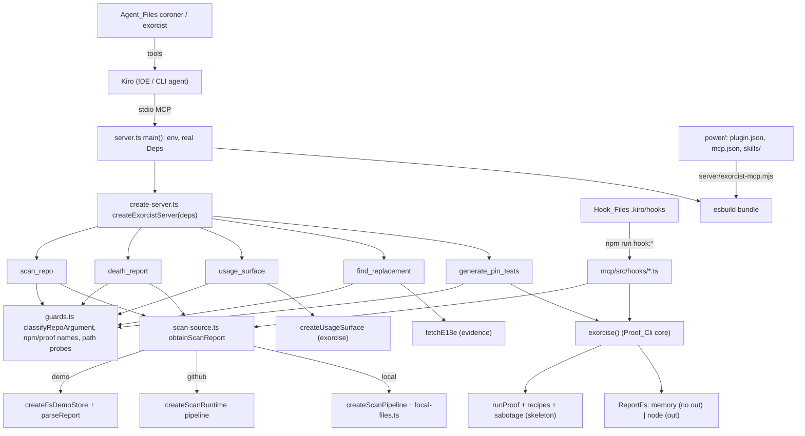

# Design

## Overview

Kiro_Integration puts Last Rites inside Kiro. A stdio MCP server exposes five tools that are thin wrappers over the scanner and the proof harness that already exist. The server is registered for this repository, packaged as a Kiro power, driven by two custom agents (`coroner` reads, `exorcist` fixes and must prove), and watched by four hooks that fire while the project is built. Nothing here changes scoring, evidence, scanning or proof logic.

The five pieces:

1. **Exorcist_Mcp** (`/mcp`): `createExorcistServer(deps)` registers the tools; `main` wires real Deps and connects stdio. A tool = guard, one call into existing code, canonical output.
2. **Workspace_Settings** (`.kiro/settings/mcp.json`): one `exorcist` server entry pointing at the built bundle.
3. **Power** (`/power`): `plugin.json`, `mcp.json`, two generated skills, README; the bundle is copied in by the build.
4. **Hooks** (`.kiro/hooks/*.json`) and **Hook_Scripts** (`mcp/src/hooks/`): four hooks, each a command that runs a small script and always exits 0.
5. **Custom_Agents** (`.kiro/agents/*.json` + prompts): `coroner` and `exorcist`.

Around them: **Config_Validators** (`mcp/src/kiro-config/`) that check the shape of every Kiro file this change adds, and thirteen correctness properties with Sabotage_Lists.

The hosted app, the server and the tests make no LLM call. Tests make no network request.

## Goals

- A tool cannot be a way around a guard: the same repo, ref, package and path rules as the Scan_Api and the Proof_Cli, decided before any dependency is called.
- A tool returns the existing canonical output (`serializeReport`, `serializeProofReport`), so every output is checked by the existing `parseReport` and `parseProofReport`.
- `generate_pin_tests` is honest by construction: it is `exorcise` itself, so a counterexample is a result, a weak proof stays weak, and nothing is written without `out`.
- The `coroner` provably has no write capability; the `exorcist` provably cannot push.
- Every Kiro file in this change is shape-checked by a test, and the spec says which fields came from the documentation and which could not be confirmed.
- The real use on parse-server is recorded as it happened.

## Non-Goals

- Changing scoring, the evidence stage, the scan pipeline, the proof harness, recipes or the web app (Requirement 19).
- HTTP/SSE transports, MCP resources and prompts, OAuth, Windows paths.
- A tool that rewrites the target's code. The `exorcist` agent edits with its own file tools under its permission rules.
- Publishing the power; a registry; npm publishing of the server.
- Proving that Kiro accepts our files. Validators check our reading of the documentation; the final group checks against the real tools.

## Research Findings

Checked while writing this spec (2026-11-13).

**Code read (this repository):**

- Scan_Api: `scan/api/handler.ts` has a private `REPO_PATTERN` (`^[A-Za-z0-9._-]{1,39}/[A-Za-z0-9._-]{1,100}$`) and builds `RepoInput`; `scan/repo-target.ts` `parseRepoTarget` validates owner, repo and ref (`ref` default `HEAD`); `scan/api/demo-store.ts` has `DEMO_NAME_PATTERN` and `createFsDemoStore(dir)` (`(name) => Promise<Uint8Array | undefined>`); `scan/demo-list.ts` has `DEMO_REPOS` (`jest`, `prettier`, `parse-server`, `pump`).
- Pipeline: `createScanPipeline({ evidence, files, clock, limits })` takes a `RepoFileSource = (target, file) => Promise<FileFetch>`; `createScanRuntime` wires the evidence stage, a cache layer and a GitHub raw file source. `createDeadline(clock, ms)` and `realWatchdog` give the handler its time limit. `assembleReport` is pure and sorts by score. `serializeReport`/`parseReport` are the canonical codec.
- Evidence: `fetchE18e(ctx, name)` returns `Outcome<{ known, replacement?, sourceUrl }>`; a missing match is evidence only when all three manifests were retrieved (otherwise a failure). `configFromEnv(env, cacheRoot)` builds `EvidenceConfig`; the cache lives in `<cacheRoot>/.cache`.
- Proof harness: `exorcise(deps, args)` in `exorcise/run.ts` (injected `usageSurface`, `ReportFs`, `recipes`, `loadOracle`, `loadCandidate`, `print`), `parseCliArgs`, `isProofOutPath`, `createUsageSurface`, `createNodeSourceFs`, `createNodeReportFs`, `RECIPES`, `loadCandidate(file)`. `skeleton/src/proof` has `serializeProofReport`, `parseProofReport` (a report with `attempts: []` is valid), `isProofName`.
- Existing reports: `demo/proofs/parse-server/intersect.json` has attempt 1 (`counterexample`, the naive `Set` candidate) and attempt 2 (`proved`, not weak), on the unmodified checkout at `3402ee6`. The CLI refuses to append when the fresh usage surface differs from the report's, so the agent's proof run must happen before the target source is edited.
- Test support available for reuse: `reportArb` (`scan/test-support/arbitraries/report.ts`), `FakeHttp`, fake clock and sleep (`evidence/test-support/`), `memoryFiles` (`scan/test-support/`), `memory-fs.ts` (`exorcise/test-support/`), the `no-network` Vitest setup, `fc-runner.ts` seed policy.
- No npm package-name guard exists in the code base (checked by search): the Scan_Api never takes a package name. The Npm_Name guard below is new, and small.
- The death-score property file `skeleton/src/death-score/properties.test.ts` holds the monotonicity property; the hook runs only that test by its title (task 3.10 reads the exact title; it is not guessed here).
- `kiro-cli` 3.3.0 is installed on this machine.

**Dependencies (npm registry, `npm view`, latest on 2026-11-13):** `@modelcontextprotocol/sdk` 1.32.2 (peer `zod ^3.25 || ^4.0`, node >= 18), `zod` 4.6.7, `esbuild` 0.28.2 (node >= 18). They are pinned exactly. Not verified until task 1.3: that the SDK's `McpServer.registerTool` accepts a zod 4 raw shape as `inputSchema` in this exact pair; the unit tests and the stdio test cover it.

**Kiro documentation (kiro.dev, fetched 2026-11-13; see "Kiro formats used"):** powers (`/docs/powers/create`, `/docs/powers/installation`), hooks (`/docs/hooks`, `/docs/hooks/types`, `/docs/hooks/actions`), custom agents (`/docs/custom-agents/configuration-reference`, `/docs/custom-agents/creating`, `/docs/tools`, `/docs/cli/headless`), MCP settings (`/docs/mcp/configuration`).

**Bundling facts that shape the design (reasoned from the code, verified by tasks 6.8 to 6.11):**

- `apps/exorcist-npm/src/scan/api/config.ts` computes `demoDir` from `import.meta.url`; in a bundle that path is wrong. The server passes its own `demoDir` (`<bundle dir>/demo`, copied by the build).
- `exorcise/oracles.ts` loads the oracles with `createRequire(import.meta.url)(pkg)`, a dynamic `require` that esbuild cannot follow, and that would fail in a power installed elsewhere (no `node_modules`). The server therefore injects its own `loadOracle` with static imports of `intersect` and `deep-diff` and their `package.json`; a test asserts it agrees with the app's `loadOracle`.
- `typescript` (a runtime dependency of the usage surface) reads `__filename` when it loads. An ESM bundle needs a banner that defines `require`, `__filename` and `__dirname`.
- `loadCandidate` does `import(pathToFileURL(abs).href)`. A long-lived server would return the cached module after the file is edited, so a re-run would silently test the old code. Hence the `cacheBust` argument (Requirement 8.8).

**Not confirmed by the documentation (flagged where used):** the `POWER.md` frontmatter (not used); whether `${VAR}` is expanded in a power's `mcp.json`; how a power's `mcp.json` `args` path is resolved (relative to the power folder is assumed); the exact `match` syntax of `permissions.rules` for `fs_write` and `shell`; whether `resources` `file://` paths are workspace-relative (assumed, from the docs example) while `prompt` `file://./` is relative to the agent file; whether `autoApprove` of `mcp.json` is honored under the V3 permission system; whether a hook command receives the saved path only through stdin JSON (assumed: yes, the field name is read from a recorded sample in task 11.12); a headless run needs `KIRO_API_KEY`.

## Kiro formats used

State of each format and the fields this spec uses. Where the brief's names disagree with Kiro's current format, Kiro's wins.

### MCP settings: `.kiro/settings/mcp.json`

Source: kiro.dev/docs/mcp/configuration. Workspace file, merged over `~/.kiro/settings/mcp.json`, workspace wins. Local (stdio) server fields: `command` (required), `args`, `env` (supports `${VAR}`), `disabled`, `autoApprove` (tool names), `disabledTools`. Used: `command`, `args`, `env`, `disabled`, `autoApprove`. Not used: `type` (not listed on that page), `disabledTools`.

```json
{
  "mcpServers": {
    "exorcist": {
      "command": "node",
      "args": ["mcp/dist/server.mjs"],
      "env": { "GITHUB_TOKEN": "${GITHUB_TOKEN}" },
      "disabled": false,
      "autoApprove": ["scan_repo", "death_report", "usage_surface", "find_replacement"]
    }
  }
}
```

The IDE expands `${VAR}` only for variables approved in its settings; the CLI does not load `.env`. An empty `GITHUB_TOKEN` is treated as unset by `configFromEnv`.

### Hooks: `.kiro/hooks/<id>.json`

Source: kiro.dev/docs/hooks, /hooks/types, /hooks/actions. JSON v1; the legacy `*.kiro.hook` format is not used. Fields: `version` (`"v1"`), `hooks[]` of `{ name, description?, trigger, matcher?, action, timeout?, enabled?, confirm? }`; `action` is `{ type: "command", command }` or `{ type: "agent", prompt }`. Triggers (PascalCase): `SessionStart`, `SessionEnd`, `UserPromptSubmit`, `Stop`, `PreToolUse`, `PostToolUse`, `PostFileCreate`, `PostFileSave`, `PostFileDelete`, `PreTaskExec`, `PostTaskExec`, `PreCompact`, `PostCompact`. For file triggers `matcher` is a regular expression tested against the file path; `Stop` takes no matcher. A command receives JSON on stdin (`hook_event_name`, `cwd`, `session_id`, and for file events the path). Exit codes: for `Stop`, exit 1 starts another turn and exit 2 does not block; other triggers: 2 blocks `PreToolUse`/`PreTaskExec`. `timeout` is seconds (default 60).

Used: `version`, `hooks[].name`, `description`, `trigger` (`PostFileSave`, `Stop`), `matcher`, `action.type` `command`, `action.command`, `timeout`. Not used: `enabled`, `confirm`, agent actions.

Decision: every Hook_Script exits 0. For `Stop` an exit 1 would start another agent turn on every failing check, which could loop; the script prints `check: FAIL` and the tail instead (Decision 4).

The `{{filePath}}` template variable appears in one docs page and was blank in the copy fetched; the hooks read the path from stdin JSON instead. Task 11.12 records one real stdin payload from a save in the IDE (the entry files keep the first 2000 characters of stdin in `.cache/hooks/last-input-<id>.json`) or marks it NOT SEEN; until then the script accepts `file_path`, `filePath`, `path` and `tool_input.path` and uses the first string found.

### Custom agents: `.kiro/agents/<name>.json` (Kiro CLI 3.x / IDE 1.0)

Source: kiro.dev/docs/custom-agents/configuration-reference, /creating, /tools, /cli/headless. Current fields: `name`, `description`, `prompt` (text or `file://./path.md` relative to the agent file), `model`, `mcpServers`, `tools`, `excludedTools`, `permissions` (`{ rules: [{ capability, match?, effect, exclude? }] }`, `effect` is `allow`, `ask` or `deny`; capabilities include `fs_read`, `fs_write`, `shell`, `web_fetch`, `mcp`, `subagent`), `resources` (`file://`, `skill://`, knowledge base), `hooks`, `includeMcpJson`, `includePowers`, `welcomeMessage`. Not used because they are CLI 2.x legacy: `allowedTools`, `toolsSettings`, `toolAliases`, `keyboardShortcut`. Tool selectors in `tools`: category tags `read`, `write`, `shell`, `web`, `@builtin`, `@mcp`, `*`, and MCP names `@server` or `@server/tool`. V3 built-in read tools: `read_file`, `list_directory`, `file_search`, `grep_search` (all in tag `read`).

Used: `name`, `description`, `prompt`, `tools`, `mcpServers`, `includeMcpJson`, `permissions.rules`, `resources`. Unconfirmed: the `match` syntax for `fs_write` (assumed glob patterns of paths) and `shell` (assumed command prefix patterns ending in `*`); `@server/tool` entries in `tools` (documented, not yet seen working). Tasks 11.3 and 11.8 check both against the real CLI and record the result.

Headless: `kiro-cli chat --v3 --agent <name> --no-interactive --require-mcp-startup [--trust-tools=<ids>] "<prompt>"`; needs a non-empty prompt and `KIRO_API_KEY`; exit code 3 when an MCP server fails to start, 4 for a missing agent.

### Power: Agent Plugins format

Source: kiro.dev/docs/powers/create, /powers/installation. Only `plugin.json` is required. Fields: `$schema` (`https://agent-plugins.org/schemas/1.0.0/plugin.schema.json`), `name` (kebab-case), `version` (semver), `description`, `author` (`{ name, email?, url? }`), `keywords` (string array, trigger activation), optional `homepage`, `repository`, `license`. `mcp.json` at the power root (`$schema` `https://agent-plugins.org/schemas/1.0.0/mcp.schema.json`, `mcpServers` with `type`, `command`, `args`, `env`). `skills/<name>/SKILL.md` with frontmatter `name` and `description`. There is no `steering/` folder in this format; Kiro namespaces server names on install. Local install: IDE Powers panel, "Add Custom Power", import from a folder; CLI `kiro-cli powers install <path>`.

**Divergence from the brief:** the brief says "steering for migrations (`migration-rules.md`, `proof-rules.md`)". In this format that content is two skills. They are generated from `.kiro/steering/*.md` by `power:sync` and a test fails on drift. The legacy `POWER.md` is not used (its frontmatter schema is not documented). This also matches `structure.md` (`/power  plugin.json + skills/ + mcp.json`).

## Architecture



### Tool call flow

1. The SDK validates the arguments against the `zod` schema (type-level: strings, optional fields, integer `runs`). A rejection becomes `invalid_input` before any handler code runs (the handler wrapper also catches the SDK's own validation message).
2. The handler runs the guards of `guards.ts` (pure, plus injected existence probes for paths). The first failing guard returns a Tool_Error; no Dep has been called.
3. The handler calls exactly one existing function (listed per tool below), passing the validated values.
4. The result is turned into text by the codec that already exists, and returned. Any exception ends in `internal_error: unexpected error`.

## Components and Interfaces

### Layout

```
package.json                         + workspaces "mcp", "power"
vitest.config.ts                     + include "mcp/src/**/*.test.ts"
.gitignore                           + power/server/
apps/exorcist-npm/
  package.json                       + exports ./programmatic, ./programmatic/testing
  src/programmatic.ts                re-exports only
  src/programmatic-testing.ts        re-exports test support only
  src/scan/api/handler.ts            REPO_PATTERN exported (no other change)
  src/exorcise/candidate.ts          + optional cacheBust argument
mcp/
  package.json, tsconfig.json
  src/
    server.ts                        main(): the only reader of env; wires real Deps; connects stdio
    candidate-loader.ts              loadCandidateBusted(file): hash the source, call the app's loadCandidate(file, hash16)
    create-server.ts                 createExorcistServer(deps) -> McpServer
    deps.ts                          ExorcistDeps, FsProbe
    wire.ts                          wireRealDeps(env, bundleDir)
    guards.ts                        classifyRepoArgument, isNpmName, checkPath, checkCandidate, checkRuns, checkOut
    errors.ts                        ErrorCode, toolError(code, message), fixed messages
    result.ts                        textResult(...texts), errorResult(code, message), safely(handler)
    scan-source.ts                   obtainScanReport(deps, input) -> ScanReport | ToolErrorValue
    local-files.ts                   createLocalRepoFiles(probe) -> RepoFileSource
    oracles-static.ts                loadOracle with static imports (bundle friendly)
    tools/scan-repo.ts, death-report.ts, usage-surface.ts, find-replacement.ts, generate-pin-tests.ts, index.ts
    build/build.ts                   buildServer(outDir): esbuild bundle + banner + demo copy; BUNDLE_REL, POWER_SERVER_REL
    hooks/
      new-dead.ts                    deadNames, newDeadPackages
      candidate-target.ts            candidateTarget
      stop-summary.ts                formatStopSummary
      fired-line.ts                  formatFiredLine
      run-scan-deps.ts, run-monotonic.ts, run-stop-check.ts, run-candidate-proof.ts   injected-deps runners
      scan-deps.ts, monotonic.ts, stop-check.ts, candidate-proof.ts                   entry files (argv/env/stdin)
    kiro-config/
      hook.ts, agent.ts, mcp-settings.ts, plugin.ts, power-mcp.ts, skill.ts, privilege.ts, index.ts
    power/skill-from-steering.ts, sync.ts
    test-support/                    fakes.ts, arbitraries/, sabotage/kiro-p1.ts .. kiro-p13.ts
    __fixtures__/                    demo snapshot, local checkout trees, candidate files, Kiro file samples
    *.test.ts, *.pN.test.ts, sabotage.test.ts
power/
  package.json, plugin.json, mcp.json, README.md
  skills/migration-rules/SKILL.md, skills/proof-rules/SKILL.md      (generated)
  server/                            (build output, ignored by git)
.kiro/
  settings/mcp.json
  hooks/scan-deps-on-save.json, death-score-monotonic-on-save.json, check-on-stop.json, candidate-proof-on-save.json
  agents/coroner.json, exorcist.json, prompts/coroner.md, prompts/exorcist.md
```

### The programmatic entry (`apps/exorcist-npm/src/programmatic.ts`)

Re-exports only (no wrapper functions), so an app change shows up in one place and the server never uses a deep import:

`createScanRuntime`, `createScanPipeline`, `createRepoFileSource` types `RepoFileSource`/`FileFetch`, `parseRepoTarget`, `REPO_PATTERN`, `DEMO_NAME_PATTERN`, `createFsDemoStore`, `DEMO_REPOS`, `serializeReport`, `parseReport`, `assembleReport`, `createDeadline`, `realWatchdog`, `DEFAULT_SCAN_API_CONFIG`, `createFetchClient`, `configFromEnv`, `fetchE18e`, `CacheLayer`, `ResilientClient`, `exorcise`, `parseCliArgs`-adjacent `isProofOutPath`, `createUsageSurface`, `createNodeSourceFs`, `createNodeReportFs`, `RECIPES`, `loadCandidate`, and the types they need.

`programmatic-testing.ts` re-exports `reportArb`, `FakeHttp`, the fake clock and sleep, `memoryFiles` and the in-memory `SourceFs`. A smoke test pins both export lists.

### Guards (`guards.ts`)

```ts
export type RepoArgument =
  | { kind: "local"; path: string }
  | { kind: "github"; owner: string; repo: string }
  | { kind: "demo"; name: string }
  | { kind: "invalid"; code: "invalid_repo"; message: string };

export function classifyRepoArgument(input: string): RepoArgument;      // pure, total
export const NPM_NAME_PATTERN = /^(?:@[a-z0-9][a-z0-9._~-]*\/)?[a-z0-9][a-z0-9._~-]*$/;
export const isNpmName = (s: string): boolean => s.length <= 214 && NPM_NAME_PATTERN.test(s);
export interface FsProbe {
  stat(path: string): Promise<{ kind: "file" | "dir" | "other" } | undefined>;   // undefined: absent/unreadable
  readText(path: string): Promise<string | undefined>;
}
export async function checkPath(probe, cwd, raw): Promise<{ ok: true; abs: string } | ToolErrorValue>;
export async function checkCandidate(probe, cwd, raw): Promise<...>;            // regular file, .js/.mjs/.cjs
export function checkRuns(raw: unknown): { ok: true; runs: number } | ToolErrorValue;   // default 200, 100..100000
export function checkOut(raw: unknown): { ok: true; out: string } | ToolErrorValue;     // isProofOutPath
```

`classifyRepoArgument` order (Requirement 3.1): local prefix, then `REPO_PATTERN` (+ `parseRepoTarget` on owner and name), then `DEMO_REPOS` names, else `invalid_repo` with a message that lists the demo names. A `local` argument is never a `github` one (`owner/name` cannot start with `/` or `.`: the owner pattern excludes `.` as a first character only through `parseRepoTarget`; the order of checks makes the classes exclusive regardless, and Property 1 pins it). `checkPath` resolves with `node:path.resolve(cwd, raw)` and uses only the injected probe, so tests need no disk.

The Npm_Name pattern follows npm's own rules for new package names (lower case, URL-safe characters, one optional scope), not the looser rules of old packages; an old package with upper case letters is rejected with `invalid_package`. That is a known limit and appears in the Risks.

### Result and errors (`errors.ts`, `result.ts`)

```ts
export type ErrorCode =
  | "invalid_input" | "invalid_repo" | "invalid_ref" | "invalid_package" | "invalid_path"
  | "path_not_found" | "not_a_directory" | "invalid_candidate" | "invalid_runs" | "invalid_out"
  | "demo_not_found" | "demo_invalid" | "scan_failed" | "package_not_found" | "package_skipped"
  | "evidence_unavailable" | "usage_error" | "proof_failed" | "internal_error";
export interface ToolErrorValue { ok: false; code: ErrorCode; message: string }

export const textResult = (...texts: string[]): CallToolResult;           // content: text items
export const errorResult = (code: ErrorCode, message: string): CallToolResult;
//   { isError: true, content: [{ type: "text", text: JSON.stringify({ error: { code, message } }) }] }
export function safely(handler: () => Promise<CallToolResult>): Promise<CallToolResult>;
//   catches everything -> errorResult("internal_error", "unexpected error")
```

Every handler is `(args) => safely(() => impl(deps, args))`. `message` is built only from fixed text and validated values; an exception's message is never forwarded (it could carry a path or a token).

### Deps (`deps.ts`, `wire.ts`)

```ts
export interface ExorcistDeps {
  cwd: string;
  probe: FsProbe;
  demoStore: DemoStore;
  scan: {
    github: ScanPipeline;                          // createScanRuntime(...).pipeline
    local(dir: string): ScanPipeline;              // createScanPipeline({ evidence, files: createLocalRepoFiles(probe, dir), clock, limits })
    clock: Clock;
    timeoutSeconds: number;
    watchdog: Watchdog;
  };
  e18e(name: string): Promise<Outcome<E18eEvidence>>;
  usageSurface: UsageSurface;
  proof: {
    recipes: ReadonlyMap<string, AppRecipe>;
    loadOracle(pkg: string): { module: unknown; version: string } | undefined;
    loadCandidate(file: string): Promise<LoadedCandidate>;   // wire: hash source, call app loadCandidate(file, hash16)
    nodeReportFs: ReportFs;
    repoRoot: string;                                          // only used by exorcise for the default --out, never reached (out is explicit or memory)
  };
}
```

`wireRealDeps(env, bundleDir)` (in `wire.ts`, called only from `server.ts main`) builds: `cacheRoot` from `EXORCIST_CACHE_DIR` or `<tmpdir>/exorcist-mcp`; `evidenceConfig = configFromEnv(env, cacheRoot)`; one `createFetchClient()`; `demoStore = createFsDemoStore(<bundleDir>/demo)`; the GitHub pipeline from `createScanRuntime` with `DEFAULT_SCAN_API_CONFIG.maxDependencies`; the local pipeline factory from `createScanPipeline` with a second evidence stage on the same cache root; `e18e` over a `CacheLayer`/`ResilientClient` built as the evidence stage builds its own (same config, same disk cache); the real usage surface, `RECIPES`, the static oracle loader, the candidate loader and `createNodeReportFs()`.

The local pipeline target is `{ owner: "local", repo: <base name of the directory when it matches the repo-name pattern, else "checkout"> }` so `parseRepoTarget` accepts it; the report's `repo` field is therefore `local/<name>` and contains no absolute path.

### `local-files.ts`

`createLocalRepoFiles(probe, dir): RepoFileSource` returns, for `package.json` and `package-lock.json`, `{ kind: "ok", text }` when `probe.readText(join(dir, file))` returns text, else `{ kind: "not_found" }`. It ignores the `target` argument. Five lines of adapter; it implements an existing type, has an example test and is used by Property 3.

### `scan-source.ts`

```ts
export type ScanInput = { repo: string; ref?: string };
export async function obtainScanReport(deps, input): Promise<{ ok: true; report: ScanReport } | ToolErrorValue>;
```

Flow: classify; `demo`, or `github` equal to a `DEMO_REPOS` `owner/repo` with no `ref` → `demoStore(name)` → `parseReport` (reject → `demo_invalid`, absent → `demo_not_found`); `github` → `parseRepoTarget` for the ref, then `deps.scan.github(input, { signal })` raced against the watchdog exactly as `handler.ts` does; `local` → `checkPath` then `deps.scan.local(abs)({ owner: "local", repo }, { signal })`; a `ref` with `local` or `demo` → `invalid_ref`. A pipeline error becomes `scan_failed` with message `<code>: <pipeline message>`; a timeout becomes `scan_failed` with `scan_timeout`.

`scan_repo` returns `serializeReport(report)`. For a demo it returns the snapshot text (already canonical, because `parseReport` accepts only canonical text).

### Tools

| Tool | Input (zod) | Calls | Output |
|---|---|---|---|
| `scan_repo` | `repo: string`, `ref?: string` | `obtainScanReport` | `serializeReport(report)` |
| `death_report` | `repo`, `package`, `ref?` | `obtainScanReport`, then `assembleReport` over the one dependency | `serializeReport(oneDependencyReport)` |
| `usage_surface` | `path`, `package` | `deps.usageSurface({ root, package })` | `serializeProofReport({ repo, package, filesScanned, callSites, importSites, attempts: [] })`, plus `{"warnings":[...]}` when any |
| `find_replacement` | `package` | `deps.e18e(name)` | `{"package","replacement","sourceUrl"}` JSON |
| `generate_pin_tests` | `path`, `package`, `candidate?`, `runs?`, `out?` | `exorcise(...)` | Proof_Report text, then the summary text |

`death_report` selects `report.dependencies.find(d => d.name === package)`; `assembleReport({ target, scannedAt, scanned: [dep], skipped: [], warnings })` uses `target = { owner, repo, ref }` split from the report's own `repo`/`ref`, so `summary.total` is 1 and the grade count is derived by the existing code. Source URLs are the dependency's `signals.sourceUrls` and `death.parts[].sourceUrl`, unchanged.

`usage_surface` builds its `ProofReport` with `repo` = base name of the resolved path. The warning item is capped at 50 with a trailing `... and <n> more` string.

`generate_pin_tests` builds `CliArgs` as `parseCliArgs` would (`repo` = resolved path, `package`, `candidate`, `runs`, `seed` 20261113, `label` = base name, `fresh` false, `out`), then calls `exorcise(deps, args)` with `print` collecting lines. With no `out`: `fs` is a throw-away in-memory `ReportFs` whose `readText` returns `undefined` and whose `writeAtomic` stores the text; the default-path branch of `exorcise` is not reached because the tool passes a synthetic in-memory path `memory/proofs/dry-run/<package>.json` as `out` (it satisfies `isProofOutPath`, and the memory `ReportFs` is the only thing that ever sees it). With `out`: `nodeReportFs`. The report text returned is what `writeAtomic` received. Exit 2 → `usage_error`, exit 1 → `proof_failed`, both with `exorcise`'s message (which holds only the paths the caller gave).

The tool never calls `runProof` itself and never edits a recipe, a Projection or a mutator.

### Server (`create-server.ts`, `server.ts`)

```ts
export function createExorcistServer(deps: ExorcistDeps): McpServer;
// server = new McpServer({ name: "exorcist", version }); registerTool(name, { title, description, inputSchema, annotations }, handler) x5
export async function main(): Promise<void>;   // server.ts: env -> wireRealDeps -> createExorcistServer -> StdioServerTransport
```

`main` first replaces `console.log`, `console.info` and `console.debug` with `console.error` (so a candidate that logs cannot corrupt the protocol stream), builds the Deps, connects the stdio transport and returns. It reads `process.env`, `process.cwd()` and `import.meta.url` (for `bundleDir`); nothing else does. The entry guard follows `serve-entry.ts`: it is a separate tiny file when run through `vite-node`, and the bundle entry is `server.ts` compiled as the entry point.

Tool descriptions say what the tool returns and its cost: `scan_repo` "makes network requests unless the name is a demo", `generate_pin_tests` "executes the candidate file and runs the repository's recipe; writes only to `out`".

### Build (`build/build.ts`)

```ts
export const BUNDLE_REL = "mcp/dist/server.mjs";
export const POWER_SERVER_REL = "server/exorcist-mcp.mjs";          // inside /power
export async function buildServer(opts: { outFile: string; demoOut: string; root: string }): Promise<void>;
```

`esbuild.build({ entryPoints: [mcp/src/server.ts], bundle: true, platform: "node", format: "esm", target: "node22", outfile, banner: { js: SHIM }, legalComments: "none" })` where `SHIM` defines `require` (`createRequire(import.meta.url)`), `__filename` and `__dirname`. Workspace packages (TypeScript sources behind `exports`) are bundled because esbuild resolves them through `node_modules/@last-rites/*` symlinks; `intersect` and `deep-diff` are bundled through `oracles-static.ts`. `copyDemos` copies `demo/*.json` (top-level files only, not `proofs/`) to `<outFile dir>/demo/`. The `build` script runs `buildServer` for `mcp/dist/server.mjs` and copies the file and `demo/` to `power/server/` (`exorcist-mcp.mjs`, `demo/`). The tests call `buildServer` into a temporary directory.

### Hook files

All with `"version": "v1"`, one hook each, command run from the workspace root, `timeout` set.

| File | `trigger` | `matcher` | `action.command` | `timeout` |
|---|---|---|---|---|
| `scan-deps-on-save.json` | `PostFileSave` | `^(?!.*node_modules/).*(^\|/)package(-lock)?\.json$` | `npm run hook:scan-deps -w @last-rites/exorcist-mcp --silent` | 120 |
| `death-score-monotonic-on-save.json` | `PostFileSave` | `skeleton/src/death-score/(weights\|severity\|grade)\.ts$` | `npm run hook:monotonic -w @last-rites/exorcist-mcp --silent` | 120 |
| `check-on-stop.json` | `Stop` | (none) | `npm run hook:stop-check -w @last-rites/exorcist-mcp --silent` | 300 |
| `candidate-proof-on-save.json` | `PostFileSave` | `demo/proofs/candidates/[^/]+/[^/]+\.js$` | `npm run hook:candidate-proof -w @last-rites/exorcist-mcp --silent` | 180 |

Descriptions (short): "Scan this repository's dependencies when a manifest or lockfile is saved and warn about new dead packages."; "Re-run the death-score monotonicity property when weights, severity or grade change."; "After an agent turn, run typecheck and the tests of changed files."; "Re-run the proof for a candidate file when it is saved and show the status." The matchers are tested against the lists in Requirement 12.7 (paths that must match and paths that must not, such as `skeleton/src/death-score/weights.test.ts`, `node_modules/x/package.json`, `demo/proofs/candidates/parse-server/README.md`, `demo/proofs/candidates/x.js`).

### Hook scripts

Each runner is `run(deps, input) -> { lines: string[]; outcome: "ok" | "warn" | "fail" | "skipped" }` with injected clock, `FsProbe`/file writer, process runner (`(cmd, args) => Promise<{ code, output }>`) and scan function; the entry file reads argv, env and stdin, calls the runner, prints `lines`, appends `formatFiredLine(...)` to `.cache/hooks/fired.log` (best effort, failure ignored) and sets exit code 0.

- `hook:scan-deps`: `obtainScanReport` for `{ repo: "<repository root>" }` as a Local_Path (so it needs the network for evidence; offline it prints `scan failed: scan_failed` and keeps the baseline); `deadNames`/`newDeadPackages` against `.cache/hooks/dead-baseline.json` (a JSON array of strings, absent/invalid → `[]`); prints the warning lines; writes the new baseline (sorted names).
- `hook:monotonic`: runs `npx vitest --run skeleton/src/death-score/properties.test.ts -t "<title>"` where `<title>` is the exact title read in task 3.10; prints the last 15 lines of output and `monotonic: PASS` or `monotonic: FAIL`.
- `hook:stop-check`: runs `npm run typecheck` then `npx vitest --run --changed`; `formatStopSummary`; prints it.
- `hook:candidate-proof`: parses the hook JSON from stdin, extracts the saved path, `candidateTarget(path)`; checkout dir `<repository root>/../<SIBLING_DIR>/<repo>` where `SIBLING_DIR` is a constant of the entry file; if absent prints `skipped: no checkout at <path>`; else runs the same implementation as `generate_pin_tests` (via the tool's `impl` function, no `out`) with `runs` 200 and the candidate path, and prints `<package>: attempt 1, <status>[ (weak)], <runs> runs, seed <seed>` plus the shrunk input for a counterexample.

Pure helpers:

```ts
export const deadNames = (r: ScanReport): string[];                         // grade "dead", sorted by code unit
export const newDeadPackages = (baseline: readonly string[], r: ScanReport): string[];
export function candidateTarget(path: string): { repo: string; package: string } | undefined;
export function formatStopSummary(tc: StepResult, tests: StepResult): string;
export function formatFiredLine(now: Date, hookId: string, outcome: Outcome): string;
```

`candidateTarget` splits on `/`, finds the last occurrence of the segments `demo`, `proofs`, `candidates` in order, requires exactly `<repo>/<file>` after them, `file` ending in `.js` with `package = file.split(".")[0]`, both Proof_Names; it rejects empty segments, `.`/`..` and backslashes.

### Agents

`.kiro/agents/coroner.json`:

```json
{
  "name": "coroner",
  "description": "Read-only: gathers death evidence and call sites for a dead package. Never edits.",
  "prompt": "file://./prompts/coroner.md",
  "tools": ["read", "@exorcist/scan_repo", "@exorcist/death_report", "@exorcist/usage_surface", "@exorcist/find_replacement"],
  "includeMcpJson": false,
  "mcpServers": { "exorcist": { "command": "node", "args": ["mcp/dist/server.mjs"], "env": { "GITHUB_TOKEN": "${GITHUB_TOKEN}" } } },
  "permissions": { "rules": [
    { "capability": "fs_read", "effect": "allow" },
    { "capability": "mcp", "match": ["exorcist/scan_repo", "exorcist/death_report", "exorcist/usage_surface", "exorcist/find_replacement"], "effect": "allow" },
    { "capability": "mcp", "match": ["exorcist/generate_pin_tests"], "effect": "deny" },
    { "capability": "fs_write", "effect": "deny" },
    { "capability": "shell", "effect": "deny" },
    { "capability": "web_fetch", "effect": "deny" }
  ] }
}
```

`.kiro/agents/exorcist.json` has `tools` `["read", "write", "shell", "@exorcist"]`, the same inline server entry, `resources` `["file://.kiro/steering/migration-rules.md", "file://.kiro/steering/proof-rules.md"]` (workspace-relative, as in the documentation's example; the validator checks both resolve to existing files from the repository root), and rules: allow `fs_read`; allow `fs_write` with `match` `["demo/proofs/candidates/**", "../lastrites-work/**"]`; allow `shell` with `match` `["npm *", "npx *", "node *", "git *", "ls *"]`; deny `shell` with `match` `["git push*", "git remote*", "git config*"]`; allow `mcp` `["exorcist/*"]`. If Kiro evaluates deny rules before allow rules the `git *` allow cannot enable a push; if it evaluates in order, the deny rules must come first, so they are written first in the file and the validator checks that every `deny` rule precedes every `allow` rule of the same capability.

Prompts (short, plain text, no secrets): `coroner.md` and `exorcist.md` carry the behavior listed in Requirement 14.3 and 14.6. The `exorcist` prompt states the order: scan_repo/death_report (optional), usage_surface, write the candidate, `generate_pin_tests` with `out` BEFORE editing the target, apply only when the status is `proved`, never push, report the status and `weak` exactly, a counterexample means not done.

### Power

`power/plugin.json`:

```json
{
  "$schema": "https://agent-plugins.org/schemas/1.0.0/plugin.schema.json",
  "name": "exorcist",
  "version": "0.1.0",
  "description": "Find dead npm packages, replace them, and prove with property tests that behavior did not change.",
  "author": { "name": "Last Rites" },
  "keywords": ["dead dependencies", "deprecated packages", "npm migration", "property tests", "replace dependency"],
  "license": "MIT"
}
```

`power/mcp.json`: `$schema` `https://agent-plugins.org/schemas/1.0.0/mcp.schema.json`, `mcpServers.exorcist = { "type": "stdio", "command": "node", "args": ["server/exorcist-mcp.mjs"], "env": { "GITHUB_TOKEN": "${GITHUB_TOKEN}" } }`. Skills: `migration-rules` and `proof-rules`, each `skillFromSteering(steering, { name, description })`:

```ts
export function skillFromSteering(steering: string, meta: { name: string; description: string }): string;
// "---\nname: <name>\ndescription: <description>\n---\n\n" + body of steering without its leading "---...---" block
```

Descriptions: migration-rules "Rules for replacing a dead npm dependency without changing behavior. Use when migrating off a package."; proof-rules "Rules for proof and pin tests: no vacuous passes, sabotage checks, real call sites. Use when writing or judging proof that a migration kept behavior." `power:sync` writes both files; license value follows the repository `LICENSE`, which task 9.5 reads (the value above is replaced if the file says otherwise).

README sections: What it does; Build; Install (IDE and CLI); Tools; Environment; Safety (what `generate_pin_tests` executes); Limits.

### Config validators (`kiro-config/`)

`validateHookFile(text)`, `validateAgentFile(text, ctx)`, `validateMcpSettings(text)`, `validatePluginManifest(text)`, `validatePowerMcp(text)`, `validateSkill(text, folderName)`, each `{ ok: true } | { ok: false; error: { path: string; message: string } }`, never throwing, built on one small helper set (`parseJson`, `objectWith({ required, optional })` rejecting unknown keys, `stringField`, `arrayOf`). Field lists are exactly those in "Kiro formats used". Extra rules: hook `matcher` compiles with `new RegExp`; `trigger` in the documented list; agent `prompt` `file://` target exists (via `ctx.exists`); every `mcpServers` entry has `command`; `permissions.rules[*].capability` in the documented list and `effect` in `allow|ask|deny`; skill frontmatter has exactly `name` and `description`; plugin `name` is kebab-case and `version` semver.

`privilege.ts`: `writeCapabilities(agent): string[]` returns the reasons an agent can write or run things: `tools` containing `write`, `shell`, `*`, `@builtin`, `@mcp`, `subagent`, `web`, or `@exorcist` without a tool name, or an MCP tool `@exorcist/generate_pin_tests`; any `allow` or `ask` rule for `fs_write`, `shell`, `web_fetch`, `subagent`; an `mcp` allow rule whose `match` includes `generate_pin_tests` or a `*`. `[]` means read only. Also `pushCapabilities(agent)`: true unless a `deny` rule for `git push*` precedes every `allow` rule that could match `git push` (a `shell` allow whose pattern matches the string `git push origin x`, using a simple glob matcher defined in the module).

## Data Models

### Error codes

| Code | When |
|---|---|
| `invalid_input` | arguments rejected by the input schema |
| `invalid_repo` | Repo_Argument is none of local, `owner/name`, demo name |
| `invalid_ref` | bad ref, or a ref with a local path or demo |
| `invalid_package` | Npm_Name (or Proof_Name for `generate_pin_tests`) violated |
| `invalid_path`, `path_not_found`, `not_a_directory` | path guard |
| `invalid_candidate` | candidate missing, not a regular file, or wrong extension |
| `invalid_runs`, `invalid_out` | `runs` not 100..100000, `out` not a proof report path |
| `demo_not_found`, `demo_invalid` | snapshot missing, snapshot rejected by `parseReport` |
| `scan_failed` | pipeline error (message starts with the pipeline code) |
| `package_not_found`, `package_skipped` | `death_report` |
| `evidence_unavailable` | `find_replacement`, source failed |
| `usage_error`, `proof_failed` | `exorcise` exit 2 / exit 1 |
| `internal_error` | anything unexpected; message `unexpected error` |

### Tool output contracts

| Tool | First text item | Validator |
|---|---|---|
| `scan_repo` | Scan_Report | `parseReport` |
| `death_report` | Scan_Report with one dependency (`summary.total` 1) | `parseReport` |
| `usage_surface` | Proof_Report, `attempts: []` | `parseProofReport` |
| `find_replacement` | `{ package, replacement: ReplacementInfo \| "none", sourceUrl }` | a structural checker in test support (no existing validator exists for this shape) |
| `generate_pin_tests` | Proof_Report, last attempt is this run | `parseProofReport` |

### Files the hooks keep (under `.cache/hooks/`, ignored by git)

`dead-baseline.json`: a JSON array of strings, sorted. `fired.log`: lines `<ISO time> <hook id> <ok|warn|fail|skipped>`; hook ids are `scan-deps`, `monotonic`, `stop-check`, `candidate-proof`.

## Decisions and Requirement Clarifications

1. **Kiro's format wins over the brief.** The power is Agent Plugins (`plugin.json` + `mcp.json` + `skills/`), the steering files become skills, agents use `tools` + `permissions.rules`, hooks are JSON v1. Each divergence is listed in "Kiro formats used" and in the Introduction.
2. **Tools are wrappers; adapters are named.** The only code that is not a direct call is: the zod schemas, the guards, `createLocalRepoFiles` (5 lines, implements `RepoFileSource`), the one-dependency re-assembly (`assembleReport`), the throw-away in-memory `ReportFs`, the static oracle loader, and the error mapping. Each has a test.
3. **`death_report` and `usage_surface` reuse the existing report codecs** (`parseReport`, `parseProofReport`) as their output formats instead of inventing JSON shapes, so "output parses with the existing validators" is literally true for four of five tools. `find_replacement` has no existing shape; it gets a tiny one, validated in test support.
4. **Hook scripts exit 0.** `Stop` with exit 1 starts another turn; a failing typecheck would re-prompt forever. The script reports `check: FAIL`; the agent sees it in the hook output. Cost: a failing check does not by itself force a fix.
5. **`generate_pin_tests` has no `seed` input.** The Proof_Cli default (20261113) makes a re-run reproducible and a report comparable; a free seed would let an agent re-roll until green. `runs` can be raised, not lowered below 100.
6. **Counterexample is a successful call.** The tool's job is to report the harness's verdict; the agent prompt turns `counterexample` into "not done". Exit-code-like failure semantics would hide the shrunk input behind an error.
7. **Dry run by default.** No `out`, no file. The agent iterates on a candidate without growing the history; the final run (and the hook's) is explicit. The brief's real-use group passes `out`, so the attempt history is kept for the demo.
8. **`out` must be a proof report path (`isProofOutPath`).** That is the Proof_Cli's own guard; it keeps the tool from writing a JSON file anywhere else.
9. **Candidate cache busting by content hash.** Without it the second `generate_pin_tests` call after an edit would test the old module. Imports of the candidate's own relative modules stay cached (a limit, in the Risks and README).
10. **Static oracle loader in `/mcp`.** The bundle has no `node_modules` next to it. `oracles-static.ts` imports `intersect` and `deep-diff` statically; a test asserts its modules behave like `loadOracle`'s and versions match, so the recipes' `expectedVersion` check still applies.
11. **Demo snapshots ship next to the bundle.** `scan_repo` for a demo name must work from a power install; the build copies the four `demo/*.json` beside the bundle. They are as stale as the committed snapshots; the scan result contains `scannedAt`, which tells the caller.
12. **Local scans use `owner: "local"`.** The pipeline validates its target with `parseRepoTarget`. The report says `local/<name>`, never an absolute path.
13. **`autoApprove` covers the four read tools only.** `generate_pin_tests` executes a file; the user (or the agent's permission rule, or `--trust-tools` in headless mode) approves it each time.
14. **The `coroner` is read-only twice.** Its `tools` list names no write tool, and its permission rules deny writes and shell. The privilege checker (Property 9) reads both, because the two mechanisms are not guaranteed to be enforced the same way in every Kiro version.
15. **Hooks are created early.** Hook scripts and the two hooks that need no server (`death-score-monotonic`, `check-on-stop`) are written in Phase 7, before the long phases, so they fire while the rest is built. The scan and candidate hooks follow when the tools exist.
16. **Hook logging is the evidence.** The Fired_Log is how Requirement 17.8 knows what fired; a hook that did not write a line did not run (or its script failed before logging, which the log entry cannot hide: `formatFiredLine` is the first thing the entry file does after the runner returns, and an uncaught runner error is logged as `fail`).
17. **Seed policy for tests** follows `fc-runner.ts`; Sabotage runs use 20261113.
18. **Version numbers** are exact and from `npm view` on 2026-11-13. A newer SDK is a deliberate upgrade, not a drift.

## Risks

- **The candidate runs in the server process.** `generate_pin_tests` imports a JavaScript file and calls it thousands of times. A hostile or looping candidate can hang or harm the process; there is no timeout (same as the Proof_Cli). Mitigation: not auto-approved, the description says so, the README says so. Residual risk is the user's own code.
- **Bundling `typescript`.** About 9 MB, needs the banner shim. If the bundle fails at start or at the first `usage_surface` call, the fallback is to mark `typescript` external and install it next to the bundle; task 6.11 decides after running it, and the README records the outcome.
- **A tool schema mismatch between SDK and zod 4** would show at registration. The stdio test lists tools and calls one with a bad argument.
- **Unconfirmed Kiro details** (list in Research Findings). The validators encode our reading; if Kiro rejects a field, the final group records it and the validator and file are corrected in a follow-up, not hidden.
- **Hooks depend on the Kiro build in use.** `PostFileSave` fires on editor saves; edits written by an agent tool may not trigger it. The log says which fired.
- **Npm_Name guard rejects legacy names** with upper case or other old characters. Such packages cannot be inspected with these tools. Acceptable for v1; the Scan_Api scans them and `scan_repo` shows them.
- **Local scan reads any readable directory** the user's server can read (`path` is not confined to the workspace). It is read only and returns only `package.json`-derived data and call sites.
- **`scan_repo` output can be large** (up to 300 dependencies with evidence). Not capped, because the brief asks for the canonical JSON; `death_report` is the small alternative.
- **Network in the hooks.** `hook:scan-deps` needs the network for evidence; offline it only prints `scan failed`. It cannot make a test or an agent turn fail.
- **Cache files** are written under the OS temp directory by default; they hold public registry responses only.

## Correctness Properties

All properties use `numRuns: 100`, the seed policy of `fc-runner.ts`, print the seed and shrunk counterexample on failure, and are written as `build(impl)` so the central sabotage test (`mcp/src/sabotage.test.ts`) can swap the implementation. Each has a Sabotage_List in `mcp/src/test-support/sabotage/kiro-pN.ts`. Shared fakes (`test-support/fakes.ts`): an in-memory `FsProbe` over a generated map, a recording `ReportFs`, a fake `DemoStore`, counting wrappers around every Dep (a call counter and an argument log), `FakeHttp`/fake clock/fake sleep from the app's test support, `reportArb`.

### Property 1: Argument guards and routing

*For any* string `s` (including prefixes `/`, `./`, `../`, `owner/name` forms with valid and invalid characters, demo names, upper case, NUL, very long, unicode): `classifyRepoArgument(s)` never throws and returns exactly one kind; it is `local` iff `s` starts with `/`, `./` or `../` with a non-empty remainder of at most 4096 code units and no NUL; otherwise `github` iff `REPO_PATTERN` matches and `parseRepoTarget` accepts the owner and name; otherwise `demo` iff `s` is a `DEMO_REPOS` name; otherwise `invalid` with `invalid_repo`. `isNpmName` accepts exactly the strings of the pattern up to 214 characters; `checkRuns` accepts exactly integers 100 to 100000 and `undefined`; `checkOut` agrees with `isProofOutPath`. For every tool and every input that a guard rejects, the counting Deps record zero calls.

- **Validates: Requirements 3.1 to 3.8, 2.5**
- Sabotage list `kiro-p1.ts`:
  - (a) *treat `owner/name` with a leading `./` as `github`*;
  - (b) *classify demo names before the local prefix* (a local path such as `./pump` becomes `demo`);
  - (c) *accept upper case in the Npm_Name*;
  - (d) *accept `runs` 99*;
  - (e) *skip `parseRepoTarget` for the owner*;
  - (f) *call the pipeline before the path guard*;
  - (g) *accept a `ref` with a local path*.

### Property 2: Output contract with the existing validators

*For any* generated successful outcome of the wrapped code (a `reportArb` Scan_Report returned by a fake pipeline, a generated Usage_Surface result, a generated `exorcise` outcome from the real `runProof` on the synthetic recipes, a generated e18e outcome): the first text item of `scan_repo` and `death_report` is accepted by `parseReport` and equals `serializeReport` of its parse; the first item of `usage_surface` and `generate_pin_tests` is accepted by `parseProofReport` and equals the re-serialization; `death_report`'s report has `summary.total` 1 and its single dependency deep-equals the chosen one; `find_replacement`'s text satisfies the structural checker (keys in order; `replacement` is `"none"` or a `ReplacementInfo`). Every Tool_Error text parses as `{error:{code,message}}` with a known code and a non-empty message and no `isError` false.

- **Validates: Requirements 4.8, 5.3, 5.5, 6.3, 7.3, 7.4, 7.6, 8.5, 9.1, 9.2**
- Sabotage list `kiro-p2.ts`:
  - (a) *a tool that returns non-canonical JSON* (4-space indent; required by Requirement 18.5);
  - (b) *`death_report` that returns the dependency object instead of a report*;
  - (c) *`usage_surface` that leaves `attempts` out*;
  - (d) *`find_replacement` that reports `replacement: null`*;
  - (e) *an error result without `isError`*;
  - (f) *`death_report` that keeps the whole summary of the original report*.

### Property 3: Thin-wrapper equivalence

*For any* generated input accepted by the guards, the tool's first text item equals what the wrapped call produces directly: `scan_repo` (github) equals `serializeReport(outcome.report)` of the fake pipeline called with the same `RepoInput`; `scan_repo` (local) equals the same for the pipeline built over `createLocalRepoFiles` and a generated directory (so the manifest read is the directory's); `death_report` equals `serializeReport(assembleReport(...))` of the dependency found by name; `usage_surface` equals the `serializeProofReport` of the direct `createUsageSurface` result for the same in-memory tree; `find_replacement` equals the JSON of the direct `fetchE18e` outcome; `generate_pin_tests` (no `out`) equals the report text the direct `exorcise` call writes to its in-memory `ReportFs` with the same `CliArgs`, and the same text with `out` goes to the recording `ReportFs`. The fake Deps record exactly one call per wrapped function per tool call and no call to any other function.

- **Validates: Requirements 4.4, 4.5, 5.2, 5.3, 6.2, 7.2, 8.2, 8.3, 8.4**
- Sabotage list `kiro-p3.ts`:
  - (a) *add a field the wrapped code does not return* (a `source: "mcp"` key; required by Requirement 18.5);
  - (b) *sort the dependencies differently*;
  - (c) *call the pipeline twice*;
  - (d) *`generate_pin_tests` with a different default seed*;
  - (e) *ignore the `ref`*;
  - (f) *`usage_surface` that drops `importSites`*;
  - (g) *`find_replacement` that calls the evidence stage instead of `fetchE18e`*.

### Property 4: Tool totality

*For any* tool name and any argument value (objects with random keys and values of any JSON type, `__proto__` keys, huge strings, NUL, arrays, nested depth) and any Dep behavior (a fake that throws, rejects, returns `undefined`, returns malformed data, or hangs until the watchdog fires): the call settles, never throws or rejects; the result is a success per Property 2 or a Tool_Error with a known code; for an unexpected Dep failure the code is `internal_error` and the message is exactly `unexpected error`; the error text contains none of the thrown message, an environment value or a stack frame (`at ` lines).

- **Validates: Requirements 2.5, 2.6, 9.2, 9.3, 9.4**
- Sabotage list `kiro-p4.ts`:
  - (a) *forward `err.message` into the error*;
  - (b) *rethrow from the handler*;
  - (c) *include the stack in the message*;
  - (d) *treat `undefined` from a Dep as success*;
  - (e) *no timeout on a hung pipeline*;
  - (f) *an empty message for `internal_error`*.

### Property 5: Write confinement

*For any* generated sequence of tool calls (all five tools, valid and invalid arguments, with and without `out`) against a recording file system (every `ReportFs` write, every probe, the cache writer): `scan_repo`, `death_report`, `usage_surface` and `find_replacement` cause zero writes except through the injected cache; `generate_pin_tests` without `out` causes zero writes; with `out` the set of paths written is a subset of `{out, <dir of out>/.<name>.<n>.tmp}` and `out` is a proof report path; a rejected input causes zero writes and zero reads other than the probes of Requirement 3.6 and 3.7; the target directory and the candidate file are never written.

- **Validates: Requirements 3.8, 8.3, 8.4, 8.9, 10.4**
- Sabotage list `kiro-p5.ts`:
  - (a) *write next to `out`* (a `.bak` file; required by Requirement 18.5);
  - (b) *write the report when `out` is absent*;
  - (c) *write the report to the candidate's directory*;
  - (d) *write the cache under the target directory*;
  - (e) *accept an `out` outside a `proofs/<name>/` directory*;
  - (f) *write before the guards run*.

### Property 6: Determinism

*For any* generated valid call and fixed Deps (fake clock, fake HTTP, in-memory trees, fixed seed), three runs of the tool, with `Math.random` consumed and `Date.now` changed between them, produce byte-identical text items; the `usage_surface` and `generate_pin_tests` outputs contain no ISO timestamp, no absolute path of the test process and no digits equal to the current time; the `scan_repo` output differs between runs only in `scannedAt`, and only when the fake clock differs.

- **Validates: Requirements 6.5, 9.5**
- Sabotage list `kiro-p6.ts`:
  - (a) *put `Date.now()` in the `usage_surface` report*;
  - (b) *put the resolved absolute path in the `repo` label*;
  - (c) *use a random seed for `generate_pin_tests`*;
  - (d) *list warnings in `Set` insertion order of a shuffled input*;
  - (e) *add a random request id to the output*.

### Property 7: Demo routing

*For any* `DEMO_REPOS` entry and a generated demo store (valid snapshot, missing, invalid text, valid but non-canonical): `scan_repo` with the demo name, or with `owner/repo` and no `ref`, returns the snapshot text exactly when `parseReport` accepts it, with zero pipeline calls and zero HTTP requests; a missing snapshot gives `demo_not_found` and an invalid one `demo_invalid`, with no live scan; with a `ref` given, the same `owner/repo` goes to the pipeline; a Demo_Name with a `ref` gives `invalid_ref`. The real committed snapshots (`demo/*.json`) are accepted by `parseReport` (an example test).

- **Validates: Requirements 4.2, 4.3, 3.3**
- Sabotage list `kiro-p7.ts`:
  - (a) *fall back to a live scan when the snapshot is invalid*;
  - (b) *serve an unvalidated snapshot*;
  - (c) *route `owner/repo` with a `ref` to the demo*;
  - (d) *call the pipeline as well as the store*;
  - (e) *treat a missing snapshot as an empty report*.

### Property 8: Config validators

*For any* generated valid Kiro file of each kind (hook files with 1 to 3 hooks, any documented trigger, optional fields; agent files; MCP settings; plugin manifests; Power `mcp.json`; skills): the validator returns `ok`. *For any* single fault applied to a valid file (delete a required field, change a field to the wrong type, add an unknown field, set an unknown trigger, set a `matcher` that does not compile, drop `command` from a command action, drop `prompt` from an agent action, use a non-kebab plugin name, a non-semver version, a skill whose frontmatter `name` differs from its folder, a rule with an unknown `effect`): the validator returns `ok: false` with a `path` that names the faulted field and a non-empty message. The validators never throw on arbitrary strings. Example tests assert each real file of this repository is `ok`.

- **Validates: Requirements 16.1, 16.2, 16.3, 11.3, 12.7, 15.2, 15.3, 15.4**
- Sabotage list `kiro-p8.ts`:
  - (a) *accept an unknown trigger*;
  - (b) *skip the matcher compile check*;
  - (c) *accept an unknown field*;
  - (d) *report the wrong path*;
  - (e) *throw on non-JSON text*;
  - (f) *accept an `agent` action with no `prompt`*;
  - (g) *accept a plugin version `1.0`*.

### Property 9: Agent privilege

*For any* generated agent file built from a valid read-only base (the real `coroner`) with one injected grant (a tool selector `write`, `shell`, `*`, `@builtin`, `@mcp`, `web`, `subagent`, `@exorcist`, `@exorcist/generate_pin_tests`; an `allow` or `ask` rule for `fs_write`, `shell`, `web_fetch` or `subagent`; an `mcp` allow rule with `exorcist/*` or `exorcist/generate_pin_tests`; removal of the `deny` rules): `writeCapabilities` returns a non-empty list naming that grant; for the unmodified base it returns `[]`. *For any* generated `exorcist` variant with the `git push*` deny rule removed or placed after an allow, `pushCapabilities` is true; for the real `exorcist` it is false. The real `coroner.json` has `writeCapabilities` `[]`; the real `exorcist.json` has `pushCapabilities` false and its `fs_write` match list is exactly the two roots of Requirement 14.5.

- **Validates: Requirements 14.2, 14.4, 14.5, 14.7**
- Sabotage list `kiro-p9.ts`:
  - (a) *ignore an `@exorcist` selector without a tool name* (required by Requirement 18.5);
  - (b) *ignore `ask` rules*;
  - (c) *ignore the `shell` capability*;
  - (d) *treat `exorcist/*` as a single tool*;
  - (e) *accept a push deny rule placed after the `git *` allow*;
  - (f) *only inspect `tools`, not `permissions`*.

### Property 10: New dead packages

*For any* generated Scan_Report (`reportArb`) and any baseline (a subset of the report's dead names, a superset, disjoint names, duplicates, unsorted): `deadNames(r)` is the sorted, duplicate-free list of names with `death.grade === "dead"`; `newDeadPackages(b, r)` is the sorted list of those names not in `b`; it is a subset of `deadNames(r)`; `newDeadPackages(deadNames(r), r)` is `[]`; and for any `b`, `newDeadPackages(newDeadPackages(b, r).concat(b), r)` is `[]` (idempotent after the baseline is updated). A package that is `dying` is never reported.

- **Validates: Requirements 13.1**
- Sabotage list `kiro-p10.ts`:
  - (a) *include `dying` packages*;
  - (b) *report packages already in the baseline*;
  - (c) *return names in score order instead of code-unit order*;
  - (d) *return duplicates*;
  - (e) *compare names case-insensitively*.

### Property 11: Candidate path mapping

*For any* generated repo and package Proof_Names, any `<package>.<tag>.js` file name and any prefix (`/abs/dir/`, `./`, empty, Windows-looking separators): `candidateTarget(prefix + "demo/proofs/candidates/" + repo + "/" + file)` returns `{ repo, package }` and `proofReportPath(repo, package)` is defined; it returns `undefined` for every path with a `..` segment, an empty segment, extra depth, a non-`.js` extension, a name that is not a Proof_Name (upper case, dot, 65 characters), a missing `candidates` segment, or a backslash; the result never contains `/` or `.` in either name.

- **Validates: Requirements 13.3, 12.5**
- Sabotage list `kiro-p11.ts`:
  - (a) *accept `..`* (required by Requirement 18.5);
  - (b) *take the package as everything before the last dot*;
  - (c) *accept upper case names*;
  - (d) *accept extra directory depth*;
  - (e) *accept a `.ts` candidate*;
  - (f) *accept a path without the `candidates` segment*.

### Property 12: Hook output formatting

*For any* two step results (exit codes 0 to 255, outputs of 0 to 500 lines of any length, with control characters): `formatStopSummary` starts with `check: PASS` iff both codes are 0 and `check: FAIL` otherwise; contains one section per failed step and none for a passing step; shows at most 20 lines per failed step, each at most 200 code units, taking the tail; its total length is at most 4000 code units; it never throws. *For any* date, hook id and outcome, `formatFiredLine` is `<toISOString()> <id> <outcome>` and parses back to the same three fields; an invalid date or id is rejected without throwing.

- **Validates: Requirements 13.5, 13.6**
- Sabotage list `kiro-p12.ts`:
  - (a) *report PASS when only the tests passed*;
  - (b) *show the head of the output instead of the tail*;
  - (c) *no length cap*;
  - (d) *a local-time date in the fired line*;
  - (e) *print a section for a passing step*.

### Property 13: Skill generation

*For any* steering text (with a `---` frontmatter block of any keys, or none; CRLF or LF; bodies including `---` lines) and any valid `name` and `description`: `skillFromSteering` output starts with a frontmatter block of exactly `name` and `description`; the text after it equals the steering body (steering frontmatter removed, a leading blank line normalized once); the result passes `validateSkill`; applying it twice to its own body gives the same output; a steering file with no frontmatter keeps its whole text as the body. The two committed skills equal `skillFromSteering` of the current steering files (an example test, so a steering edit without `power:sync` is a red test).

- **Validates: Requirements 15.4, 15.5**
- Sabotage list `kiro-p13.ts`:
  - (a) *keep the steering frontmatter* (the `inclusion:` line leaks into the skill);
  - (b) *drop a body line that equals `---`*;
  - (c) *emit `description` first, then `name`*;
  - (d) *convert LF to CRLF*;
  - (e) *truncate the body at 4000 characters*.

## Testing Strategy

- **Properties**: the thirteen above, each with `numRuns` 100 and a Sabotage_List; one central test, `mcp/src/sabotage.test.ts`, runs every list with the seed 20261113 and asserts the real implementation passes every property under the same seed.
- **Examples**: one test file per module with fixtures (a demo snapshot, a local checkout tree with `package.json` and `package-lock.json`, the `intersect-like` and `declared-only` source trees from the proof harness fixtures copied into `mcp/src/__fixtures__/` as small trees written for this repository, a candidate that is the oracle, a candidate that de-duplicates, a candidate that logs with `console.log`).
- **Stdio test** (offline): builds the bundle into a temporary directory (with the demo snapshots) and spawns `node <tmp>/server.mjs` with an empty environment; sends `initialize`, `tools/list`, a `scan_repo` call for a demo name, a `usage_surface` call over a fixture tree, a `generate_pin_tests` call with an oracle-equivalent candidate and one with a logging candidate; asserts the five tools, that every stdout line is a JSON-RPC message, and that the proof result is `proved` or the expected `counterexample`. The temporary directory is removed in `finally`. Because the bundle lives outside the repository, a missing bundled dependency (`typescript`, an oracle) shows up here.
- **Format tests**: every real Kiro file of this change validated by its Config_Validator, the matchers tested against path lists, the power `mcp.json` `args[0]` equal to `POWER_SERVER_REL`, the Workspace_Settings `args[0]` equal to `BUNDLE_REL`, the agents' inline server entry equal to the Workspace_Settings entry.
- **Smoke tests**: the Programmatic_Entry export list is pinned; `skeleton` imports nothing from `mcp`, `power` or `apps`; no new dependency is an LLM client; `process.env`, `process.argv` and stdin are read only in `server.ts` and the four hook entry files; no test file contains `lastrites-work`.
- **Manual (outside `npm test`)**: the final group.
