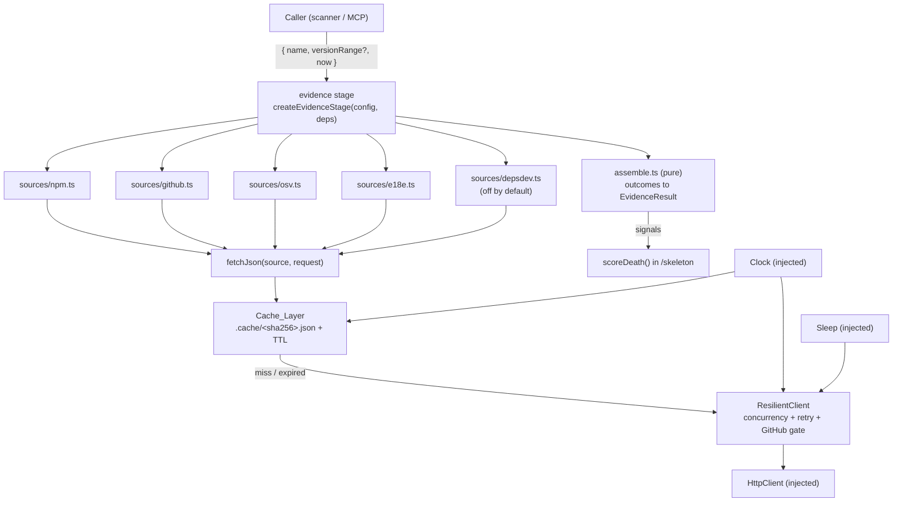
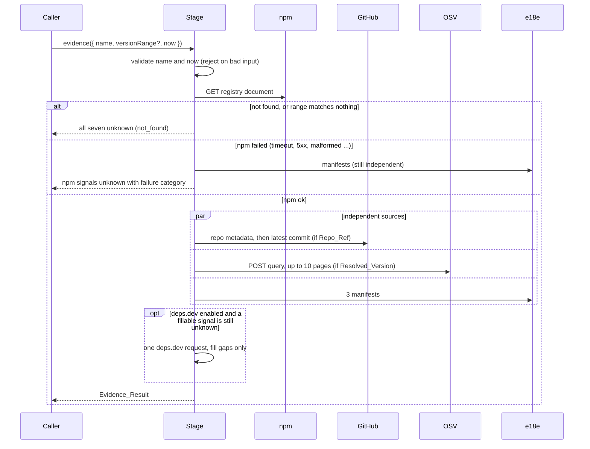

# Design

## Overview

The Npm_Evidence_Stage is the `evidence` stage of the npm adapter in `/apps/exorcist-npm`. One call takes one package name (plus an optional declared version range and an injected Now) and returns an Evidence_Result: a `PackageSignals` object exactly as defined in `skeleton/src/death-score/types.ts`, a source URL for every known signal, and, beside the signals, an `unknownReasons` record, an optional `replacement`, and a `warnings` list. The Death_Score_Engine consumes `signals` unchanged. The stage adds nothing to `PackageSignals`.

The stage is the only place in the npm adapter that talks to the outside world for scoring evidence, so the design is organized around three guarantees:

1. **Failure isolation.** Every source is wrapped so it returns an outcome value (`ok` or `failed(reason)`) and never rejects. A broken source makes only its dependent signals unknown.
2. **Unknown is never alive.** A signal becomes known only when a parsed value and a source URL exist. Every failure path produces `{ kind: "unknown" }` plus exactly one Unknown_Reason.
3. **Zero-network determinism.** All I/O goes through an injectable `HttpClient`, a disk `Cache_Layer`, an injectable `Clock` and an injectable `Sleep`. Pure logic (URL parsing, Months_Since, OSV counting, signal assembly) has no I/O.

The hosted app and tests make no LLM calls, and no API key is needed. `GITHUB_TOKEN` is optional and is sent only to `api.github.com`.

## Goals

- Return all seven signals for a package from the npm registry, GitHub, OSV.dev and e18e, with a source URL for each known signal.
- Keep one broken source from costing more than its own signals.
- Route every request through one cache and one HTTP client interface so tests run on recorded fixtures.
- Be polite to free APIs: bounded concurrency, GitHub rate-limit gate, 429 retry with backoff, per-request timeout.
- Prove the pure logic and the failure behavior with fast-check properties, each with a sabotage check.

## Non-Goals

- Scanning a lockfile, the API, the UI, the replacement, proof and inventory stages.
- Choosing which replacement to migrate to (this stage only records e18e's mapping as Replacement_Info).
- Authenticated or private-repository access beyond an optional `GITHUB_TOKEN` for public data.
- Inferring a repository from deps.dev (explicitly excluded by Requirement 7.2).

## Research Findings

These findings shaped the design. Several differ from what the requirements assume and are flagged under "Decisions and Requirement Clarifications".

- **e18e data shape.** The `es-tooling`/`e18e` `module-replacements` repository ships three manifests, `native.json`, `micro-utilities.json` and `preferred.json`, under `manifests/` and no single combined file. Each file has the shape `{ "mappings": { "<module>": { "type": "module", "moduleName": "<module>", "replacements": ["a", "b"], "url": { ... } } } }`. Replacements are an array (`replacements`), not a single name. Because `mappings` is a JSON object keyed by module name, duplicate entries cannot survive `JSON.parse`. Sources: [module-replacements README](https://raw.githubusercontent.com/es-tooling/module-replacements/main/README.md), [preferred.json](https://raw.githubusercontent.com/es-tooling/module-replacements/main/manifests/preferred.json), [native.json](https://raw.githubusercontent.com/es-tooling/module-replacements/main/manifests/native.json), [manifests directory listing](https://api.github.com/repos/es-tooling/module-replacements/contents/manifests).
- **Skeleton public surface.** `skeleton/src/death-score/index.ts` exports `scoreDeath`, `SIGNAL_NAMES` and the types `SignalValue`, `SignalName`, `PackageSignals` through the package export `@last-rites/skeleton`. It does not export the test helpers (`fc-runner`, `sabotage`). Requirement 14.1 forbids deep imports, so the app carries its own small property-test runner, mirroring the skeleton one.
- **No adapter interface yet.** `/skeleton` contains only `death-score`. The adapter interface named in Requirement 14.7 does not exist yet, so this design defines a local `EvidenceStage` function type that the future interface can adopt.
- **Existing test conventions.** The death-score spec uses a `NamedProperty { name, build(impl) }` pattern, a `FIXED_SEED` in CI, `FC_SEED` replay, and a sabotage list where each wrong implementation must be caught. This design reuses that pattern.
- **npm workspace state.** `apps/exorcist-npm` contains only `.gitkeep`. The root `vitest.config.ts` already includes `apps/*/src/**/*.test.ts`, and the root `workspaces` already includes `apps/*`, so the app needs a `package.json` and `tsconfig.json` and nothing else at the root.

## Architecture



Layering rule: the cache wraps the resilient client, which wraps the raw client. A cache hit costs zero client calls. On a miss the cache calls the resilient client exactly once; the resilient client may call the raw client several times (retries). This is what makes Requirement 8 ("call the Http_Client exactly once") and Requirement 10 (retries) consistent.

`/skeleton` never imports from the app. The app imports only from `@last-rites/skeleton`.

### Evidence flow



## Components and Interfaces

Layout under `apps/exorcist-npm/` (new `package.json` and `tsconfig.json` extending `tsconfig.base.json`, dependency on `@last-rites/skeleton`, exact-pinned `semver`, dev dependencies `vitest` and `fast-check` already used by the workspace):

```
src/evidence/
  index.ts               public API: createEvidenceStage, configFromEnv, types
  types.ts               EvidenceInput, EvidenceResult, UnknownReason, ReplacementInfo, Source, FailureCategory
  config.ts              EvidenceConfig, DEFAULT_CONFIG, validateConfig, configFromEnv
  months-since.ts        monthsSince(timestamp, now)
  repo-url.ts            parseRepoUrl(repositoryField)
  version.ts             resolveVersion(doc, versionRange?)
  osv-count.ts           countOpenVulnsNoFix(vulns, name)
  assemble.ts            assembleResult(outcomes): EvidenceResult (pure)
  stage.ts               createEvidenceStage (orchestration)
  http/
    types.ts             HttpClient, HttpRequest, HttpResponse, HttpClientError, Clock, Sleep
    cache.ts             CacheLayer
    resilient-client.ts  Scheduler, retry, GitHubGate
    fetch-json.ts        classify(response) and parse helpers
  sources/
    npm.ts github.ts osv.ts e18e.ts depsdev.ts
  __fixtures__/          recorded responses per case
  test-support/          fake clients, fc-runner, sabotage implementations, arbitraries
```

### Public types

```ts
import type { PackageSignals, SignalName } from "@last-rites/skeleton";

export type Source = "npm" | "github" | "osv" | "e18e" | "depsdev";

export type FailureCategory =
  | "not_found" | "timeout" | "rate_limited" | "malformed_response"
  | "network_error" | "not_applicable" | "incomplete";

export interface UnknownReason {
  source: Source;
  category: FailureCategory;
  /** Human-readable, built from the category and the public URL only. Never contains a token. */
  message: string;
}

export interface ReplacementInfo {
  type: string;                       // as reported by the manifest
  replacement?: string;               // first entry of `replacements`, absent when none
  replacements: readonly string[];    // all entries, in manifest order (may be empty)
}

export interface EvidenceInput {
  name: string;
  versionRange?: string;
  now: Date | string;                 // ISO 8601
}

export interface EvidenceResult {
  signals: PackageSignals;
  /** Exactly one entry per unknown signal and no entry for a known signal. */
  unknownReasons: Partial<Record<SignalName, UnknownReason>>;
  replacement?: ReplacementInfo;
  warnings: string[];
}

export type EvidenceStage = (input: EvidenceInput) => Promise<EvidenceResult>;

export class EvidenceInputError extends Error {}   // empty name, invalid now
export class EvidenceConfigError extends Error {}  // bad concurrency, retries, TTL ...
```

`PackageSignals`, `SignalValue` and `SignalName` are imported, never redeclared (Requirement 1.2). A compile-time test assigns `EvidenceResult["signals"]` to `PackageSignals` (Requirement 12.10).

### Injection points

```ts
export interface HttpRequest {
  method: "GET" | "POST";
  url: string;
  headers?: Record<string, string>;   // never part of a cache key
  body?: string;                      // JSON text for POST
  timeoutMs: number;
}
export interface HttpResponse {
  status: number;
  headers: Record<string, string>;    // lower-cased names
  body: string;                       // raw text
}
/** Resolves for any HTTP status. Throws HttpClientError for transport failures. */
export interface HttpClient { request(req: HttpRequest): Promise<HttpResponse>; }
export class HttpClientError extends Error {
  constructor(readonly category: "timeout" | "network_error", message: string) { super(message); }
}
export type Clock = () => Date;
export type Sleep = (ms: number) => Promise<void>;

export interface EvidenceDeps { http: HttpClient; clock: Clock; sleep: Sleep; }
export function createEvidenceStage(config: EvidenceConfig, deps: EvidenceDeps): EvidenceStage;
```

Timeouts are the client's job: the stage passes `timeoutMs` and the real client enforces it (for example with `AbortSignal.timeout`) and throws `HttpClientError("timeout")`. A fake client simulates a timeout by throwing the same error. Racing a timer against the request inside the stage would need a real timer and break zero-wait tests, so it is not done.

Two time inputs exist on purpose. `now` (a parameter of each call) drives every Months_Since computation. `Clock` drives cache expiry and the GitHub rate-limit gate, which need time to advance during a call. Tests inject a controllable clock; neither reads the system clock directly (Requirements 8.10, 11.1).

### EvidenceConfig

```ts
export interface EvidenceConfig {
  cacheRoot: string;                       // directory that holds .cache/
  ttlSeconds: Record<Source, number>;      // each > 0
  requestTimeoutMs: number;                // default 10000
  maxConcurrency: number;                  // integer 1..32, default 4
  maxRetries: number;                      // integer 0..10, default 3 (429 only)
  githubMaxWaitSeconds: number;            // default 60
  githubToken?: string;                    // empty string is treated as unset
  depsdev: { enabled: boolean };           // default false
}
```

Default TTLs: npm 3600, github 3600, osv 21600, e18e 86400, depsdev 86400 seconds. `OSV_MAX_PAGES = 10` is a constant (Requirement 5.4). `configFromEnv(env, cacheRoot)` reads `GITHUB_TOKEN` and is the only place that touches the environment. `createEvidenceStage` calls `validateConfig` first and throws `EvidenceConfigError` naming the invalid value before any request is possible (Requirement 10.2).

### months-since.ts (pure)

`monthsSince(timestamp: string, now: Date): number | undefined`. Returns `undefined` for an unparseable ISO 8601 timestamp (the caller maps that to `malformed_response`). Otherwise, using UTC components:

```
D = (now.year - t.year) * 12 + (now.month - t.month)
if (now's day, hour, minute, second, ms) < (t's day, hour, minute, second, ms) lexicographically: D -= 1
return max(0, D)
```

So a timestamp later than Now gives 0 (Requirement 11.3). Jan 31 to Feb 28 is 0 months, because the day-of-month tuple has not been reached; this is the stated rule for "whole calendar months". The function is monotone non-decreasing in `now` for a fixed timestamp: moving within a month can only clear the "-1", and crossing into the next month adds 1 and can re-apply the "-1", which never lowers the result. `Now` itself is validated once at stage entry (invalid Now rejects the call with `EvidenceInputError` before any cache read or request).

### repo-url.ts (pure)

`parseRepoUrl(field: unknown): RepoRef | undefined` where `RepoRef = { owner: string; repo: string }`. It never throws. It does not use the `URL` class, because URL path normalization would rewrite segments such as `..`. Steps:

1. Take the string, or `field.url` when `field` is an object with a string `url` (the `directory` property is ignored). Anything else returns `undefined`. Trim whitespace.
2. Strip a `#fragment` and a `?query`.
3. Match, case-insensitively on the scheme and host, one of: `(git+)?https?://(www.)?github.com/`, `git://github.com/`, `git+ssh://git@github.com/`, `ssh://git@github.com/`, `git@github.com:`, `github:`, or a bare `owner/repo` shorthand. Any other prefix (`gitlab:`, `bitbucket:`, a different host, a `scheme:` that is not listed) returns `undefined`.
4. Split the remainder on `/`. Require at least an owner and a repo segment; ignore everything after the second segment (`/tree/main/packages/x`). Drop a trailing slash. Strip one `.git` suffix from the repo.
5. Validate: owner matches `^[A-Za-z0-9-]{1,39}$`; repo matches `^[A-Za-z0-9._-]{1,100}$` and is not `.` or `..`. Otherwise return `undefined`.

### version.ts (pure)

`resolveVersion(doc, range?)` returns `{ kind: "resolved"; version } | { kind: "none" } | { kind: "no_match" }`.

- No range (or whitespace-only): use `dist-tags.latest`; if it is absent or not a key of `versions`, return `none`.
- A range: take the highest published `versions` key satisfying it using `semver.maxSatisfying(keys, range)` with default options, which includes pre-releases only when the range names a pre-release tag (Requirement 1.3). If the range is not valid semver but equals a `dist-tags` key (for example `latest`), use that tag's version. Otherwise, or when nothing satisfies, return `no_match`.

### osv-count.ts (pure)

`countOpenVulnsNoFix(vulns: readonly OsvVuln[], name: string): number`. Collect the distinct `id` values. For each id, gather the `affected` entries whose `package.ecosystem === "npm"` and `package.name === name`, across all pages. The id counts when none of those entries has a range with an event containing `fixed`. A vulnerability with no matching affected entry counts as unfixed (literal reading of Requirement 5.2). `last_affected` events are not fixes. Range type is not filtered.

### Sources

Each source module exports an async function that returns an outcome and never throws:

```ts
type Outcome<T> = { ok: true; value: T } | { ok: false; reason: Omit<UnknownReason, "message"> };
```

- **npm.ts** `GET https://registry.npmjs.org/<encoded name>`. Returns the parsed document pieces: the Resolved_Version entry's deprecation message, the latest valid `time` entry, the `maintainers` count, the `repository` field. Each field is parsed independently, so a missing `maintainers` makes only `maintainerCount` malformed (Requirement 9.7). 404 yields `not_found`, which the stage turns into the all-unknown result.
- **github.ts** `GET https://api.github.com/repos/<owner>/<repo>`, then `GET .../commits?per_page=1&sha=<default_branch>` (commit date from `commit.committer.date`, falling back to `commit.author.date`). Sends `Authorization: Bearer <token>` only when a token is configured. On a 401 while a token was sent, retries once without the token through the same cache and client path, and adds a warning that the token was rejected (Requirement 14.6). Redirects are followed by the real client; an unreachable renamed repo surfaces as 404 and yields `not_found`.
- **osv.ts** `POST https://api.osv.dev/v1/query` with `{ package: { name, ecosystem: "npm" }, version }`, following `next_page_token` by resending the body with `page_token` for up to `OSV_MAX_PAGES` pages. If the token is still present after the last page, the outcome is `incomplete`.
- **e18e.ts** Fetches the three manifests in fixed order (`native`, `micro-utilities`, `preferred`) from `https://raw.githubusercontent.com/e18e/module-replacements/main/manifests/<file>.json`. Looks the package up with `Object.hasOwn(mappings, name)` (case-sensitive, immune to names like `__proto__`). The first manifest in that order that has the entry wins. A match yields known true with a Replacement_Info; no match is known false only if all three manifests were retrieved and parsed. If any manifest failed and none of the retrieved ones matched, the signal is unknown (no evidence of absence). A match whose `type` is not a non-empty string is unknown with `malformed_response` and no Replacement_Info.
- **depsdev.ts** Only when `config.depsdev.enabled`. One `GET https://api.deps.dev/v3/systems/npm/packages/<name>`. It can fill only `deprecated` and `monthsSinceLastPublish`, and only when those are unknown. The exact response field names are confirmed against a recorded fixture during implementation. Source URL: `https://deps.dev/npm/<name>`. No retry on failure.

### http/cache.ts

```ts
class CacheLayer {
  constructor(rootDir: string, client: HttpClient, clock: Clock, ttlSeconds: Record<Source, number>);
  get(source: Source, req: HttpRequest): Promise<CacheResult>;
}
type CacheResult =
  | { ok: true; response: HttpResponse; fromCache: boolean }
  | { ok: false; failure: { kind: "http"; response: HttpResponse } | { kind: "transport"; category: "timeout" | "network_error" | "rate_limited" } };
```

- **Key.** `sha256(method + "\n" + url + "\n" + (body ?? ""))` as hex. Headers are excluded, so the GitHub token cannot reach a key. File: `<rootDir>/.cache/<hash>.json`.
- **Entry.** `{ schema: 1, storedAt: <ISO from clock>, method, url, response: { status, headers, body } }`. Request headers are never stored.
- **Hit.** Entry parses, `0 <= age < ttl` where age = `clock() - storedAt`: return the stored response, zero client calls.
- **Miss, expired, unreadable, invalid JSON, or storedAt in the future.** Treated as absent. One call to the underlying client. On 2xx, write the entry atomically (temp file then rename) and return the response. A failed write is ignored and the response is still returned.
- **Failure.** A non-2xx response or a thrown error is returned as a failure. Nothing is written, any existing entry is untouched.
- **Normalization.** The populating read returns the same `response` shape that a later hit returns (the entry is built first and returned from the in-memory copy), so the two reads deep-equal. `fromCache` is carried outside `response`.
- **Rate-limit headers.** Only live responses (`fromCache: false`) update the GitHub gate, so a stale cached `x-ratelimit-remaining: 0` never blocks a request.

A malformed 2xx body is cached like any other 2xx body until its TTL expires, because the cache layer does not know the shape a source expects. This is accepted: the cost is a bounded delay in recovering from a bad upstream response.

### http/resilient-client.ts

`ResilientClient implements HttpClient` wraps the injected client:

- **Scheduler.** A counting semaphore with `maxConcurrency` slots, acquired per attempt around the raw call and released before any sleep. In-flight requests never exceed the maximum (Requirement 10.1).
- **429 retry.** On status 429, wait `retry-after` seconds when the header is a non-negative integer; otherwise wait `min(30, 2^attempt)` seconds starting at 1 (`1, 2, 4, ...`). All waits go through the injected `Sleep`. Retry up to `maxRetries` times; when exhausted, throw `HttpClientError`-like failure with category `rate_limited`.
- **Timeout.** A thrown timeout is not retried and is surfaced as category `timeout`.
- **GitHub gate.** For requests to `api.github.com`, before each live attempt: if a previous live response had `x-ratelimit-remaining: 0` and `x-ratelimit-reset` (epoch seconds) is later than `clock()`, compute the wait. If the wait exceeds `githubMaxWaitSeconds`, do not issue the request and fail with `rate_limited`. Otherwise sleep the wait, then proceed. A 403 with `x-ratelimit-remaining: 0` is classified as `rate_limited`.

### stage.ts and assemble.ts

`stage.ts` validates input, builds `CacheLayer(ResilientClient(http))`, runs the flow in the sequence diagram, and passes plain outcome values to `assemble.ts`. `assemble.ts` is a pure function with no I/O: it computes Months_Since from `now`, builds each `SignalValue`, fills `sourceUrls` only for known signals, fills `unknownReasons` only for unknown signals, and orders everything by `SIGNAL_NAMES` so the output does not depend on the completion order of concurrent requests.

Signal-to-source dependencies (used by assembly and by the failure-isolation property):

| Signal | Depends on |
|---|---|
| `deprecated`, `monthsSinceLastPublish`, `maintainerCount` | npm |
| `repoArchived`, `monthsSinceLastCommit` | npm (for the repository field), github |
| `openVulnsNoFix` | npm (for Resolved_Version), osv |
| `knownReplacementExists` | e18e |

The stage exports the function as the npm adapter's `evidence` stage. It does not export `inventory`, `replacement` or `proof` (Requirement 14.7).

## Data Models

### Source URL per signal

| Signal | `sourceUrls` entry |
|---|---|
| `deprecated`, `monthsSinceLastPublish`, `maintainerCount` | `https://registry.npmjs.org/<name>` |
| `repoArchived`, `monthsSinceLastCommit` | `https://github.com/<owner>/<repo>` |
| `openVulnsNoFix` | `https://osv.dev/list?q=<name>` |
| `knownReplacementExists` | URL of the matching manifest, or the manifests directory page when no manifest matches (see decisions) |
| any signal filled by deps.dev | `https://deps.dev/npm/<name>` |

### Failure classification

| Situation | Category |
|---|---|
| `HttpClientError` timeout | `timeout` |
| `HttpClientError` network error | `network_error` |
| HTTP 404 or 410 | `not_found` |
| HTTP 429 after retries are exhausted; GitHub gate wait above the maximum; 403 with `x-ratelimit-remaining: 0` | `rate_limited` |
| Any other non-2xx (5xx, 401 without a token, other 4xx) | `network_error` |
| 2xx body that is not JSON, or JSON missing the needed field, or an unparseable timestamp | `malformed_response` |
| No Repo_Ref for the GitHub signals | `not_applicable` |
| OSV page cap reached with a token still present | `incomplete` |

### On-disk cache entry

```ts
interface CacheEntry {
  schema: 1;
  storedAt: string;                 // ISO 8601 from the injected Clock
  method: "GET" | "POST";
  url: string;
  response: { status: number; headers: Record<string, string>; body: string };
}
```

### Evidence_Result invariants

For every result `r`:

- `r.signals` has all seven signals, each `known` or `unknown`.
- `r.unknownReasons` has a key for a signal if and only if that signal is unknown.
- `r.signals.sourceUrls` has a key for a signal if and only if that signal is known, and each value is an absolute URL.
- When every source fails, all seven signals are unknown and `sourceUrls` is empty or absent.

## Decisions and Requirement Clarifications

These are the places where the design had to choose, or where the requirements and the researched data disagree. Each is reviewable.

1. **npm 404 versus failure isolation.** Requirement 1.7 says a package missing from the registry makes all seven signals unknown, including `knownReplacementExists`. Requirement 2.5 and 9.4 say a failed source leaves other sources' signals unchanged and lists "package not found" among the failures. These conflict for `knownReplacementExists` on a 404. The design follows Requirement 1.7 (the more specific rule): npm not-found or a range that matches nothing short-circuits to all-unknown `not_found`, skips the remaining sources and skips deps.dev. The failure-isolation property therefore injects only non-404 failures for npm; the 404 and no-match paths are covered by example tests. Recommend amending 2.5 and 9.4 to exclude npm not-found.
2. **e18e is three files, not one.** Requirement 6 assumes one data file with a single `replacement` name and possible duplicate entries. The real data is three manifests keyed by module name with a `replacements` array. The design reads all three in fixed order, treats "first match in file order" as manifest order (duplicates within a file cannot exist after `JSON.parse`), keeps the first `replacements` element as `replacement` and all of them in `replacements`, and uses the matching manifest URL as the source URL. For a no-match result it uses the manifests directory page, `https://github.com/e18e/module-replacements/tree/main/manifests`, because no single file URL is accurate. Requirement 6.3 and 6.6 would benefit from a wording update.
3. **Partial e18e failure.** If any of the three manifests fails and none of the retrieved ones contains the package, `knownReplacementExists` is unknown, not false. Absence cannot be shown from partial data.
4. **Whitespace-only version range** is treated as no range (use `latest`).
5. **Repo names `.` and `..`** are rejected even though they fall inside the character set in Requirement 3.9, because GitHub does not allow them and a parser that accepted them would conflict with path handling.
6. **deps.dev is narrow.** It fills only `deprecated` and `monthsSinceLastPublish`, and the request is skipped when neither is unknown. Requirement 7.3 says "at most one request", so zero is allowed.
7. **Adapter interface not yet in `/skeleton`.** Requirement 14.7 refers to it. This design defines `EvidenceStage` locally; when the adapter interface lands, the stage's type must be assignable to its `evidence` member.
8. **Input errors reject, source errors never do.** Empty name and invalid Now reject the returned promise with `EvidenceInputError` (Requirements 1.6, 11.5). Invalid configuration throws `EvidenceConfigError` from `createEvidenceStage`. Requirement 9.3's "never reject" applies to source failures only.

## Risks

- **GitHub unauthenticated limit (60 requests/hour).** A scan of many packages exhausts it quickly. Mitigated by the 1-hour GitHub TTL, the rate-limit gate, and the optional token. Packages whose GitHub calls are skipped show `rate_limited`, never alive.
- **Large e18e manifests (about 300 KB across three files).** Cached for 24 hours on disk, so the cost is paid once per day, not per package.
- **Cache poisoning by a malformed 2xx body.** Bounded by TTL (see the cache section). A later spec can add a source-aware "do not cache unparseable bodies" hook.
- **Months_Since month-end edge.** Jan 31 to Feb 28 counts as 0 months. Documented, and covered by Property 7.

## Correctness Properties

A property is a characteristic or behavior that should hold true across all valid executions of a system, a formal statement about what the system should do. Properties serve as the bridge between human-readable specifications and machine-verifiable correctness guarantees.

Reflection after prework: many acceptance criteria collapse into a few properties: the "valid result" criteria (1.1, 2.4, 9.2, 9.5, 9.6) become one result invariant checked inside Properties 3 and 5; the repo URL criteria 3.1 to 3.6 and 3.10 become Property 1, and 3.7 to 3.9 become Property 2; the failure criteria 2.5, 4.6, 5.7, 9.1, 9.3, 9.4, 9.8 and 10.8 become Property 3; 8.4, 8.5 and 8.10 become Property 4; 11.1 and 11.6 become Property 5; 11.3 and 11.7 become Property 6; 11.2 becomes Property 7. Properties 8 to 11 cover pure counting, cache keys, concurrency and token confinement. Everything else is an example, edge case or smoke test (see Testing Strategy).

**Result invariant (`isValidEvidenceResult`).** Used by Properties 3 and 5: all seven signals present; `unknownReasons` has a key if and only if the signal is unknown, each with a category from the Glossary set; `sourceUrls` has a key if and only if the signal is known, and its value is an absolute URL; every numeric known value is an integer greater than or equal to 0.

All properties run with fast-check `numRuns: 100` (internal properties, per proof-rules.md), a fixed seed in CI (`CI` set), `FC_SEED` replay, and the seed plus shrunk counterexample printed on failure. Each property is built as `build(impl)` over the seam it tests, so a sabotage check can swap in a deliberately wrong implementation. Every property has a sabotage list; each sabotage must make at least one run of its property fail, and if one does not, the harness fails the suite with a message naming the property and the sabotage (Requirements 13.7, 13.8).

### Property 1: Every GitHub URL form maps to the same Repo_Ref

*For any* valid owner and repo name, *for any* of the nine forms (`https://`, `http://`, `git+https://`, `git://`, `git+ssh://`, `ssh://git@`, `git@github.com:`, `github:`, bare `o/r`), *for any* combination of decorations (`.git` suffix, trailing slash, `#fragment`, `?query`, `/tree/<branch>/<path>` suffix, upper or lower case host and optional `www.`, leading and trailing whitespace) and *for any* wrapper (a bare string, or an object `{ url }` with an optional `directory`), `parseRepoUrl` returns exactly `{ owner, repo }`.

- Arbitrary: owner from `[A-Za-z0-9-]{1,39}`, repo from `[A-Za-z0-9._-]{1,100}` excluding `.`, `..` and names ending in `.git`; form index; decoration flags; wrapper choice.
- **Validates: Requirements 3.1, 3.2, 3.3, 3.4, 3.5, 3.6, 3.10, 13.2**
- Sabotage: (a) a parser that does not strip the `.git` suffix; (b) a parser that matches the host case-sensitively; (c) a parser that does not trim whitespace; (d) a parser that returns the whole path as the repo.

### Property 2: Non-GitHub and invalid values map to no Repo_Ref and never throw

*For any* value that is not a GitHub repository reference, `parseRepoUrl` returns `undefined` and does not throw. This covers URLs on any other host, shorthand with a `gitlab:` or `bitbucket:` prefix, owner or repo names with characters outside the allowed set or over the length limits, owners or repos missing, `.` and `..`, empty and whitespace-only strings, objects without a string `url`, and arbitrary values from `fc.anything()` (numbers, arrays, `null`, nested objects).

- Arbitrary: `fc.oneof` of the above generators.
- **Validates: Requirements 3.7, 3.8, 3.9, 13.2**
- Sabotage: (a) a parser that ignores the host and accepts any `https://<host>/o/r`; (b) a parser that accepts a repo name over 100 characters; (c) a parser that throws on non-string input.

### Property 3: Failure isolation

*For any* fixture case, *for any* subset of the four sources `npm`, `github`, `osv`, `e18e` (including the empty subset and the full set), and *for any* failure mode per failing source from `{ network_error, timeout, http_500, rate_limited, malformed_body }` (and, for `github`, `osv` and `e18e` only, also `not_found`), the stage resolves (never rejects), the result satisfies the result invariant, every signal that depends on a failed source (per the dependency table) is unknown with a reason whose category matches the failure mode of the first failed source in its chain (npm before github and osv), and every other signal, its source URL, `replacement` and `warnings` are deep-equal to the same fields of the run with no failing source. When all four sources fail, all seven signals are unknown and `sourceUrls` is empty or absent.

- Arbitrary: fixture case from the five recorded cases (`picocolors`, `request`, `left-pad`, archived repo, no repository), a failure mode or `none` per source, `now`.
- Each run uses a fresh temp cache directory and a fake sleep, so `rate_limited` (persistent 429) exhausts retries without delay.
- Excluded on purpose: npm `not_found`, which short-circuits to all-unknown by Requirement 1.7 (see Decisions, item 1) and is covered by an example test.
- **Validates: Requirements 2.5, 4.6, 5.7, 9.1, 9.2, 9.3, 9.4, 9.5, 9.6, 9.8, 10.8, 13.3**
- Sabotage: (a) fail-fast: any recorded reason turns all seven signals unknown; (b) failed-as-alive: a failed source's signals become known `false` or `0` with a source URL; (c) npm-blanks-all: an npm failure also makes `knownReplacementExists` unknown; (d) a stage that rethrows the first source failure.

### Property 4: Cache transparency and TTL

*For any* request (GET or POST, any URL, any body), any successful response, any TTL greater than 0 and any elapsed time `age` on the injected clock after the populating read: if `age < ttl`, the second read makes zero client calls, returns a response deep-equal to the populating read and reports `fromCache: true`; if `age >= ttl`, the second read makes exactly one client call and replaces the stored entry, so a third read within the TTL returns the new response with no further client call.

- Arbitrary: request, two distinct response bodies, `ttl` in 1 to 86400 s, `age` chosen from `{0, ttl-1ms, ttl, ttl+1ms, random in [0, 2*ttl]}`.
- **Validates: Requirements 8.4, 8.5, 8.10, 13.4**
- Sabotage: (a) a cache that ignores the TTL and always hits; (b) a cache that treats `age == ttl` as fresh; (c) a cache that calls the client twice on expiry; (d) a cache that never writes; (e) a cache that stores a lossy copy (trimmed body).

### Property 5: Determinism and dependence on the injected Now only

*For any* fixture case, version range, failure subset, `now` between 2000 and 2100, `maxConcurrency` and *for any* two completion orders of the fake client's responses, two runs with fresh caches produce deep-equal Evidence_Results, and the result satisfies the result invariant. In addition, `monthsSinceLastPublish` and `monthsSinceLastCommit`, when known, equal `monthsSince(<timestamp recorded in the fixture>, now)` computed independently from the fixture, so the result depends on the injected Now and not on the system clock.

- Arbitrary: as above, plus two permutations that decide the order in which pending fake responses are released.
- **Validates: Requirements 11.1, 11.6, 13.5**
- Sabotage: (a) a stage that reads `new Date()` for Months_Since (caught by the fixture oracle, because the run result no longer follows the generated `now`); (b) a stage that adds `Math.random()` jitter to a reason message; (c) a stage that builds `unknownReasons` and `warnings` in completion order instead of `SIGNAL_NAMES` order (caught by the two completion orders).

### Property 6: Months_Since is non-negative and monotone in Now

*For any* valid timestamp `T` and any `N1 <= N2`, `monthsSince(T, N1)` is an integer, `0 <= monthsSince(T, N1) <= monthsSince(T, N2)`. This includes `T` later than both `N1` and `N2`, where both results are 0.

- Arbitrary: `T`, `N1`, `N2` as UTC instants across 1970 to 2100, with extra weight on equal instants, month-end days and `T > N`.
- **Validates: Requirements 11.2, 11.3, 11.7, 13.6**
- Sabotage: (a) no clamp, so a future timestamp gives a negative number; (b) absolute value of the month difference, which is not monotone when `N < T`; (c) month difference computed from month numbers only, ignoring years.

### Property 7: Months_Since counts whole calendar months

*For any* timestamp `T` with a UTC day of month from 1 to 28 and any `k` in 0 to 1200, let `A` be `T` shifted forward by `k` calendar months (same day and time of day). Then `monthsSince(T, A) = k`, `monthsSince(T, A + 1 ms) = k`, and `monthsSince(T, A - 1 ms) = max(0, k - 1)`.

- Arbitrary: `T` with day 1 to 28, any time of day including milliseconds; `k`.
- **Validates: Requirements 11.2**
- Sabotage: (a) month difference that ignores the day-of-month tuple (monotone and non-negative, so Property 6 alone would not catch it); (b) `floor(days / 30)`; (c) rounding up instead of down.

### Property 8: Open-vulnerability count matches the unfixed-id model

*For any* list of OSV vulnerabilities (any ids, with repeated ids across pages; affected entries for the target npm package, for other npm packages and for other ecosystems; ranges with any mix of `introduced`, `fixed`, `last_affected` and `limit` events), `countOpenVulnsNoFix(vulns, name)` equals the number of distinct ids for which no matching affected entry has a `fixed` event, and the count is unchanged when the list is reordered or when it is concatenated with itself. A list with no vulnerabilities gives 0.

- Arbitrary: ids from a small pool so duplicates are common; names from `{target, other}`; ecosystems from `{npm, PyPI}`.
- **Validates: Requirements 5.2, 5.3**
- Sabotage: (a) count of vulnerability objects instead of distinct ids; (b) `last_affected` treated as a fix; (c) ecosystem ignored, so a PyPI fix counts; (d) only the first affected entry examined.

### Property 9: Cache keys map one-to-one to files

*For any* two requests, if their method, URL and body are equal (headers may differ) they map to the same file path under `<root>/.cache/`, and if any of method, URL or body differs they map to different file paths. Every path lies inside the configured root directory.

- Arbitrary: pairs of requests built by mutating exactly one field, or only headers, or nothing.
- **Validates: Requirements 8.3, 8.9**
- Sabotage: (a) key includes request headers; (b) key ignores the body (POST collisions); (c) key ignores the method.

### Property 10: Concurrency never exceeds the configured maximum

*For any* integer maximum `M` from 1 to 32, any number of simultaneous requests from 1 to 60 and any release order of the fake client's pending responses (including 429 responses that trigger retries), the number of in-flight client requests never exceeds `M` at any instant, and every request settles.

- Arbitrary: `M`, request count, release permutation, a subset of requests that return 429 once.
- **Validates: Requirements 10.1**
- Sabotage: (a) no limit; (b) a limit of `M + 1`; (c) a semaphore that releases the slot before the client call settles.

### Property 11: The GitHub token is confined to GitHub requests and never persisted

*For any* non-empty token string and any fixture case (including a run where GitHub rejects the token once with 401), every client request to `api.github.com` carries `Authorization: Bearer <token>` except the single retry after a 401, every request to any other host carries no `Authorization` header, the token string appears in no cache file path, no cache file content, no `unknownReasons` message, no `warnings` entry and not in the serialized Evidence_Result, and after a 401 the result contains exactly one warning that the token was rejected.

- Arbitrary: tokens of the form `tok_` plus 12 to 40 alphanumeric characters (so they cannot collide with fixture text); fixture case; reject-once flag.
- **Validates: Requirements 4.8, 4.10, 14.5, 14.6**
- Sabotage: (a) token added to the cache key; (b) token sent to every host; (c) a failure message that includes the request headers.

### Sabotage harness

`test-support/sabotage.ts` holds `SABOTAGES: Record<PropertyName, ReadonlyArray<{ name: string; impl: ... }>>`, one list per property above, using the same shape as `skeleton/src/death-score/sabotage.ts` (`runAgainst`, `runSabotageChecks`). For each entry the harness runs the property built over the wrong implementation with the fixed seed and expects a counterexample report. A report that never appears fails the suite with `Sabotage "<name>" stayed green for "<property>"`. Stage-level sabotages are wrappers over the real stage (they post-process or pre-process the real result), so they stay small and cannot drift from the real code.

## Error Handling

- **Bad input.** An empty or whitespace-only name rejects with `EvidenceInputError("package name is required")` and makes no client call or cache read. An invalid `now` rejects with `EvidenceInputError("invalid now")` before any client call or cache read. Name is checked after `now`, and neither check touches the network.
- **Bad configuration.** `createEvidenceStage` throws `EvidenceConfigError` naming the invalid field and value for concurrency outside 1 to 32 or non-integer, retries outside 0 to 10 or non-integer, a non-positive TTL, a negative maximum wait or timeout. No request can be issued from a stage that failed to construct.
- **Source failures** never throw out of the stage. Each source module catches transport errors, classifies statuses with the table in Data Models, and returns an `Outcome`. The stage wraps each source call in a last-resort catch that maps an unexpected exception to `network_error` for that source, so a programming error in one parser cannot take down the other sources.
- **Partial documents.** Each signal parser validates only the fields it needs, so a missing field affects one signal (`malformed_response`).
- **Unknown reasons.** Every unknown signal gets exactly one reason with a category and a message built from the category, source and public URL. Messages never include request headers, response bodies or the token.
- **Cache I/O.** Unreadable or invalid cache files are treated as absent and overwritten on the next successful fetch. A failed cache write is ignored; the live response is still used.
- **Unmatched fake request.** The fake client throws `UnmatchedFixtureRequest` and also records the request. The stage will classify the throw as `network_error`, so each test checks the recorded list is empty in `afterEach`; this keeps Requirement 12.4 from being silently absorbed by failure isolation.

## Testing Strategy

PBT applies to this feature: the parser, Months_Since, OSV counting, cache behavior, concurrency and failure isolation are logic with large input spaces. The I/O layer itself (real HTTP, real GitHub) is not property-tested; it is exercised only through fakes.

- **Library:** `fast-check` with Vitest, as in `/skeleton`. No custom property engine. The app carries its own small `test-support/fc-runner.ts` (resolve seed, `checkProperty`, `assertProperty`, `formatReport`) modeled on the skeleton helper, because the skeleton does not export it publicly (Requirement 14.1).
- **Configuration:** each property is one `fc.assert`-style test with `numRuns: 100`; with `CI` set the seed is fixed; `FC_SEED` replays; on failure the output carries the seed and the shrunk counterexample (Requirements 13.9, 13.10).
- **Tagging:** every property test carries a comment `Feature: npm-evidence, Property <n>: <title>`.
- **Property tests:** Properties 1 to 11 above, one test each. Properties 1 to 5 and 6 are the five required subjects of Requirement 13.1 (parsing, failure isolation, cache transparency, determinism, Months_Since); 2, 7 to 11 are additional.
- **Sabotage checks:** one `sabotage.test.ts` that runs every sabotage in the harness against its property and fails by name if any stays green.
- **Unit and example tests** (fixtures under `__fixtures__/`, zero network):
  - Fixture cases: `picocolors` (deprecated false, replacement false), `request` (deprecated true), `left-pad` (replacement true with non-empty name), an archived-repository package (`repoArchived` true), a package with no `repository` field (both GitHub signals unknown with `not_applicable`). Each output is passed to `scoreDeath` and must not throw (Requirement 12.11).
  - npm: version range resolution including pre-release ranges and dist-tag ranges, no-match range, 404 package, `maintainers` missing or not a list, `time` missing, Resolved_Version absent, empty maintainers.
  - GitHub: 404, 5xx, rate limit, commit request failing or returning no commits, token present or absent header, 401-then-retry with warning, gate waiting for `x-ratelimit-reset`, wait above maximum, redirect.
  - OSV: request body, three pages, ten pages, endless `next_page_token` giving `incomplete`, no resolved version giving zero OSV calls.
  - e18e: match in each manifest, duplicate in two manifests (first in fixed order wins), names like `__proto__`, entry without replacements, entry without type, one manifest failing.
  - deps.dev: disabled by default (zero calls), enabled with all signals known (zero calls), enabled with a gap (one call, fills only unknown), failure not retried, no-repo case never calls it.
  - Cache: second run makes zero client calls, corrupt files, failure does not overwrite an existing entry.
  - Resilience: `retry-after` honored, exponential backoff capped at 30, retries bounded, timeout not retried.
  - Input: whitespace names, invalid `now`, invalid configuration, each with zero client calls.
  - Static smoke checks: the app imports `/skeleton` only through `@last-rites/skeleton`; `/skeleton` has no import resolving under `apps/exorcist-npm`; `package.json` has no LLM client dependency; the module exports `evidence` and no `inventory`, `replacement` or `proof`; `npm run typecheck` proves `EvidenceResult["signals"]` is assignable to `PackageSignals`.
- **No network:** a Vitest setup file replaces `globalThis.fetch` with a function that fails the test, so an accidental real request cannot pass.
- **Fixture recording:** fixtures are recorded once by a script in `test-support/record-fixtures.ts` (run manually, never in `npm test`) and committed.
