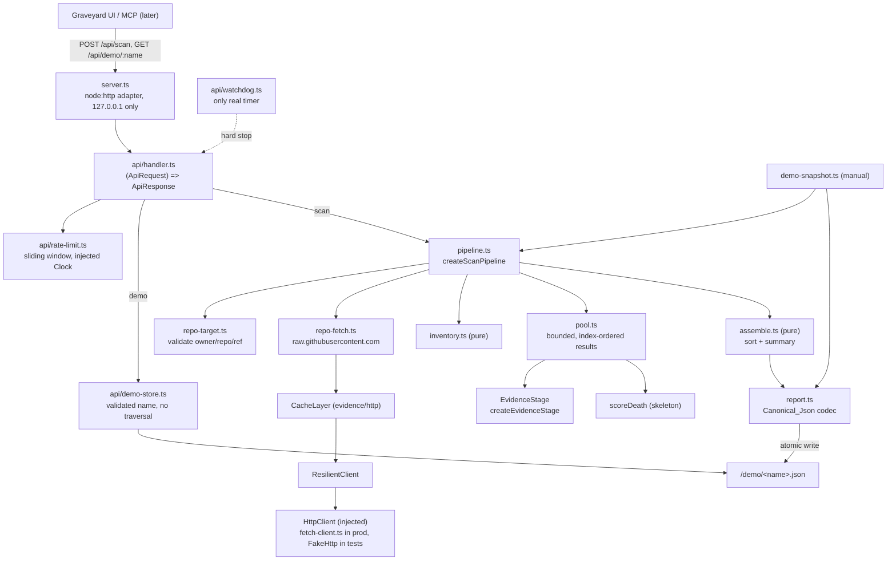
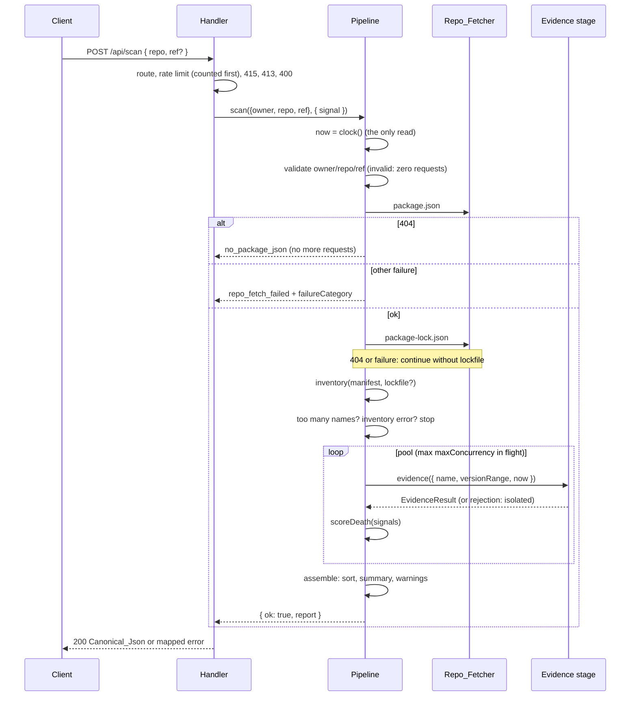

# Design

## Overview

The Npm_Scanner is the scan component of `/apps/exorcist-npm`. Given a public GitHub repository (`owner/repo`, optional ref) it returns one deterministic Scan_Report: every direct npm dependency of the root `package.json`, each with its evidence, death score, grade and replacement info, sorted most-dead first. It sits on top of two things that already exist:

- `scoreDeath` and its types from `@graveyard-kit/skeleton` (pure, no I/O).
- `createEvidenceStage` and the `http/` stack (`CacheLayer`, `ResilientClient`) in `apps/exorcist-npm/src/evidence`.

It adds five parts under `apps/exorcist-npm/src/scan/`:

1. **Inventory_Stage** (`inventory.ts`): a pure function from `package.json` text plus optional `package-lock.json` text to a list of dependencies to scan and a list of skipped specifiers. This is the `inventory` stage of the npm adapter and the only adapter stage this spec exports.
2. **Repo_Fetcher** (`repo-fetch.ts`): downloads the two files from `raw.githubusercontent.com` through the existing cache and resilient client.
3. **Scan_Pipeline** (`pipeline.ts`, `pool.ts`, `assemble.ts`): fetch, inventory, one evidence call per dependency through a bounded pool, `scoreDeath`, then a report whose order does not depend on completion order.
4. **Report codec** (`report.ts`): Canonical_Json serializer and strict parser with a fixed key order.
5. **Scan_Api** (`api/`, `server.ts`): a framework-free handler (plain request object in, plain response object out), a thin `node:http` adapter that binds `127.0.0.1` only, and the manual demo snapshot script (`demo-snapshot.ts`) that fills `/demo`.

The hosted app and the tests make no LLM calls. Tests make no network requests: every external request goes through the injected `HttpClient`, and tests supply `FakeHttp` with recorded fixtures.

## Goals

- One call returns a scored, sorted, byte-stable report for a public repo.
- A broken lookup for one dependency costs only that dependency, never the scan.
- The same inputs always give the same Canonical_Json, regardless of the order in which evidence calls finish.
- The API refuses bad and abusive requests cheaply (size, type, shape, per-IP rate limits, timeouts) and listens on loopback only.
- Cached demo reports load from disk with zero evidence calls and zero external requests.
- Prove the logic with the six fast-check properties of Requirement 14, each with a sabotage list that must be caught.

## Non-Goals

- The shared adapter interface in `/skeleton`. That is a separate later spec. This spec exports a plain `inventory` function and does not design or add any adapter type to the skeleton (Requirement 12.3).
- The `replacement` and `proof` stages, workspaces and monorepo packages, yarn and pnpm lockfiles, private repositories, transitive dependencies, the UI and the MCP server.
- Mounting the handler in Hono or serving the web UI (see Decision 4).
- Accounts, API keys, persistence of scans beyond the evidence disk cache and `/demo`.
- A new data source: the scanner uses only the files and sources above.

## Research Findings

- **What exists in `evidence/`.** `createEvidenceStage(config, deps)` returns `(input: { name, versionRange?, now }) => Promise<EvidenceResult>`. It validates the config, builds its own `CacheLayer(ResilientClient(http))` and a separate no-retry client for deps.dev, rejects with `EvidenceInputError` on an empty name or invalid `now`, and otherwise never rejects. `evidence/index.ts` exports `createEvidenceStage`, `configFromEnv`, `DEFAULT_CONFIG` and the types `EvidenceConfig`, `EvidenceResult`, `EvidenceStage`, `ReplacementInfo`, `UnknownReason`, `FailureCategory`, `Source`, `HttpClient`, `HttpRequest`, `HttpResponse`, `Clock`, `Sleep`, `EvidenceDeps`, plus `HttpClientError`. It does not export `CacheLayer` or `ResilientClient`; the scanner imports those two from `../evidence/http/cache.js` and `../evidence/http/resilient-client.js` (Decision 2) and does not widen `evidence/index.ts`.
- **`CacheLayer.get(source, req)`** keys the disk cache on method, URL and body (never headers), caches only 2xx responses, applies the TTL of `ttlSeconds[source]`, and returns `{ ok: true, response, fromCache }` or `{ ok: false, failure }` where `failure` is `{ kind: "http", response }` or `{ kind: "transport", category: "timeout" | "network_error" | "rate_limited" }`. `ResilientClient` throws `RateLimitedError` (category `rate_limited`) after exhausted 429 retries; the cache maps it to a transport failure. These transport categories are exactly the `failureCategory` values Requirement 4.4 asks for.
- **`classifyStatus(response)`** in `evidence/http/fetch-json.ts` maps 404/410 to `not_found`, 429 and 403-with-`x-ratelimit-remaining: 0` to `rate_limited`, everything else to `network_error`.
- **There is no production `HttpClient` yet.** The only `fetch`-based client is `fetchClient` in `test-support/record-fixtures.ts`, which hard-codes recorder headers. The scanner adds a small production client (`scan/fetch-client.ts`) for the server and the demo script.
- **Test-support to reuse:** `FakeHttp` and `loadFixtureCase` (`fake-http.ts`, with the `hold`/`release` mechanism for controlling completion order), `createFakeClock`, `createFakeSleep`, `createTempCache`, `fc-runner.ts` (`NUM_RUNS` 100, `FIXED_SEED` 20261113, `FC_SEED` and `CI` seed policy, `assertPropertyAsync`), `sabotage-runner.ts` (`NamedProperty`, `NamedAsyncProperty`, `assertAllSabotagesCaught[Async]`), the `createRecorder` and `recordPackageCase` recorder in `record-fixtures.ts`, and `no-network.setup.ts` (already loaded by the root `vitest.config.ts` for every test file).
- **Skeleton surface.** `@graveyard-kit/skeleton` exports `scoreDeath`, `SIGNAL_NAMES`, and the types `PackageSignals`, `SignalName`, `GradeBand` (`"alive" | "ailing" | "dying" | "dead"`), `DeathScoreResult` (`score`, `grade`, `parts[]`). `scoreDeath` is pure.
- **Workspace.** Root `vitest.config.ts` already includes `apps/*/src/**/*.test.ts`. `apps/exorcist-npm/package.json` already has `semver` (exact `7.6.3`), `@types/node`, `fast-check`, `vitest`, and a `record-fixtures` script that uses `vite-node`. The scanner needs no new runtime dependency.
- **raw.githubusercontent.com.** It serves file bytes for `/<owner>/<repo>/<ref>/<path>` where `<ref>` is a branch, tag, SHA or `HEAD`, and answers 404 for private and nonexistent repos alike. It is not part of the REST API quota (60 requests per hour unauthenticated, [GitHub REST rate limits](https://docs.github.com/en/rest/overview/rate-limits-for-the-rest-api)), but GitHub has tightened unauthenticated limits on raw and other static endpoints, and clients see HTTP 429 when throttled ([community discussion](https://github.com/orgs/community/discussions/158445)). The existing `ResilientClient` already retries 429 with backoff. Content was rephrased for compliance with licensing restrictions.
- **npm lockfiles.** `lockfileVersion` 2 and 3 carry a `packages` map keyed by install path: the root project at `""`, and a hoisted dependency at `node_modules/<name>` (scoped names keep their slash: `node_modules/@scope/pkg`). Entries may carry `version`, `link: true` (a workspace or `file:` link) and `name` (set when the install name differs from the real name, as with `npm:` aliases). Version 1 has no `packages` map. See the [npm package-lock.json docs](https://docs.npmjs.com/cli/v7/configuring-npm/package-lock-json/).

## Architecture



Layering rules:

- `/skeleton` never imports from the app. The scanner imports skeleton only through `@graveyard-kit/skeleton` (Requirement 12.1, 12.4).
- The cache wraps the resilient client, which wraps the raw client. A cache hit costs zero client calls.
- Pure modules (`inventory.ts`, `repo-target.ts`, `assemble.ts`, `report.ts`, `rate-limit.ts` given a clock) do no I/O. The pipeline, the file source, the demo store and the server are the only modules that touch the outside world, and each receives its I/O as an injected value.

### Scan flow



### Sharing in the server process

`createScanRuntime` (`runtime.ts`) runs once at process start and builds a single `EvidenceStage`, a single repo-file `CacheLayer` over its own `ResilientClient`, and a single pipeline. Every request reuses them. Sharing therefore means three things:

- **One stage instance.** The stage's internal `ResilientClient` keeps the GitHub rate-limit gate and the concurrency semaphore across scans, so two simultaneous scans cannot together exceed `maxConcurrency` evidence-source requests.
- **One disk cache directory.** `cacheRoot` is the same for the stage and the repo-file cache, so a second scan of the same dependency within the evidence TTL makes no registry request (Requirement 5.11). Disk is the sharing mechanism; no in-memory cache is added.
- **One repo-file client.** The repo-file `ResilientClient` is a separate instance from the stage's because the stage constructs its own and does not accept one. `raw.githubusercontent.com` is not gated by the GitHub API gate (the existing gate matches `api.github.com` only), so nothing is lost.

## Components and Interfaces

### Layout

```
apps/exorcist-npm/src/scan/
  types.ts            shared types (RepoTarget, Dependency_Entry, Skipped_Entry, Scan_Report, Scan_Outcome, ...)
  inventory.ts        classifySpecifier, inventory (the exported adapter stage)
  repo-target.ts      parseRepoTarget (owner, repo, ref validation)
  repo-fetch.ts       createRepoFileSource (raw.githubusercontent.com via CacheLayer)
  stop-signal.ts      StopSignal, createDeadline (cooperative cancellation)
  pool.ts             runPool (bounded concurrency, index-ordered results)
  assemble.ts         assembleReport, compareScanned (pure)
  pipeline.ts         createScanPipeline, scanOne, failedEvidenceResult, REAL_PARTS
  report.ts           serializeReport, parseReport, CANONICAL key order
  fetch-client.ts     createFetchClient (production HttpClient)
  runtime.ts          createScanRuntime (composition of stage, files, pipeline)
  api/
    types.ts          ApiRequest, ApiResponse, ApiHandler, ApiError codes
    config.ts         ScanApiConfig, DEFAULT_SCAN_API_CONFIG, validateScanApiConfig, parsePortEnv
    handler.ts        createScanApi
    rate-limit.ts     createRateLimiter
    client-ip.ts      clientIp
    demo-store.ts     DEMO_NAME_PATTERN, createFsDemoStore
    watchdog.ts       Watchdog, noWatchdog, realWatchdog
  server.ts           node:http adapter, startServer, main (the one place process.env is read for the API)
  demo-list.ts        DEMO_REPOS: named repositories for the snapshot script
  demo-snapshot.ts    runDemoSnapshots (testable core) and main (manual entry point)
  index.ts            public exports: inventory, createScanPipeline, serializeReport, parseReport, types
  __fixtures__/       recorded repo + evidence fixtures (see Fixture recording)
  test-support/       generators, gated evidence, scan harness, properties/, sabotage/scan-p1.ts .. scan-p8.ts
/demo/                pre-scanned Canonical_Json reports (repo root), one <name>.json each
```

`apps/exorcist-npm/package.json` gains these scripts (no new dependency):

```json
{
  "scripts": {
    "demo-snapshot": "vite-node src/scan/demo-snapshot.ts --",
    "record-scan-fixtures": "vite-node src/scan/test-support/record-scan-fixtures.ts --",
    "serve": "vite-node src/scan/server.ts"
  }
}
```

`npm test` runs none of the three (Requirement 11.7); `demo-snapshot.ts` and the recorder both start only outside Vitest (`if (!process.env["VITEST"])`, the same guard `record-fixtures.ts` uses).

### Imports, never redeclarations (Requirement 12)

```ts
import { scoreDeath, SIGNAL_NAMES } from "@graveyard-kit/skeleton";
import type { DeathScoreResult, GradeBand, PackageSignals, SignalName } from "@graveyard-kit/skeleton";
import { createEvidenceStage, configFromEnv, DEFAULT_CONFIG } from "../evidence/index.js";
import type {
  Clock, EvidenceConfig, EvidenceResult, EvidenceStage, FailureCategory,
  HttpClient, ReplacementInfo, Sleep, UnknownReason,
} from "../evidence/index.js";
import { CacheLayer } from "../evidence/http/cache.js";
import { ResilientClient } from "../evidence/http/resilient-client.js";
```

### types.ts

```ts
export type DependencyKind = "dependencies" | "devDependencies" | "optionalDependencies" | "peerDependencies";

/** Kind_Precedence. A name's Declared_Range comes from the first kind in this list that has it. */
export const KIND_PRECEDENCE: readonly DependencyKind[] =
  ["dependencies", "optionalDependencies", "devDependencies", "peerDependencies"];

export type SkipReason = "npm_alias" | "git" | "file" | "link" | "http" | "workspace" | "other";

export interface DependencyEntry {
  name: string;
  /** Every kind the name appears in, in Kind_Precedence order, no duplicates. */
  kinds: readonly DependencyKind[];
  /** The string from the first kind in Kind_Precedence, unchanged. */
  declaredRange: string;
  /** Present only when versionSource is "lockfile". */
  resolvedVersion?: string;
  versionSource: "lockfile" | "range";
}

export interface SkippedEntry {
  name: string;
  /** The first kind in Kind_Precedence that lists the name. */
  kind: DependencyKind;
  specifier: string;
  reason: SkipReason;
}

export interface InventoryResult {
  dependencies: DependencyEntry[];   // sorted by name, UTF-16 code-unit order
  skipped: SkippedEntry[];           // sorted by name, UTF-16 code-unit order
  warnings: string[];
  lockfile: "used" | "absent";
}

export interface InventoryError {
  code: "malformed_package_json" | "invalid_package_json_shape";
  message: string;
}

export type InventoryOutcome =
  | { ok: true; inventory: InventoryResult }
  | { ok: false; error: InventoryError };

/** The npm adapter's inventory stage. Pure. Never throws. */
export type InventoryStage = (manifestText: string, lockfileText?: string) => InventoryOutcome;

/** Raw caller input to the pipeline. */
export interface RepoInput { owner: string; repo: string; ref?: string }

/** Validated target. `ref` is the requested ref, or "HEAD". */
export interface RepoTarget { owner: string; repo: string; ref: string }

export interface ScannedDependency extends DependencyEntry {
  signals: PackageSignals;
  unknownReasons: EvidenceResult["unknownReasons"];
  replacement?: ReplacementInfo;
  evidenceWarnings: string[];
  death: DeathScoreResult;
}

export interface ScanSummary {
  total: number;
  skipped: number;
  alive: number; ailing: number; dying: number; dead: number;   // one count per GradeBand
}

export interface ScanReport {
  repo: string;            // "owner/repo"
  ref: string;             // the Repo_Target ref
  scannedAt: string;       // ISO 8601, from the one Clock reading
  dependencies: ScannedDependency[];
  skipped: SkippedEntry[];
  warnings: string[];
  summary: ScanSummary;
}

export type FetchFailureCategory = Extract<FailureCategory, "network_error" | "timeout" | "rate_limited">;

export type ScanError =
  | { code: "repo_fetch_failed"; message: string; failureCategory: FetchFailureCategory }
  | {
      code: "invalid_repo" | "invalid_ref" | "no_package_json" | "malformed_package_json"
          | "invalid_package_json_shape" | "too_many_dependencies" | "scan_timeout" | "internal_error";
      message: string;
    };

export type ScanOutcome = { ok: true; report: ScanReport } | { ok: false; error: ScanError };
```

`GradeBand` is used by `assemble.ts` and `report.ts` to key the summary counts. `ScanSummary` spells the four counts out so the Canonical_Json key order is explicit; a type-level test asserts that its four grade keys equal `GradeBand`.

### inventory.ts

`inventory(manifestText, lockfileText?)` runs these steps. It reads no clock, no environment and no file.

1. **Parse the manifest.** Strip one leading U+FEFF, then `JSON.parse`. A parse failure, empty text or whitespace-only text returns `malformed_package_json`. A non-object top level (array, string, number, boolean, `null`) returns `invalid_package_json_shape`.
2. **Read the four kinds.** For each kind present: it must be a non-array, non-null object, and every value must be a string, or the result is `invalid_package_json_shape` with a message naming the field or the dependency name. An absent kind is empty. Names are collected in a `Map<string, Map<DependencyKind, string>>`, never a plain object, so names such as `__proto__` and `constructor` are ordinary keys.
3. **Workspaces.** If the manifest has an own `workspaces` key of any value, add exactly one warning (text fixed: `workspaces are not scanned in v1; only the root package.json is inventoried`).
4. **Lockfile status.** Decide the lockfile once, with this precedence (Decision 10):
   - no text given: `lockfile: "absent"`, warning `no lockfile found; results use declared ranges`;
   - text not parseable as JSON: absent, warning `lockfile is not valid JSON`;
   - parsed value not a JSON object: absent, warning `lockfile is not a JSON object`;
   - `lockfileVersion` is not the number 2 or 3 (this includes 1 and a missing field): absent, warning `lockfile version is unsupported: found <value>` where `<value>` is `JSON.stringify` of the field or the word `missing`;
   - no `packages` that is a JSON object: absent, warning `lockfile has no packages map`;
   - otherwise `lockfile: "used"`.
5. **Choose, classify, resolve.** For each distinct name, in code-unit order:
   - the chosen Declared_Range is the one from the first kind in Kind_Precedence that lists the name; `kinds` lists every kind that does, in Kind_Precedence order;
   - `classifySpecifier(range)` returns a `SkipReason` for an Unscannable_Specifier or `undefined` for a Registry_Specifier. A skipped name becomes a `SkippedEntry` with the first kind and the specifier; it never reaches the lockfile step;
   - a registry name is looked up as `packages["node_modules/" + name]` using `Object.hasOwn`. The entry is usable only if it is an object, does not have `link: true`, has no `name` field different from the dependency name, and has a string `version` for which `semver.valid(version)` is non-null. A usable entry sets `resolvedVersion` and `versionSource: "lockfile"`; anything else leaves `resolvedVersion` absent and `versionSource: "range"`, with no warning.
6. **Per-name warnings** (after the lockfile-level warning, in name order, conflict before mismatch):
   - **kind conflict:** the name appears in more than one kind and at least one other kind has a different range string: one warning naming the package, the kind used, and each ignored kind whose range differs. Identical ranges give no warning. This applies to skipped names too.
   - **lockfile mismatch:** a usable lockfile version exists, `semver.validRange(declaredRange)` is non-null, and `semver.satisfies(version, declaredRange, { includePrerelease: true })` is false: one warning with the package name, the lockfile version and the range. A tag-like or otherwise non-semver range is not comparable, so it gets no mismatch warning (Decision 11).
7. **Return** `{ ok: true, inventory }` with `dependencies` and `skipped` sorted by name in UTF-16 code-unit order (the default `<` string comparison, not `localeCompare`).

Warning order is therefore fixed: workspaces warning, lockfile-level warning, then per-name warnings in name order. `warnings` order is part of the determinism guarantee.

`classifySpecifier(spec: string): SkipReason | undefined` examines `spec.trim()` and returns the first match in this order. The Declared_Range itself is never altered.

| Test on the trimmed specifier | Reason |
|---|---|
| starts with `npm:` | `npm_alias` |
| starts with `git:`, `git+`, `github:`, `gitlab:`, `bitbucket:`, `gist:`, `ssh:`; or matches `^[\w.-]+@[\w.-]+:` (scp-like git); or matches the GitHub shorthand `^[A-Za-z0-9][A-Za-z0-9._-]*/[A-Za-z0-9._-]+(#.*)?$` | `git` |
| starts with `file:`, `./`, `../`, `~/` or `/` | `file` |
| starts with `link:` | `link` |
| starts with `http:` or `https:` | `http` |
| starts with `workspace:` | `workspace` |
| starts with `portal:`, or contains `/` and matched none of the rows above | `other` |
| anything else (semver range, dist-tag, `*`, empty string) | `undefined` (Registry_Specifier) |

The `git+` check runs before the `http` check so `git+https://...` is `git`. The empty string and `*` are Registry_Specifiers (Decision 9).

### repo-target.ts

`parseRepoTarget(input: RepoInput): { ok: true; target: RepoTarget } | { ok: false; error: { code: "invalid_repo" | "invalid_ref"; message: string } }`. Pure. Owner must match `^[A-Za-z0-9-]{1,39}$`. Repo must match `^[A-Za-z0-9._-]{1,100}$` and not be `.` or `..`. If either is invalid the code is `invalid_repo`, even when the ref is also invalid (Requirement 4.10). If `ref` is present it must be 1 to 200 characters of `[A-Za-z0-9._/-]` and not contain `..`; otherwise `invalid_ref`. A missing ref becomes `HEAD`. The charset excludes `?`, `#`, `%` and whitespace, so a validated ref cannot change the URL structure.

### repo-fetch.ts

```ts
export type RepoFileName = "package.json" | "package-lock.json";
export type FileFetch =
  | { kind: "ok"; text: string }
  | { kind: "not_found" }
  | { kind: "failed"; category: FetchFailureCategory };

/** Seam for tests: the pipeline depends on this function type, not on CacheLayer. */
export type RepoFileSource = (target: RepoTarget, file: RepoFileName) => Promise<FileFetch>;

export function createRepoFileSource(
  cache: Pick<CacheLayer, "get">,
  requestTimeoutMs: number,
): RepoFileSource;
```

The URL is `https://raw.githubusercontent.com/${owner}/${repo}/${ref}/${file}`. The request is a plain `GET` with no headers, so no token can be attached (Requirement 4.1). The cache source key is `"github"` (Decision 17). Result mapping:

- `{ ok: true }`: `{ kind: "ok", text: response.body }`.
- `{ ok: false, failure: { kind: "http" } }` with status 404: `not_found`. Any other status: `failed` with `classifyStatus(response)`, where a resulting `not_found` (HTTP 410) is reported as `network_error`.
- `{ ok: false, failure: { kind: "transport" } }`: `failed` with that category.
- A rejected `cache.get` (should not happen): `failed` with `network_error`.

The function never throws. 404 responses are not cached by `CacheLayer` (it caches 2xx only); the per-IP rate limit bounds repeated 404 probing.

### stop-signal.ts and the timeout mechanism

```ts
/** AbortSignal-like. Checked between evidence calls; never interrupts one. */
export interface StopSignal { readonly aborted: boolean }
export interface StopController extends StopSignal { abort(): void }

/** aborted becomes true once `clock()` has advanced `timeoutMs` past the creation time, or abort() is called. */
export function createDeadline(clock: Clock, timeoutMs: number): StopController;
```

`createDeadline` reads `clock()` once when created and once per `aborted` read, so tests drive timeouts with a fake clock and never wait. The condition is `clock().getTime() - start >= timeoutMs` (Decision 12).

The pipeline does not create the signal. The caller (the handler, or a test, or the demo script) creates it and passes it in `opts.signal`. That keeps the pipeline's own `Clock` read count at exactly one per scan (Requirement 5.6): the deadline reads whichever `Clock` instance its creator gave it.

Cooperative cancellation works like this: the pool checks `signal.aborted` before starting each item; after the pool drains, the pipeline returns `scan_timeout` if `signal.aborted` is true. Items already in flight are allowed to settle (each source request is bounded by `requestTimeoutMs`). Nothing is started after the abort is observed.

For the hard request limit (Requirement 9.10) a cooperative check is not enough, because a hung dependency would block the check forever. The handler therefore also takes an injected `Watchdog`:

```ts
export type Watchdog = (ms: number) => { fired: Promise<void>; dispose(): void };
export const noWatchdog: Watchdog;      // fired never settles; used when a test does not exercise the timeout
export const realWatchdog: Watchdog;    // setTimeout based; the only real timer in the scanner
```

`realWatchdog` is built in `api/watchdog.ts` and wired only in `server.ts`. Tests inject a manual watchdog with a `fire()` method (or `noWatchdog`), so no test starts a real timer or waits. The demo script passes no signal and no watchdog; a manual run is allowed to take as long as its requests take.

### pool.ts

```ts
export interface PoolResult<R> {
  /** results[i] belongs to items[i], whatever order the workers finished in. undefined = never started. */
  results: Array<R | undefined>;
  /** True when at least one item was not started because the signal was aborted. */
  stoppedEarly: boolean;
}

export type PoolRunner = <T, R>(
  items: readonly T[],
  limit: number,
  worker: (item: T, index: number) => Promise<R>,
  signal?: StopSignal,
) => Promise<PoolResult<R>>;

export const runPool: PoolRunner;
```

Algorithm: a shared `next` counter and `min(limit, items.length)` worker loops. Each loop does `while (!signal?.aborted && next < items.length) { const i = next++; results[i] = await worker(items[i], i); }`. Because the counter is incremented synchronously before the first `await`, no two loops take the same index, and at most `limit` workers run at once. The result array is written by index, so the output ordering depends only on the input ordering, not on which worker finished first. If a worker rejects, `runPool` rejects (the real worker never rejects; see `scanOne`). `limit` is `EvidenceConfig.maxConcurrency` (Requirement 5.2).

### pipeline.ts

```ts
export interface PipelineDeps {
  evidence: EvidenceStage;
  files: RepoFileSource;
  clock: Clock;
  /** maxDependencies defaults to 300; concurrency is EvidenceConfig.maxConcurrency. */
  limits: { maxDependencies: number; concurrency: number };
}

export interface ScanOneContext { evidence: EvidenceStage; now: Date }
export interface ScanOneResult { dep: ScannedDependency; failed: boolean }
export type ScanOne = (entry: DependencyEntry, ctx: ScanOneContext) => Promise<ScanOneResult>;

export interface AssembleInput {
  target: RepoTarget;
  scannedAt: string;
  scanned: readonly ScannedDependency[];   // any order
  skipped: readonly SkippedEntry[];
  warnings: readonly string[];
}
export type AssembleReport = (input: AssembleInput) => ScanReport;

/** The swappable parts. Properties build over this record; sabotages replace one field. */
export interface PipelineParts {
  inventory: InventoryStage;
  pool: PoolRunner;
  scanOne: ScanOne;
  assemble: AssembleReport;
}
export const REAL_PARTS: PipelineParts;

export type ScanPipeline = (input: RepoInput, opts?: { signal?: StopSignal }) => Promise<ScanOutcome>;
export function createScanPipeline(deps: PipelineDeps, parts?: PipelineParts): ScanPipeline;
```

Flow of the returned function. The whole body runs in one `try`; anything unexpected becomes `internal_error` (Decision 6), so the promise never rejects (Requirement 5.10):

1. `const now = deps.clock()`: the only Clock read. `scannedAt = now.toISOString()`.
2. `parseRepoTarget(input)`: on error return `{ ok: false, error }` with zero requests.
3. `files(target, "package.json")`: `not_found` returns `no_package_json` and stops (no lockfile request); `failed` returns `repo_fetch_failed` with `failureCategory`.
4. `files(target, "package-lock.json")`: `ok` passes the text on; `not_found` passes nothing and adds no warning of its own; `failed` passes nothing and records one pipeline warning `could not fetch package-lock.json: <category>`.
5. `parts.inventory(manifest, lockfile)`: an `InventoryError` becomes the Scan_Error with the same code and zero evidence calls.
6. If `dependencies.length + skipped.length > limits.maxDependencies`, return `too_many_dependencies` with zero evidence calls (the cap counts every distinct name across all kinds, Requirement 5.8).
7. `parts.pool(dependencies, concurrency, (entry) => parts.scanOne(entry, { evidence, now }), opts.signal)`.
8. If `opts.signal?.aborted`, return `scan_timeout` (never a partial report).
9. Gather the `ScanOneResult`s. Pipeline warnings are built in `dependencies` index order after the pool has finished: first the lockfile fetch warning (if any), then one `evidence failed for <name> (requested "<spec>")` per failed entry, where `<spec>` is `resolvedVersion ?? declaredRange`. Building warnings after the pool, by index, keeps their order independent of completion order.
10. `parts.assemble({ target, scannedAt, scanned, skipped, warnings: [...inventory.warnings, ...pipelineWarnings] })`.

`scanOne` (the real one) is where failure isolation lives:

```ts
async function scanOne(entry, ctx): Promise<ScanOneResult> {
  const versionRange = entry.resolvedVersion ?? entry.declaredRange;   // lockfile version wins
  let evidence: EvidenceResult; let failed = false;
  try {
    evidence = await ctx.evidence({ name: entry.name, versionRange, now: ctx.now });
  } catch {
    failed = true;
    evidence = failedEvidenceResult(entry.name, versionRange);
  }
  const death = scoreDeath(evidence.signals);
  return { failed, dep: { ...entry, signals: evidence.signals, unknownReasons: evidence.unknownReasons,
    ...(evidence.replacement ? { replacement: evidence.replacement } : {}),
    evidenceWarnings: evidence.warnings, death } };
}
```

`failedEvidenceResult(name, requested)` builds an `EvidenceResult` with all seven signals `{ kind: "unknown" }`, no `sourceUrls`, one `unknownReasons` entry per `SIGNAL_NAMES` item of `{ source: "npm", category: "network_error", message: "npm: network_error (evidence lookup failed)" }`, no replacement, and `warnings: ["evidence failed for <name>"]`. It satisfies the evidence result invariant, so `scoreDeath` always accepts it. An `EvidenceInputError` (for example an empty dependency name) is handled by the same catch.

If `scoreDeath` throws on a real result, `scanOne` falls back to the failed-evidence result once; a second throw propagates and ends in `internal_error`. The skeleton engine is total on valid signals, so this is defensive.

### assemble.ts

`assembleReport(input)`:

- `dependencies = [...scanned].sort(compareScanned)` where `compareScanned(a, b) = b.death.score - a.death.score || (a.name < b.name ? -1 : a.name > b.name ? 1 : 0)`. Names are distinct, so this is a total order and the result does not depend on input order (Requirement 5.4).
- `summary = { total: dependencies.length, skipped: skipped.length, alive, ailing, dying, dead }`, counted from `death.grade`.
- `repo = owner + "/" + repo`, `ref = target.ref`, `skipped` and `warnings` copied unchanged and in order.

### report.ts (Canonical_Json)

```ts
export type ReportParseError = {
  category: "empty" | "invalid_json" | "missing_field" | "wrong_type" | "not_canonical";
  message: string;       // names the path of the offending field when there is one
};
export type ParseReportOutcome = { ok: true; report: ScanReport } | { ok: false; error: ReportParseError };

export interface ReportCodec {
  serialize(report: ScanReport): string;
  parse(text: string): ParseReportOutcome;
}
export function serializeReport(report: ScanReport): string;
export function parseReport(text: string): ParseReportOutcome;
export const REAL_CODEC: ReportCodec;
```

`serializeReport` rebuilds the report as plain objects with keys inserted in the fixed order below (it never relies on the input object's key order), then returns `JSON.stringify(obj, null, 2) + "\n"`. Optional fields that are absent are omitted, never written as `null`. Arrays keep their order.

| Object | Key order |
|---|---|
| Scan_Report | `repo`, `ref`, `scannedAt`, `dependencies`, `skipped`, `warnings`, `summary` |
| Scanned_Dependency | `name`, `kinds`, `declaredRange`, `resolvedVersion` (if present), `versionSource`, `signals`, `unknownReasons`, `replacement` (if present), `evidenceWarnings`, `death` |
| signals | the seven `SIGNAL_NAMES` in their exported order, then `sourceUrls` (if present) |
| signal value | `kind`, then `value` (known only) |
| `sourceUrls`, `unknownReasons` | keys in `SIGNAL_NAMES` order |
| unknown reason | `source`, `category`, `message` |
| replacement | `type`, `replacement` (if present), `replacements` |
| death | `score`, `grade`, `parts` |
| death part | `signal`, `rawValue`, `weight`, `points`, `status`, `sourceUrl` (if present) |
| Skipped_Entry | `name`, `kind`, `specifier`, `reason` |
| summary | `total`, `skipped`, `alive`, `ailing`, `dying`, `dead` |

`parseReport` never throws and never returns a partial report:

1. Empty or whitespace-only text returns `empty`.
2. `JSON.parse` failure returns `invalid_json`.
3. A strict structural walk builds a normalized `ScanReport`, copying only the known keys. A missing required field returns `missing_field`; a wrong type, a bad enum value (`grade`, `status`, `versionSource`, `kind`, `reason`, signal name), a non-integer where an integer is required, or an unknown key in a keyed record (`sourceUrls`, `unknownReasons`) returns `wrong_type`. Each message names the path, for example `dependencies[3].death.score`.
4. The normalized report is serialized and compared with the input text. Any difference (extra keys, different key order, different indentation, a missing trailing newline) returns `not_canonical`.

The parser checks shape, not scoring consistency; whether `score` equals the sum of part points is the engine's job. The report has no schema-version field in v1 (Decision 26).

### fetch-client.ts

`createFetchClient(opts?: { maxBodyBytes?: number; userAgent?: string }): HttpClient` wraps global `fetch`: it forwards `req.method`, `req.headers`, `req.body`, uses `AbortSignal.timeout(req.timeoutMs)`, lower-cases response header names, and reads the body as a stream up to `maxBodyBytes` (default 32 MiB), throwing `HttpClientError("network_error", ...)` when the cap is exceeded and `HttpClientError("timeout", ...)` on timeout. It sets `user-agent` and attaches no credentials of its own; the evidence stage adds `Authorization` for `api.github.com` only. Redirects are followed. It is used by `server.ts` and `demo-snapshot.ts`; tests never import it (the root `no-network.setup.ts` would fail any real `fetch`).

### runtime.ts

```ts
export interface RuntimeDeps {
  http: HttpClient; clock: Clock; sleep: Sleep;
  evidenceConfig: EvidenceConfig;
  maxDependencies: number;
}
export function createScanRuntime(deps: RuntimeDeps): { pipeline: ScanPipeline };
```

It calls `createEvidenceStage(evidenceConfig, { http, clock, sleep })`, builds `new CacheLayer(evidenceConfig.cacheRoot, new ResilientClient(http, clock, sleep, { maxConcurrency, maxRetries, githubMaxWaitSeconds }), clock, evidenceConfig.ttlSeconds)`, wraps it with `createRepoFileSource(cache, evidenceConfig.requestTimeoutMs)`, and returns `createScanPipeline({ evidence, files, clock, limits: { maxDependencies, concurrency: evidenceConfig.maxConcurrency } })`. A bad `evidenceConfig` throws `EvidenceConfigError` here, before any request.

### api/types.ts

```ts
export interface ApiRequest {
  method: string;                                   // upper-case
  path: string;                                     // pathname only, no query, not decoded
  headers: Readonly<Record<string, string>>;        // lower-case names
  remoteAddress: string | undefined;                // socket address
  /** Reads at most limitBytes. Called only after the rate limit, content-type and content-length checks. */
  readBody(limitBytes: number): Promise<{ ok: true; bytes: Uint8Array } | { ok: false; reason: "too_large" }>;
}
export interface ApiResponse {
  status: number;
  headers: Record<string, string>;                  // always includes content-type
  body: string | Uint8Array;
}
export type ApiHandler = (req: ApiRequest) => Promise<ApiResponse>;
```

The shape is "Web-standard-ish": it mirrors the pieces of `Request`/`Response` the handler needs, with a lazy body so the size cap is enforced before the body is buffered. It is plain data, so tests call the handler with literals and no socket (Requirement 10.6), and a later Hono mount is a few lines of conversion (Decision 4).

### api/config.ts

```ts
export interface ScanApiConfig {
  port: number;                                              // default 24817
  scanRateLimit: { limit: number; windowSeconds: number };   // default 10 per 60
  demoRateLimit: { limit: number; windowSeconds: number };   // default 120 per 60, separate counter
  timeoutSeconds: number;                                    // request and scan timeout, default 60
  trustProxy: boolean;                                       // default false
  demoDir: string;                                           // default: <repo root>/demo
  maxDependencies: number;                                   // default 300
}
export const DEFAULT_SCAN_API_CONFIG: ScanApiConfig;
export class ScanApiConfigError extends Error {}
export function validateScanApiConfig(c: ScanApiConfig): void;   // throws, naming the invalid field
export function parsePortEnv(raw: string | undefined): number;  // the only reader of the PORT value
```

`validateScanApiConfig` requires `port` to be an integer from 1 to 65535, every limit, window and timeout to be a finite number greater than 0, and `maxDependencies` to be a positive integer. `parsePortEnv` returns 24817 for `undefined` or `""`, accepts only `/^[0-9]{1,5}$/` strings whose value is 1 to 65535, and throws `ScanApiConfigError` naming `PORT` and the rejected value otherwise (so `" 80"`, `"+80"`, `"80.0"`, `"8e1"` and `"0"` are rejected). `demoDir` defaults to `fileURLToPath(new URL("../../../../../demo/", import.meta.url))` evaluated in `src/scan/api/config.ts`, which is `<repo root>/demo`. `demo-snapshot.ts` (one level up) uses `../../../../demo/` and must resolve to the same directory; a smoke test compares the two.

### api/rate-limit.ts

```ts
export interface RateLimiter {
  /** Admit or refuse one request from `key`. */
  hit(key: string): { allowed: true } | { allowed: false; retryAfterSeconds: number };
  /** Number of keys currently tracked. Exposed so a test can assert the memory bound. */
  size(): number;
}
export function createRateLimiter(opts: {
  limit: number; windowSeconds: number; clock: Clock; maxKeys?: number;   // maxKeys default 10_000
}): RateLimiter;
```

Sliding-window log with an injected Clock. State: `Map<string, number[]>` of admitted request timestamps (ms), oldest first. On `hit(key)`:

1. `now = clock().getTime()`; drop timestamps `t` with `now - t >= windowMs` from the front of the key's list.
2. If the list length is below `limit`, push `now`, refresh the key's position in the map, return allowed.
3. Otherwise return refused with `retryAfterSeconds = max(1, ceil((list[0] + windowMs - now) / 1000))`. Refused requests are not recorded (Decision 14), so waiting that long always admits the next request.

Memory is bounded two ways. Each list holds at most `limit` timestamps. The map holds at most `maxKeys` keys: when inserting a new key at the cap, first sweep keys whose lists are empty after expiry; if still full, evict the least recently used key (map iteration order, kept current by delete-and-reinsert on each hit). Evicting a key only forgets its history, which is safe for a rate limiter that must never grow without bound. The scan limiter and the demo limiter are two separate instances with separate counters.

### api/client-ip.ts

`clientIp(req, trustProxy)`: when `trustProxy` is true, split `x-forwarded-for` on commas, trim, take the last entry, and use it if non-empty; otherwise (header absent or last entry empty) use `req.remoteAddress`. When `trustProxy` is false the header is ignored. If neither yields a value the key is the literal `"unknown"` (one shared bucket). nginx must set `X-Forwarded-For` so that its last entry is the real client address (for example `proxy_set_header X-Forwarded-For $remote_addr;`), which is why only the last entry is trusted.

### api/demo-store.ts

```ts
export const DEMO_NAME_PATTERN = /^[a-z0-9][a-z0-9-]{0,63}$/;
export type DemoStore = (name: string) => Promise<Uint8Array | undefined>;   // undefined = not found
export function createFsDemoStore(demoDir: string): DemoStore;
```

`createFsDemoStore` re-checks the name against `DEMO_NAME_PATTERN` (throwing on a non-match, as a guard against misuse), reads `join(demoDir, name + ".json")` as bytes and returns them untouched. Because the pattern allows only lower-case letters, digits and `-`, a name can contain no `/`, `\`, `.` or `%`, so traversal is impossible by construction. `ENOENT`, `EISDIR` and `ENOTDIR` return `undefined`; any other error propagates and the handler answers 500 `internal_error`. The demo script uses the same `DEMO_NAME_PATTERN`.

### api/handler.ts

```ts
export interface ScanApiDeps {
  http: HttpClient; clock: Clock; sleep: Sleep;
  config: ScanApiConfig;
  evidenceConfig: EvidenceConfig;
  /** Test seams. Defaults: a pipeline from createScanRuntime, an fs demo store, noWatchdog. */
  pipeline?: ScanPipeline;
  demoStore?: DemoStore;
  watchdog?: Watchdog;
}
export function createScanApi(deps: ScanApiDeps): ApiHandler;
```

`createScanApi` calls `validateScanApiConfig` first (a bad config throws before anything listens), builds the two rate limiters on `deps.clock`, and builds the default pipeline through `createScanRuntime` from `http`, `clock`, `sleep`, `evidenceConfig` and `config.maxDependencies`. It matches `deps.http`, `deps.clock` and `deps.sleep` to Requirement 10.6.

Routing and checks, in order. The whole handler is wrapped so an unexpected throw returns 500 `internal_error` and the returned promise never rejects.

1. **Route.** `/api/scan` and `/^\/api\/demo\/([^/]+)$/` are the only routes. Any other path: 404 `not_found`. A known path with the wrong method: 405 `method_not_allowed` with `allow: POST` or `allow: GET`.
2. **`POST /api/scan`:**
   1. Rate limit: `scanLimiter.hit(clientIp(...))`. Refused: 429 `rate_limited` with `retry-after`. This happens before any header or body inspection, so every request that reaches this point counts (Requirement 9.5).
   2. `content-type` (parameters such as `charset` ignored, case-insensitive) must be `application/json`, else 415 `unsupported_media_type`.
   3. Size: a `content-length` header above 4096 returns 413 `body_too_large` without reading; otherwise `readBody(4096)`, and `too_large` returns 413. The body is never parsed on 413 or 415.
   4. Decode as strict UTF-8, `JSON.parse`, then validate: object, string `repo` matching `^[A-Za-z0-9._-]{1,39}/[A-Za-z0-9._-]{1,100}$`, and `ref` either absent or a string of 1 to 256 characters. Any failure: 400 `invalid_input`.
   5. Run the scan: `const stop = createDeadline(clock, timeoutMs)`, `const wd = watchdog(timeoutMs)`, `await Promise.race([pipeline(input, { signal: stop }), wd.fired.then(() => TIMED_OUT)])`, then `stop.abort()` and `wd.dispose()` in `finally`. `TIMED_OUT` or a `scan_timeout` outcome returns 504 `scan_timeout`.
   6. `{ ok: true }` returns 200 `serializeReport(report)`. `{ ok: false }` maps by code: `invalid_repo` and `invalid_ref` 400, `no_package_json` 404, `malformed_package_json`, `invalid_package_json_shape` and `too_many_dependencies` 422, `repo_fetch_failed` 502, `scan_timeout` 504, `internal_error` 500. The body code is the Scan_Error code.
3. **`GET /api/demo/:name`:**
   1. Rate limit with the demo limiter (separate counter, default 120 per 60 seconds), before name validation.
   2. Name not matching `DEMO_NAME_PATTERN`: 400 `invalid_demo_name`, no file read.
   3. `demoStore(name)`; `undefined`: 404 `demo_not_found`; otherwise 200 with the bytes unmodified. No evidence call and no external request is possible on this path because it does not touch the pipeline.

Every response has `content-type: application/json`. Every error body is `{ "error": { "code": "<code>", "message": "<message>" } }`, built by one `errorResponse(status, code, message)` helper so both strings are always non-empty. The handler adds no CORS headers: the UI is served from the same origin behind nginx.

### server.ts

A thin `node:http` adapter around an `ApiHandler`:

- `toApiRequest(IncomingMessage)` builds an `ApiRequest`: method upper-cased, `path` from `new URL(req.url, "http://x").pathname`, headers as Node provides them (already lower-case), `remoteAddress` from the socket, and a `readBody(limit)` that accumulates chunks and, once the total exceeds `limit`, stops reading and resolves `{ ok: false, reason: "too_large" }`.
- `writeApiResponse(ServerResponse, ApiResponse)` writes the status, headers and body. After a 413 it sets `connection: close` and destroys the request stream so the rest of an oversized body is not read.
- `startServer(handler, { port }): Promise<http.Server>` calls `server.listen(port, "127.0.0.1")` (host fixed in code, not configurable), sets `headersTimeout` and `requestTimeout` slightly above the scan timeout, and rejects with a `ServerStartError` naming the port if `listen` emits an error such as `EADDRINUSE`.
- `main()` is the only reader of `process.env` for the API: it calls `parsePortEnv(env["PORT"])`, builds `evidenceConfig = configFromEnv(env, cacheRoot)`, builds `createFetchClient()`, a real `Clock` and `Sleep`, `createScanApi({... watchdog: realWatchdog })`, and `startServer`. On `ScanApiConfigError` or `ServerStartError` it writes the message to stderr and exits with status 1, before any socket is open in the config case. `main()` runs only when the file is the process entry point and `VITEST` is unset.

`cacheRoot` defaults to the repository root (the cache layer adds `.cache/`, which `.gitignore` already covers).

### demo-snapshot.ts

```ts
export interface DemoRepo { name: string; owner: string; repo: string; ref?: string }
export interface DemoFs {
  mkdir(dir: string): Promise<void>;
  writeFile(path: string, text: string): Promise<void>;
  rename(from: string, to: string): Promise<void>;
  rm(path: string): Promise<void>;
}
export interface DemoSnapshotDeps {
  pipeline: ScanPipeline; fs: DemoFs; demoDir: string; log(line: string): void;
}
export interface DemoSnapshotSummary { written: string[]; failed: Array<{ name: string; reason: string }> }
export function runDemoSnapshots(list: readonly DemoRepo[], deps: DemoSnapshotDeps): Promise<DemoSnapshotSummary>;
```

For each entry, in list order and one at a time (to stay polite to the sources):

1. A name that does not match `DEMO_NAME_PATTERN` is skipped without scanning or writing, logged as `<name>: invalid demo name`, and counted as failed (Requirement 11.8).
2. Run the pipeline. An `ok: false` outcome logs `<owner>/<repo>: <code>`, leaves any existing file unchanged, counts as failed, and continues.
3. On success write `serializeReport(report)` to a temp path in the demo directory (`.<name>.json.<n>.tmp`; a leading dot can never match the demo name pattern), then `rename` to `<name>.json`. If the write or rename fails: `rm` the temp file if it exists, leave the existing final file untouched, log `<name>: write failed`, count as failed, continue.

`main()` wires the real pieces (`createFetchClient`, real clock and sleep, `configFromEnv` with a `GITHUB_TOKEN` that is optional, `createScanRuntime`, `node:fs/promises`), runs the list from `demo-list.ts`, and calls `process.exit(summary.failed.length > 0 ? 1 : 0)`. It is started only by `npm run demo-snapshot`. `demo-list.ts` holds the named repositories; choosing them is a task, not a design decision.

## Data Models

The types above are the data model. This section records the invariants that tests and the parser rely on.

### Scan_Report invariants

For every `ScanReport` `r` produced by the pipeline:

- `r.summary.total === r.dependencies.length` and `r.summary.skipped === r.skipped.length`.
- `alive + ailing + dying + dead === r.summary.total`, and each count equals the number of dependencies with that `death.grade`.
- `r.dependencies` is ordered by `death.score` descending, then `name` ascending in code-unit order; names are distinct.
- Every `r.dependencies[i].signals` satisfies the evidence result invariant (all seven signals present, `unknownReasons` has a key if and only if the signal is unknown).
- `r.dependencies.length + r.skipped.length` equals the number of distinct names in the manifest.
- `r.scannedAt` is the one Clock reading; no other field derives from the system clock, randomness or elapsed time.

### Canonical_Json

The text is the Scan_Report with the key order of the table in `report.ts`, two-space indentation and exactly one trailing newline. Optional fields are omitted when absent. Integers are written as plain JSON numbers.

### Failure categories used by the scanner

| Situation | Where it surfaces |
|---|---|
| `package.json` HTTP 404 | Scan_Error `no_package_json` |
| `package.json` timeout, network error, 5xx, other non-404, rate limit after retries | Scan_Error `repo_fetch_failed`, `failureCategory` `timeout` / `network_error` / `rate_limited` |
| `package-lock.json` HTTP 404 | no pipeline warning (the inventory warns that no lockfile was found) |
| `package-lock.json` other failure | one pipeline warning naming the category |
| evidence stage rejects or throws for one dependency | all-unknown Scanned_Dependency with category `network_error` and one report warning |
| deadline passed or watchdog fired | Scan_Error `scan_timeout` |

### Fixture layout

Fixtures live next to the tests, under `apps/exorcist-npm/src/scan/__fixtures__/`. They reuse the `FixtureEntry` layout and `loadFixtureCase` from the evidence test-support:

```
scan/__fixtures__/
  README.md                       names the repository and commit SHA (Requirement 13.4)
  <case>/                         e.g. "repo-a"; the case name is chosen when the repo is chosen
    meta.json                     { owner, repo, sha, license, lockfileVersion, recordedAt, dependencies: [...] }
    repo/package-json.json        FixtureEntry for raw.githubusercontent.com/<o>/<r>/<sha>/package.json
    repo/package-lock-json.json   FixtureEntry for .../package-lock.json
    <pkg>/npm.json                evidence fixtures, one directory per registry dependency
    <pkg>/github-repo.json        (scoped names: "@scope/pkg" is stored as "@scope__pkg")
    <pkg>/github-commit.json
    <pkg>/osv.json
```

The e18e manifests come from the existing `evidence/__fixtures__/shared/` directory, loaded with `loadFixtureCase("shared", FIXTURES_ROOT)`. `meta.json` sits at the case root, outside every directory the entry loader reads, so it is never mistaken for a `FixtureEntry`. A scan test reads `meta.sha` and scans with `ref = meta.sha`, so the recorded raw URLs match exactly.

### Fixture recording

A new manual script `scan/test-support/record-scan-fixtures.ts` (`npm run record-scan-fixtures -w @graveyard-kit/exorcist-npm -- <case> <owner/repo> [ref]`) reuses `createRecorder` and `recordPackageCase` from `evidence/test-support/record-fixtures.ts`. It is unauthenticated, never reads `GITHUB_TOKEN`, stores no request headers, and never runs under Vitest. Steps:

1. **Check the repository** with `GET https://api.github.com/repos/<owner>/<repo>` through a plain `ResilientClient(fetchClient, ...)` (not recorded): refuse unless it is public and `license.spdx_id` is `MIT`.
2. **Pin the commit.** `GET https://api.github.com/repos/<owner>/<repo>/commits/<ref or HEAD>` and keep the 40-character `sha`. Everything below uses the SHA, never a branch name, so the recorded raw URLs are reproducible.
3. **Record the two files** with `rec.record("<case>/repo", name, { method: "GET", url: "https://raw.githubusercontent.com/<owner>/<repo>/<sha>/<file>" })`.
4. **Check the lockfile.** Refuse unless `lockfileVersion` is 2 or 3 and `packages` lists at most 25 entries (excluding the root `""`).
5. **Inventory the recorded text** with the real `inventory` function and, for each registry dependency, call `recordPackageCase(rec, "<case>/<sanitized-name>", name, resolvedVersion)`.
6. **Write `meta.json` and the `README.md` entry**, and print a warning if no direct dependency is deprecated (per the recorded npm document) or listed in the shared e18e manifests.

`recordPackageCase` gets one backward-compatible change: an optional fourth parameter `version?: string` that replaces `dist-tags.latest` as the version sent to OSV. This is required because the stage queries OSV with the Resolved_Version, which for a lockfile-backed scan is the lockfile version, and `FakeHttp` matches the OSV request body exactly. When the parameter is omitted the function behaves as today, so the existing evidence fixtures and tests are untouched.

## Decisions and Requirement Clarifications

Each item is a place where the design had to choose, where the requirements are silent, or where they conflict with the existing code or with each other.

1. **Only `inventory` is exported as an adapter stage (Requirement 12.3).** There is no adapter interface in `/skeleton`, and this spec does not add or design one. `InventoryStage` is a local function type, `(manifestText, lockfileText?) => InventoryOutcome`. The later adapter spec decides how the four stages are wrapped.
2. **`CacheLayer` and `ResilientClient` are imported directly** from `evidence/http/cache.js` and `evidence/http/resilient-client.js`. `evidence/index.ts` is not widened; the public index supplies only `createEvidenceStage`, `configFromEnv`, `DEFAULT_CONFIG` and types. `classifyStatus` is likewise imported from `evidence/http/fetch-json.js`.
3. **Source of repo files is `raw.githubusercontent.com`.** It needs no token, does not draw on the 60-per-hour unauthenticated REST quota that the evidence stage needs for repository metadata, returns file bytes in one GET, and accepts `HEAD`, branches, tags and SHAs. Its drawbacks are that it reports private and nonexistent repos identically (404), and that GitHub has begun throttling anonymous raw traffic (see Risks).
4. **`tech.md` says "Hono on Node", but this spec uses a plain handler plus `node:http`.** The handler takes and returns plain data so tests need no framework and the scanner adds no runtime dependency (Requirement 12.6 then has nothing to check). Mounting it in Hono later is a conversion of `Request` to `ApiRequest` and `ApiResponse` to `Response`. If Hono is wanted for the hosted app, the web/UI spec should own that adapter.
5. **`failureCategory` naming.** `repo_fetch_failed` carries one of `network_error`, `timeout`, `rate_limited`, the transport categories `CacheLayer` already returns. It reuses `FailureCategory` from the evidence types; no new vocabulary. A non-404 HTTP status maps through `classifyStatus`; HTTP 410 is reported as `network_error`, not `not_found`, because only 404 means "no such file" (Requirement 4.3).
6. **A sixth error code is needed: `internal_error`.** Requirement 5.10 says the pipeline returns a Scan_Outcome for every input, even when something throws, but the Scan_Error list is closed and has no code for that. The design adds `internal_error`, maps it to HTTP 500, and the handler also uses it for unexpected failures. Recommend amending Requirement 5.10 and Requirement 8.8 to list it.
7. **Private, nonexistent and ref-less repos are all `no_package_json`.** raw.githubusercontent.com returns 404 for private repos, missing repos, a ref that does not exist and a repo with no `package.json` at that ref, and the scanner cannot tell them apart. The message says so.
8. **Lockfile key rule.** A direct dependency is looked up at exactly `packages["node_modules/" + name]` (scoped names keep their slash). Nested paths such as `node_modules/a/node_modules/b` are never consulted, so transitive entries cannot leak in (Requirements 3.8, 12.9). Lookups use `Object.hasOwn`, and manifest names go into a `Map`, because `__proto__` and `constructor` are valid package.json keys.
9. **Specifier classification.** `""` and `*` are Registry_Specifiers (the evidence resolver treats a blank range as `latest` and `*` as any version). Dist-tags such as `next` and `latest` are Registry_Specifiers too. Dist-tags cannot contain `/`, so the `owner/repo` shorthand test (which requires a `/`) can never swallow a tag, and a semver range never contains `/` either. A string that contains `/` but matches no recognized form (for example `@scope/other`, which is not a valid specifier) is skipped as `other` rather than sent to the registry. Two extensions go beyond the Unscannable_Specifier glossary, and the glossary should be updated to match: bare file paths (`./`, `../`, `~/`, `/`) are `file`, and the hosted-git shorthands `gitlab:`, `bitbucket:`, `gist:`, `ssh:` and scp-like `user@host:path` are `git`. `portal:` is `other`.
10. **Lockfile check precedence.** A lockfile version 1 has no `packages` map, so Requirement 3.5 ("no packages map") and 3.6 ("version 1") both apply. The design applies 3.6 first: not parseable, then not an object, then unsupported `lockfileVersion`, then no `packages` map. A v1 lockfile therefore always gets the "unsupported" warning that names the value found.
11. **Mismatch warning scope.** Requirement 3.4 warns when the lockfile version does not satisfy the declared range. Satisfaction is only defined for valid semver ranges, so a dist-tag or other non-semver range gets no warning. The check uses `includePrerelease: true`, so `*` is satisfied by a pre-release lockfile version.
12. **Clock reads and the timeout.** Requirement 5.6 says the pipeline reads the Clock exactly once. The deadline therefore lives outside the pipeline (`createDeadline`, created by the caller from its own `Clock`), and the pipeline only reads `signal.aborted`. "Longer than the timeout" is implemented as `elapsed >= timeoutMs` ("reached"). After the pool drains, an aborted signal always yields `scan_timeout`, even if every dependency finished, because Requirement 6.5 forbids returning a report after the timeout.
13. **A watchdog backs the cooperative check.** Cooperative cancellation only runs between evidence calls, so one hung call could pass the 60 seconds. The handler also races the scan against an injected `Watchdog` (Requirement 9.10). `realWatchdog` is the only `setTimeout` in the scanner and is wired only in `server.ts`; tests inject a manual watchdog. Evidence calls that were already in flight when the timeout hit keep running in the background until their own request timeouts end.
14. **Rate limiter semantics.** A request counts when it is admitted. A request refused with 429 is not recorded, so `retry-after` (time until the oldest counted request leaves the window, rounded up, minimum 1) is exact: after that long the next request is admitted. This also caps stored timestamps at `limit` per key. Requirement 9.5 ("counted whether or not later rejected") is satisfied for every request that can be rejected for size, type or body, because the limiter runs before those checks.
15. **Check order for `POST /api/scan`:** route and method, rate limit, content type (415), size (413), body shape (400). Content type is checked before size because it is a header-only test and neither requirement fixes an order.
16. **Two repo grammars.** The API's `repo` shape check (Requirement 9.2) allows `.`, `_` and `-` in the owner; the pipeline's owner rule (Requirement 4.8) allows only letters, digits and `-`. An owner like `a_b` therefore passes the API check and is refused by the pipeline as `invalid_repo` (also HTTP 400). Both are 400, so the client sees a 400 either way; only the `code` differs. The pipeline is authoritative. The same holds for `ref`: the API accepts 1 to 256 characters and the pipeline refuses more than 200 or a bad charset as `invalid_ref`.
17. **Cache source key for repo files is `"github"`.** `CacheLayer.get` needs a `Source` for its TTL, and the `Source` type is not widened. `github` has a 3600-second TTL, which suits files addressed by a mutable ref such as `HEAD`.
18. **The dependency cap counts every distinct name.** `too_many_dependencies` is checked on `dependencies.length + skipped.length` after a successful inventory, so skipped names count toward the 300.
19. **Warning order is fixed.** Inventory warnings (workspaces, lockfile-level, then per-name in name order), then the lockfile-fetch warning, then evidence-failure warnings in dependency (name) order. Pipeline warnings are built after the pool, by index.
20. **Content type is exactly `application/json`**, without a charset parameter, matching the requirement text. JSON is UTF-8 by definition.
21. **Fixture refs are SHAs.** Fixtures record against a pinned commit SHA and the scan tests pass that SHA as the ref. The default-ref (`HEAD`) behavior is covered by a synthetic-body example test with `FakeHttp`.
22. **Two properties beyond the six in Requirement 14.** The tech rule asks for a property on every pure module. The rate limiter and the repo-target validator are pure and need one each, so the design adds `scan-p7` (rate limiter window) and `scan-p8` (repo-target validation). Requirement 14.1 and 14.8 only name six subjects, and say "exactly one property for each of the following six"; they do not forbid others. Recommend extending 14.1 and 14.8 to list the two extra subjects. If they are not wanted, `scan-p7`/`scan-p8` drop out and the two modules keep example tests only.
23. **Test-support lives in `scan/test-support/`.** The sabotage files are `scan/test-support/sabotage/scan-p1.ts` to `scan-p8.ts`; the `scan-` prefix keeps the names unique across the app. Scan tests import the shared helpers (`FakeHttp`, `createFakeClock`, `createFakeSleep`, `createTempCache`, `fc-runner`, `sabotage-runner`) from `../../evidence/test-support/`.
24. **A leading BOM in `package.json` is ignored.** npm tolerates it; `JSON.parse` does not.
25. **A package.json with zero dependencies is a successful scan** with empty lists (Requirement 1.5), not an error. A dependency with an empty name is not filtered out by the inventory: the evidence stage rejects it with `EvidenceInputError`, and failure isolation turns that into an unknown entry with a warning.
26. **No schema-version field in the report.** Requirement 7 fixes the Scan_Report fields. Adding a version later is a breaking change to Canonical_Json and needs its own decision.
27. **Environment is read in two places only:** `main()` in `server.ts` and `main()` in `demo-snapshot.ts`. Only `PORT` and `GITHUB_TOKEN` are read. The demo directory and cache root are fixed to the repository layout.

## Risks

- **Anonymous raw.githubusercontent.com throttling.** A shared VPS IP can be throttled with 429. `ResilientClient` retries with backoff, then the scan ends in `repo_fetch_failed` with `rate_limited`. Mitigations: the 1-hour file cache, the per-IP scan limit, and pre-scanned `/demo` reports for the judged demo.
- **GitHub REST quota for large repos.** Each dependency costs up to two `api.github.com` requests, and unauthenticated quota is 60 per hour. A 100-dependency repo will exhaust it; the remaining dependencies show `rate_limited` unknowns, never alive. An optional `GITHUB_TOKEN` for the evidence stage raises the limit; the fixture and demo flow do not need it.
- **Fan-out cost per scan.** Up to 300 dependencies with about five requests each is roughly 1500 requests. The shared `maxConcurrency` (default 4) bounds speed, so a large scan can hit the 60-second timeout and return 504. Smaller repos and cached dependencies finish well inside it.
- **Work continues after a timeout.** Calls already in flight keep running until their own request timeout. They write to the shared cache, so the work is not wasted, but it counts against the concurrency budget.
- **No single-flight.** Two simultaneous scans of the same cold dependency both fetch it. The disk cache absorbs the second scan only after the first writes. Acceptable at this scale.
- **Large lockfiles.** `JSON.parse` of a multi-megabyte lockfile blocks the event loop for tens of milliseconds. The fetch client's 32 MiB body cap bounds the worst case. A body that exceeds the cap fails the file fetch (a `package.json` failure is `repo_fetch_failed`; a lockfile failure only adds a warning).
- **Rate-limit key spoofing.** With `trustProxy` true and a proxy that appends rather than overwrites `X-Forwarded-For`, only the last entry is trusted, which is what nginx wrote. With `trustProxy` false behind a proxy every client shares the proxy's address. The deployment note in `client-ip.ts` and the README must state the nginx setting.
- **Rate-limiter state is in memory.** A restart resets all windows. Bounded memory (at most `maxKeys` keys times `limit` timestamps) is the trade for not persisting them.
- **Evidence disk cache has no eviction.** Inherited from the evidence spec; the scanner makes it grow faster. Out of scope here.
- **Fixture repo availability.** The recorded repo must have a `package-lock.json` v2/v3 of at most 25 packages and ideally a deprecated or e18e-listed dependency. If none exists the recording task falls back to a repo without one, and the example tests that need a flagged dependency use the existing evidence fixtures (`request`, `left-pad`) through a synthetic manifest.

## Correctness Properties

A property is a characteristic or behavior that should hold true across all valid executions of a system, a formal statement about what the system should do. Properties serve as the bridge between human-readable specifications and machine-verifiable correctness guarantees.

Reflection after prework. Many criteria collapse into a few properties:

- The inventory criteria 1.1, 1.4, 1.7, 2.1 to 2.5, 2.7, 2.8 and 12.9 become the completeness property (Property 2).
- The lockfile criteria 3.1 to 3.4, 3.6, 3.8, the evidence-call inputs 5.1 and the no-evidence-for-skipped rule 2.6 become the lockfile precedence property (Property 3).
- The sort, summary and scoring criteria 5.3 to 5.5 become one property (Property 4). The failure criteria 5.7, 5.10, 6.1 to 6.4 and 6.6 become one property (Property 5).
- Determinism criteria 5.2, 5.6, 7.1 to 7.3 become Property 1. The codec criteria 7.4 to 7.7 become Property 6.
- Rate limiting 9.4 and 9.9 become Property 7, and target validation 4.8 to 4.10 become Property 8. Both are beyond Requirement 14's six (Decision 22).
- Everything else is an example, edge case, integration or smoke test (see Testing Strategy).

Properties 1, 3, 4 and 5 run the real pipeline over in-memory seams (`RepoFileSource` returning generated text, and a generated `EvidenceStage`), so they need no `FakeHttp`. Property 2 calls `parts.inventory` directly. The seam of Properties 1 to 5 is `PipelineParts`; a sabotage is `{ ...REAL_PARTS, <one field replaced> }` (or a wrapper that pre- or post-processes one real field), so each wrong implementation stays small and cannot drift from the real code. Property 6 builds over `ReportCodec`, Property 7 over a rate-limiter factory and Property 8 over `parseRepoTarget`.

Shared test helpers (`scan/test-support/`):

- `evidenceFor(profile, name)`: a pure `EvidenceResult` built from one of about six `PackageSignals` profiles (some tied on score) so sorting has ties; it satisfies the evidence result invariant.
- `createGatedEvidence({ profileOf, failures })`: an `EvidenceStage` whose calls stay pending until released (the `FakeHttp.hold` pattern). It records `calls` (name, versionRange, `now`), `inFlight` and `maxInFlight`, and rejects or throws for names in `failures`.
- `driveScan(promise, gate, picks)`: releases pending evidence calls in the order given by `picks` until the scan settles (the `drive` helper pattern; ticks with `setImmediate`, no real waiting).
- `memoryFiles(manifestText, lockfileText?)`: a `RepoFileSource` over generated text.
- Arbitraries for manifests, lockfiles and reports (`arbitraries.ts`).

All properties use `numRuns: 100`, the fixed seed in CI, `FC_SEED` replay, and print the seed and shrunk counterexample on failure, through the existing `fc-runner.ts`. Each property is written as `build(impl)` so the central sabotage test can swap the implementation.

### Property 1: Determinism and completion-order independence

*For any* generated dependency set of 0 to 50 names (spread across the four kinds, some with unscannable specifiers, with or without a lockfile), any generated `maxConcurrency` from 1 to 8, any generated evidence profile per name, and *for any* two generated release-order sequences `A` and `B` for the gated evidence calls, scanning with `A` twice and with `B` once yields three Canonical_Json strings that are byte-identical. In every run the pipeline reads its Clock exactly once, every evidence call receives the same `now` (equal to that reading), `scannedAt` is the ISO string of that reading, and the gate never observes more than `maxConcurrency` evidence calls in flight.

- Arbitrary: manifest and optional lockfile from the shared arbitraries, concurrency, profile per name, two arrays of 400 naturals used as release picks (modulo the pending count).
- Each run uses a counting fake clock fixed at one instant and a fresh gated evidence.
- **Validates: Requirements 5.2, 5.6, 7.1, 7.2, 7.3**
- Sabotage list `scan-p1.ts`:
  - (a) *order report by completion order*: a pool that appends results as workers finish, plus an assemble that does not sort (required by Requirement 14.10);
  - (b) *random tiebreak*: an assemble whose comparator breaks score ties with `Math.random()`;
  - (c) *elapsed-time warning*: an assemble that appends a warning containing `performance.now()`;
  - (d) *per-call now*: a `scanOne` that passes `new Date()` to the evidence stage instead of `ctx.now`;
  - (e) *pool ignores the limit*: a pool that starts every item at once.

### Property 2: Inventory completeness and partition

*For any* generated `package.json` whose names (including scoped names, upper-case letters and the names `__proto__` and `constructor`) are spread across the four Dependency_Kinds with overlaps, whose specifiers are drawn from every class (semver ranges, `*`, the empty string, dist-tags, `npm:` aliases, git forms, GitHub shorthand with and without `#ref`, `file:`, bare paths, `link:`, `http(s):`, `workspace:`, `portal:`), and which may carry a `workspaces` field, `inventory` returns `ok: true` and:

- every distinct name appears in exactly one of `dependencies` or `skipped`, never both and never neither, so the two counts sum to the number of distinct names;
- both lists are sorted by name in UTF-16 code-unit order;
- for each name, `kinds` is exactly the set of kinds that list it, in Kind_Precedence order, and `declaredRange` or `specifier` is the string from the first of those kinds, unchanged;
- a name goes to `skipped` with the reason the generator assigned its chosen specifier if and only if that specifier is unscannable, and the `kind` of a skipped entry is the first kind in Kind_Precedence;
- there is exactly one kind-conflict warning for every name whose kinds carry different range strings (naming the package, the used kind and each differing ignored kind), none for names whose ranges are identical, and exactly one workspaces warning if and only if the manifest has a `workspaces` key;
- calling `inventory` twice on the same text yields deep-equal results.

- Arbitrary: names from a small pool (so overlaps are common) plus a few fixed edge names; per name a subset of kinds (at least one) and a specifier per kind tagged with its intended class; optional `workspaces`.
- **Validates: Requirements 1.1, 1.4, 1.7, 2.1, 2.2, 2.3, 2.4, 2.5, 2.7, 2.8, 12.9**
- Sabotage list `scan-p2.ts`:
  - (a) *drop a name that appears in two kinds* (required by Requirement 14.10);
  - (b) *take the range from the last kind instead of the first*;
  - (c) *kinds in insertion order, not Kind_Precedence order*;
  - (d) *lose prototype-property names* (`__proto__`, `constructor`);
  - (e) *list a skipped name in `dependencies` too*;
  - (f) *sort with `localeCompare`*;
  - (g) *no conflict warning*;
  - (h) *conflict warning even when the ranges are identical*.

### Property 3: Lockfile precedence and what the evidence stage receives

*For any* generated manifest and *any* generated lockfile, where lockfile entries include usable versions, `link: true` entries, entries whose `name` differs from the dependency, entries with invalid semver versions, missing entries, nested paths and extra non-direct packages, and where `lockfileVersion` is drawn from 1, 2, 3, 4 and missing (the generator always includes a `packages` map so a version-1 or version-4 lockfile would be readable if wrongly accepted):

- for `lockfileVersion` 2 or 3, every Dependency_Entry whose `node_modules/<name>` entry is usable has `resolvedVersion` equal to that entry's `version` and `versionSource` `"lockfile"`; every other entry has no `resolvedVersion` and `versionSource` `"range"`, and an unusable entry adds no warning;
- for any other lockfile (absent, unparseable, not an object, unsupported version, no `packages`), `lockfile` is `"absent"`, every `versionSource` is `"range"`, and exactly one lockfile-level warning is present;
- a usable lockfile version that does not satisfy a valid semver declared range adds exactly one warning with the package name, the version and the range; satisfied ranges, tag-like ranges and unusable entries add none;
- running the pipeline, the evidence stage is called exactly once per Dependency_Entry and zero times for any skipped name, each call receives `versionRange` equal to `resolvedVersion` when present and otherwise `declaredRange`, and the entries of `dependencies` plus `skipped` equal the distinct names of the manifest (transitive lockfile entries never appear).

- Arbitrary: manifest from Property 2's arbitrary restricted to registry specifiers for the lockfile part, lockfile built from the manifest names with a per-name entry variant, `lockfileVersion`, and extra packages.
- **Validates: Requirements 2.6, 3.1, 3.2, 3.3, 3.4, 3.6, 3.8, 5.1, 12.9**
- Sabotage list `scan-p3.ts`:
  - (a) *prefer the declared range*: an inventory that never sets `resolvedVersion` (required by Requirement 14.10);
  - (b) *evidence gets the declared range*: a `scanOne` that sends `declaredRange` even when `resolvedVersion` exists;
  - (c) *honor `link: true`*: an inventory that strips `link` fields from the lockfile before running the real one;
  - (d) *ignore a mismatched `name` field*: strips `name` fields first;
  - (e) *include transitive packages*: adds a dependency entry for every non-direct `node_modules/` key;
  - (f) *accept lockfileVersion 1 or 4*: rewrites the version to 3 first;
  - (g) *evidence call for skipped names*: a `scanOne` path that also calls the stage for skipped entries (implemented by appending skipped names to the pool input);
  - (h) *mismatch warning twice*: duplicates the warning.

### Property 4: Sort order, summary counts and scoring

*For any* generated set of distinct dependency entries (mixed-case names, profiles chosen so that score ties are common) scanned through `parts.scanOne` with a generated evidence stage, and *for any* permutation of the resulting Scanned_Dependency values and any generated skipped list passed to `parts.assemble`:

- `report.dependencies` is ordered by `death.score` descending, then by `name` ascending in UTF-16 code-unit order, and is identical for every permutation of the same set;
- `summary.total` equals `dependencies.length`, `summary.skipped` equals `skipped.length`, each GradeBand count equals the number of dependencies with that `death.grade`, and the four counts sum to `summary.total`;
- for each dependency, `death` deep-equals `scoreDeath(signals)` of the evidence result, and `signals`, `unknownReasons`, `replacement` and `evidenceWarnings` are copied from the evidence result unchanged.

- Arbitrary: 0 to 50 distinct names, a profile per name from a pool of six, a permutation, a skipped list.
- **Validates: Requirements 5.3, 5.4, 5.5**
- Sabotage list `scan-p4.ts`:
  - (a) *sort by score ascending* (required by Requirement 14.10);
  - (b) *omit the name tiebreak*: sort by score only, stably (required by Requirement 14.10; caught because the generated permutation is not name order);
  - (c) *tiebreak by name descending*;
  - (d) *tiebreak with `localeCompare`*;
  - (e) *summary counts a dying dependency as dead*;
  - (f) *summary total includes skipped names*;
  - (g) *`scanOne` drops `replacement`*;
  - (h) *`scanOne` scores a fixed constant instead of the evidence signals*.

### Property 5: Failure isolation

*For any* generated dependency set, *for any* subset `S` of its registry names that fail (including the empty subset and the full set), and *for any* failure kind per failing name (the evidence stage rejects with an `Error`, throws synchronously, or rejects with `EvidenceInputError`), the pipeline resolves with `ok: true` and a report such that:

- the report parses with `parseReport(serializeReport(report))` and contains an entry for every registry dependency, so `dependencies.length` equals the number of Dependency_Entry values;
- each entry in `S` has all seven signals unknown, one `unknownReasons` entry per signal with source `npm` and category `network_error`, a non-empty `evidenceWarnings`, and a `death` equal to `scoreDeath` of those signals;
- the report has exactly one evidence-failure warning per name in `S`, each naming that package and the requested version or range, placed after the inventory warnings;
- every entry outside `S` is deep-equal to the entry for the same name in the run with no failures;
- the report's inventory warnings and `skipped` list are identical to the no-failure run.

- Arbitrary: dependency set, failing subset as a boolean mask, failure kind per name, concurrency.
- The oracle is the real pipeline run with no failing name (computed once per generated set).
- **Validates: Requirements 5.7, 5.10, 6.1, 6.2, 6.3, 6.4, 6.6**
- Sabotage list `scan-p5.ts`:
  - (a) *one failed evidence call fails the whole scan*: a `scanOne` that rethrows (required by Requirement 14.10);
  - (b) *drop the failed dependency from `dependencies`*;
  - (c) *failed as alive*: a failed entry gets known `false` and `0` signals;
  - (d) *failure poisons later entries*: once one call fails, every later `scanOne` returns the failed result;
  - (e) *no report warning for a failed entry*;
  - (f) *failed entry keeps stale reasons*: `unknownReasons` empty for the failed entry.

### Property 6: Canonical_Json round trip and strictness

*For any* generated valid Scan_Report `r` (empty and non-empty arrays, present and absent optional fields including an empty `sourceUrls` object, strings with unicode and escapes, all grade bands, integers only and never `-0`), with `text = serialize(r)`:

- `parse(text)` returns `ok: true` and a report deep-equal to `r`;
- `serialize(parse(text).report) === text`, which is the canonical round trip;
- `text` ends with exactly one newline, uses two-space indentation, and `serialize` of `r` with its object keys rebuilt in a generated random order equals `text`, so the key order is fixed by the codec, not by the input object;
- for any mutation of `text` from {empty string, whitespace only, truncated at a random point, trailing newline removed, extra trailing newline, two-space indentation replaced by four, two top-level keys swapped, a required field deleted, a field set to a value of the wrong type, an unknown key added}, `parse` returns `ok: false` with a category, does not throw, and returns no report.

- Arbitrary: `ScanReport` built field by field (not through the pipeline), a key-shuffle seed, a mutation selector with a random position.
- **Validates: Requirements 7.4, 7.5, 7.6, 7.7**
- Sabotage list `scan-p6.ts`:
  - (a) *serialize with four-space indentation*;
  - (b) *serialize without the trailing newline*;
  - (c) *serialize in input key order* (`JSON.stringify(report, null, 2)` directly);
  - (d) *drop `resolvedVersion` on serialize*;
  - (e) *sort `dependencies` by name on serialize*;
  - (f) *write an absent optional field as `null`*;
  - (g) *lenient parse: skip the canonical-form comparison*;
  - (h) *parse throws on empty text*;
  - (i) *parse fills a missing field with a default and returns ok*;
  - (j) *omit an empty `sourceUrls` object on serialize*.

### Property 7: Rate limiter window (beyond Requirement 14's six)

*For any* limit from 1 to 20, window from 1 to 120 seconds, `maxKeys` from 1 to 6, and *for any* sequence of up to 200 hits, each with a key from a pool of up to 10 and a clock advance of 0 to 1.5 windows, the limiter's decision for every hit equals the decision of a naive model that keeps every admitted timestamp per key: admitted if and only if fewer than `limit` admitted timestamps for that key are younger than the window (a timestamp expires when its age is greater than or equal to the window). A refusal carries a positive integer `retryAfterSeconds` equal to `max(1, ceil((oldest + window - now) / 1000))`, and advancing the clock by that many seconds makes the next hit for that key admitted. `size()` never exceeds `maxKeys`. Keys are independent whenever no eviction occurred (the model is restricted to the keys still tracked, which the test reads from `size()` bookkeeping with `maxKeys` at least the pool size in the independence runs).

- Arbitrary: as above, with a second run where `maxKeys` is at least the key pool size so the model comparison is exact, and a run with small `maxKeys` that checks only `size()` and positive-integer `retryAfterSeconds`.
- **Validates: Requirements 9.4, 9.9**
- Sabotage list `scan-p7.ts`:
  - (a) *window boundary inclusive* (`>` instead of `>=` in expiry);
  - (b) *count refused requests as hits*;
  - (c) *`retryAfterSeconds` floored*;
  - (d) *`retryAfterSeconds` in milliseconds or not clamped to at least 1*;
  - (e) *one shared counter for all keys*;
  - (f) *limit off by one* (`<=`);
  - (g) *never evict at `maxKeys`*.

### Property 8: Repo target validation (beyond Requirement 14's six)

*For any* generated owner, repo and optional ref, where each is drawn from the valid grammar or from a labelled invalid class (owner of 0 or 40 characters, owner with `_` or `.` or `/` or unicode, repo of 0 or 101 characters, repo `.` or `..`, repo with `/` or whitespace, ref empty, 201 characters, containing `..`, `?`, `#`, `%`, whitespace or unicode), `parseRepoTarget` returns `ok: true` with `ref` defaulting to `"HEAD"` if and only if all three parts are valid; otherwise it returns `invalid_repo` when the owner or repo is invalid (even if the ref is also invalid) and `invalid_ref` only when owner and repo are valid and the ref is not. It never throws.

- Arbitrary: owner, repo, ref each from a union of valid generators and labelled invalid generators; absent ref.
- **Validates: Requirements 4.8, 4.9, 4.10**
- Sabotage list `scan-p8.ts`:
  - (a) *owner allows underscore*;
  - (b) *repo `..` allowed*;
  - (c) *ref containing `..` allowed*;
  - (d) *ref length limit 201 instead of 200*;
  - (e) *`invalid_ref` takes precedence over `invalid_repo`*;
  - (f) *owner length limit 40*;
  - (g) *ref charset allows `?` and `#`*.

### Central sabotage test

`scan/sabotage.test.ts` imports `SCAN_P1_SABOTAGES` to `SCAN_P8_SABOTAGES` and the eight properties, and runs each property against every entry of its list with the fixed seed, using the existing `assertAllSabotagesCaught` and `assertAllSabotagesCaughtAsync`. A sabotage that no run catches fails the suite with `Sabotage "<name>" stayed green for "<property>"`. The file also asserts that each list has at least one entry, that the named entries required by Requirement 14.10 exist in the right lists (by exact `name` strings kept in constants beside the lists), and, as a soundness check, that the real implementations pass every property under the same seed.

## Error Handling

- **Pipeline.** Every path returns a `ScanOutcome`; the body runs in one `try`. Invalid target, missing or failed `package.json`, inventory error and the dependency cap return their Scan_Error before any evidence call. A rejection or throw from the evidence stage is isolated per dependency (all-unknown entry plus one warning). A failing lockfile fetch is a warning, not an error. An aborted signal returns `scan_timeout` with no partial report. Anything unexpected returns `internal_error` with a generic message that never contains a stack trace, a path or a header.
- **Inventory.** Returns `InventoryOutcome` values; never throws, including on hostile input such as deeply nested JSON or prototype-property names.
- **Repo_Fetcher.** Returns `FileFetch` values; never throws. No request header, token or response body appears in any message.
- **Handler.** Never rejects. Status and code table:

| Condition | Status | Code |
|---|---|---|
| unknown path | 404 | `not_found` |
| wrong method on a known path | 405 (+ `allow`) | `method_not_allowed` |
| rate limit exceeded (scan or demo) | 429 (+ `retry-after`) | `rate_limited` |
| content type not `application/json` | 415 | `unsupported_media_type` |
| body over 4096 bytes | 413 | `body_too_large` |
| bad JSON, shape, `repo` or `ref` | 400 | `invalid_input` |
| pipeline `invalid_repo`, `invalid_ref` | 400 | same as Scan_Error code |
| pipeline `no_package_json` | 404 | `no_package_json` |
| pipeline `malformed_package_json`, `invalid_package_json_shape`, `too_many_dependencies` | 422 | same as Scan_Error code |
| pipeline `repo_fetch_failed` | 502 | `repo_fetch_failed` |
| pipeline `scan_timeout` or watchdog fired | 504 | `scan_timeout` |
| bad demo name | 400 | `invalid_demo_name` |
| demo file missing | 404 | `demo_not_found` |
| pipeline `internal_error`, unexpected throw, unreadable demo file | 500 | `internal_error` |

- **Config.** `validateScanApiConfig` and `createScanRuntime` throw before anything listens (`ScanApiConfigError`, `EvidenceConfigError`). `parsePortEnv` throws `ScanApiConfigError` naming `PORT` and the rejected value; `main()` prints it to stderr and exits 1 with no socket opened.
- **Server.** A `listen` error such as `EADDRINUSE` rejects `startServer` with a `ServerStartError` naming the port; `main()` prints it and exits 1. Request-stream errors end that one request and never crash the process.
- **Demo script.** A failed repository (invalid name, scan error, write error) is logged with its name and reason, counted, and never stops the run or touches an existing file. The exit status is 1 if any repository failed, otherwise 0. A temp file is always removed on a failed write.
- **Messages never contain secrets.** Error and warning text is built from codes, package names, versions, ranges and public URLs only.

## Testing Strategy

PBT applies to this feature: the inventory, the pool-and-assemble pipeline, the codec, the rate limiter and the target validator are logic with large input spaces. The I/O edges (real `fetch`, `node:http`, the filesystem) are exercised only through fakes, temp directories and example tests.

- **Library:** `fast-check` with Vitest. No custom property engine. Scan tests reuse `evidence/test-support/fc-runner.ts` (`NUM_RUNS` 100, `FIXED_SEED`, `FC_SEED` and `CI` seed policy, seed and shrunk counterexample on failure) and `sabotage-runner.ts`.
- **Configuration:** each property is one test with `numRuns: 100`. Each carries a comment `Feature: npm-scanner, Property <n>: <title>`.
- **Property tests** (one file each, next to the code): `pipeline.p1.test.ts`, `inventory.p2.test.ts`, `pipeline.p3.test.ts`, `assemble.p4.test.ts`, `pipeline.p5.test.ts`, `report.p6.test.ts`, `api/rate-limit.p7.test.ts`, `repo-target.p8.test.ts`.
- **Sabotage checks:** sabotage lists in `scan/test-support/sabotage/scan-p1.ts` to `scan-p8.ts`; the central `scan/sabotage.test.ts` described above.
- **Unit and example tests** (zero network; `FakeHttp`, temp directories, fake clock and sleep):
  - *Inventory examples:* malformed text (empty, whitespace, truncated), each invalid shape, BOM, zero dependencies, workspaces warning, `npm:` alias, git specifier, `workspace:` specifier, a name in two kinds, `*` and `""` registry specifiers, shorthand versus tag, lockfile version 1, no lockfile, unparseable lockfile, no `packages` map.
  - *Repo fetch with `FakeHttp`:* exact URLs and absence of headers, `HEAD` default, `package.json` 404 stops with zero further requests, `package.json` failure modes with `failureCategory`, `package-lock.json` 404 and failure modes, only the two files requested, an invalid target makes zero requests.
  - *Pipeline examples:* the eight cases of Requirement 13.8 each assert `ok` and either the error code or the `skipped` reason; dependency cap at the boundary (using a small `maxDependencies`); inventory error means zero evidence calls; one Clock read; timeout with a fake clock advanced by a stub evidence call (no later calls start, no report); concurrency limit observed through `FakeHttp.maxInFlight` with real evidence over fixtures.
  - *Integration with the real cache:* two scans of the same repo through a real `CacheLayer` on a temp directory make the registry requests once (Requirement 5.11); the recorded-fixture scan (Requirement 13.6).
  - *Handler (in-process, no socket):* at least one test per status in the table above, the `allow` and `retry-after` headers, error body shape on every error, demo bytes served unmodified with zero pipeline calls, traversal-style names (`..%2f`, `a/b`, `A`, empty, 65 characters) rejected with no store call, rate limiting counted before the 415/413/400 checks, separate demo counter, `trustProxy` true and false, watchdog timeout via a manual watchdog, bad config rejected naming the field.
  - *Server:* `parsePortEnv` cases; `startServer` on port 0 asserts the bound address is `127.0.0.1`; starting a second server on the first one's port rejects naming the port; an oversized body stops being read.
  - *Demo script:* with `FakeHttp`, a fake pipeline or fixtures, a temp directory and a fake `DemoFs`: success writes canonical text through a temp file then a rename; failed scan leaves the old file; write failure removes the temp file; invalid name skipped; exit status derived from the summary; the temp directory is removed in `finally`.
  - *Static smoke checks:* `scan/index.ts` exports `inventory` and no `replacement` or `proof`; no scan module imports `evidence` internals other than `http/cache`, `http/resilient-client` and `http/fetch-json`; `/skeleton` has no import resolving under `apps/exorcist-npm`; no LLM client dependency in any `package.json`; any new runtime dependency is pinned to an exact version (none expected); `process.env` is read only in the two `main()` functions, and `PORT` only through `parsePortEnv`; `demo-snapshot` is an npm script and is not imported by any test as an entry point; the two default demo directories resolve to the same path; `ScanSummary` grade keys equal `GradeBand`; `npm run typecheck` passes.
- **Fixtures:** the recorded repository (Fixture layout and Fixture recording above), plus synthetic bodies where a case needs a shape the real repo does not have. The fixture `README.md` names the chosen repository and commit SHA. Every fixture file is a `FixtureEntry` loaded with `loadFixtureCase`; a test fails on any unmatched request, naming its method and URL (the harness asserts `FakeHttp.unmatched` is empty in `afterEach`).
- **No network:** the root `vitest.config.ts` already loads `no-network.setup.ts` for every test file, so a stray `fetch` fails the test. `fetch-client.ts` and the recorder are never imported by a test.
- **Dev commands:** `npm test` (all workspaces, `vitest --run`), `npm run typecheck`. `npm run dev` for the API and UI belongs to the later web spec; this spec adds `npm run serve -w @graveyard-kit/exorcist-npm` for the API alone, which the user starts manually.
