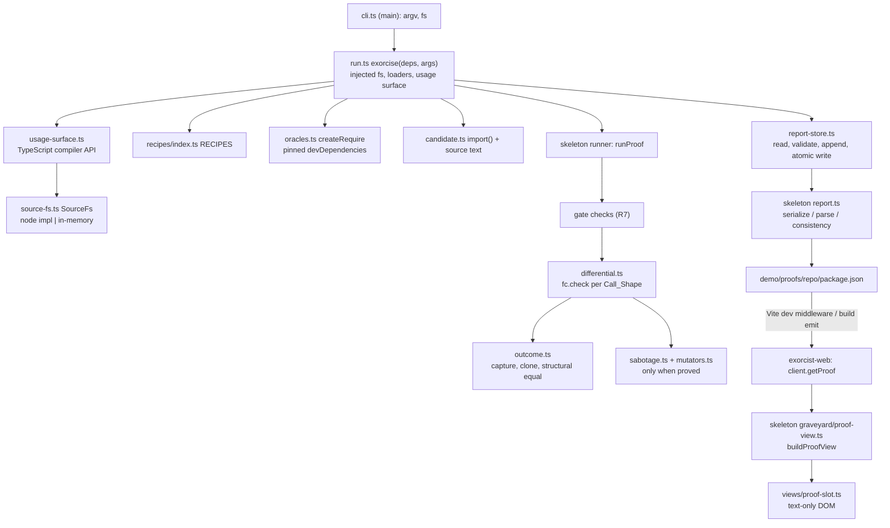

# Design

## Overview

The Proof_Harness answers one question for a dead package P in a checked-out repository: does a replacement R behave like P at the places where the repository really calls it? It answers with a status, the evidence, and, when R is wrong, the shrunk input where the two disagree. The old package is the Oracle; nothing else defines "same".

It is built from five pieces, split as `structure.md` requires (the skeleton never imports an app):

1. **Usage_Surface** (`skeleton/src/proof/usage-surface.ts` interface; `apps/exorcist-npm/src/exorcise/usage-surface.ts` npm implementation). Parses the target's source with the TypeScript compiler API and lists every import and call of P.
2. **Recipes** (`apps/exorcist-npm/src/exorcise/recipes/<package>.ts`). For a hero package: the Oracle loader, the Call_Shapes, one arbitrary per shape, the Projection, and the coverage labels.
3. **Runner** (`skeleton/src/proof/runner/`). `runProof`: gate checks, the Differential_Runner, then the Sabotage_Check with the Mutators. Generic, synchronous, never throws.
4. **Proof_Report** (`skeleton/src/proof/report.ts`) and the **Proof_Cli** (`apps/exorcist-npm/src/exorcise/cli.ts`). Canonical JSON with a strict validator; the CLI appends one attempt per run.
5. **Proof_Section** in `apps/exorcist-web` and the pure **Proof_View** in `skeleton/src/graveyard/`. It replaces the "Exorcism coming" placeholder when a report exists.

The hosted app and the tests make no network requests and no LLM calls. Tests never read the real parse-server checkout; they use small synthetic source trees.

## Goals

- A green proof is impossible without evidence: zero call sites, unsupported call sites, a bad generator, missing coverage, or a sabotage that stays green can never produce a plain "Proved".
- A red proof is real: the reported counterexample, re-run on both sides, really differs.
- The same files, recipe, candidate and seed give the same report bytes.
- The generic pieces live in the skeleton so a second ecosystem can reuse them; the npm pieces use only the adapter-specific parts.
- The page shows what happened: badge, runs and seed, call sites, attempt history with the shrunk counterexample as old output against new output, and the sabotage line.

## Non-Goals

- Running the target's own test suite (needs MongoDB), network packages, automatic rewriting of the target's code (the later power/agent spec), yarn and pnpm, transitive packages.
- Scoped package names. The report path is guarded by `^[a-z0-9][a-z0-9-]{0,63}$`, so `@scope/pkg` cannot be a report. A scoped package is a later extension of the path scheme.
- Async functions. A thenable result is an `error` (`async_not_supported`).
- Modelling JavaScript scopes, indirect uses (a function passed as a value, re-exported or aliased), and `require(variable)`. See Risks.
- Interrupting a candidate that never returns. Candidates are the user's own code; the runner is synchronous and has no timeout.

## Research Findings

Facts checked while writing this spec (read-only against `../lastrites-work/parse-server` at `3402ee6`, using the repository's own TypeScript 5.9.3; nothing from that checkout is copied or committed).

- **intersect call sites.** `src/Controllers/DatabaseController.js` imports `intersect` on line 10 and calls `intersect.big(allIds)` at 1395:25 and `intersect(allIds)` at 1397:25. `allIds` is declared with a Flow annotation (`const allIds: Array<Array<string>> = ...`). No other file in `src` or `spec` imports it.
- **Flow tolerance works.** Parsing that file with `ts.createSourceFile` and the JSX script kind yields 5 syntax diagnostics (Flow syntax) and still finds both calls. The TSX kind gives the same. So the parser must keep the tree when there are diagnostics (Requirement 2.4).
- **intersect@1.0.1 semantics** (read from the published tarball). With one argument, both `intersect(sets)` and `intersect.big(sets)` run `many(sets)`: it marks every key of the first list, advances a marker through each following list, and then walks the **last** list and pushes each element whose marker reached the end. So the result follows the order and the **duplicates of the last list**; duplicates in earlier lists do not matter; `[]` gives `[]`; a single list returns a copy of itself, duplicates included. A naive `Set`-based candidate de-duplicates, so it can disagree when the last list has a repeated element that all lists share. That is what the `duplicates-in-last-list` label forces the arbitrary to generate. Whether attempt 1 really fails is decided by the run, not assumed.
- **deep-diff call sites.** `spec/Schema.spec.js` has 10 calls of `dd`, `spec/schemas.spec.js` 12 (most spread over several lines as `expect(\n dd(...)\n).toEqual(undefined)`), `spec/MongoTransform.spec.js` 1; all with two arguments, bound by `const dd = require('deep-diff')`. Arguments are JSON-like (schema objects with `className`, `fields`, `classLevelPermissions` keys such as `'*'`, arrays, strings, booleans, numbers). The files contain 13, 14 and 1 `.toEqual(undefined)` calls, so the matcher count is at least the call count. Whether every one of the 23 sites is consumed that way is checked by the real run, and a site that is not is reported as `unsupported_call_shapes`, never skipped.
- **node-abort-controller** appears in the checkout only in `package.json` and `package-lock.json`: zero imports, zero calls.
- **Existing patterns reused.**
  - Canonical JSON and strict parse: `apps/exorcist-npm/src/scan/report.ts` (`serializeReport`, `parseReport`, `Fail`, categories, `not_canonical` by re-serializing).
  - Seeds and properties: `skeleton/src/death-score/fc-runner.ts` (`NUM_RUNS` 100, `FIXED_SEED` 20261113, `FC_SEED`/`CI` policy, `checkProperty`, `fc.stringify` for counterexamples); `apps/exorcist-npm/src/evidence/test-support/fc-runner.ts` and `sabotage-runner.ts`; `skeleton/src/graveyard/test-support/sabotage-runner.ts` (`assertAllSabotagesCaught`, the `Sabotage<F>` shape, `ensure`).
  - Sabotage lists and the central sabotage test: `scan/test-support/sabotage/scan-pN.ts`, `scan/test-support/properties/scan-pN.ts` (`build(impl)` seam), `scan/sabotage.test.ts`.
  - Name guard: `scan/api/demo-store.ts` (`DEMO_NAME_PATTERN`) and `apps/exorcist-web/vite.config.ts` (`isDemoName`, `demoNameFromPath`, `demoSnapshots()` with `configureServer` and `generateBundle`).
  - Atomic write: `scan/demo-snapshot.ts` (temp file then rename, remove the temp on failure). Script style: `vite-node src/... --`.
  - UI: `skeleton/src/graveyard/proof-slot.ts` (`ProofState`, `proofSlotFor`), `apps/exorcist-web/src/views/proof-slot.ts` (exhaustive switch), `views/detail.ts` (`renderProofSlot`), `api/client.ts` (injected `fetch`, `parseReport`), `dom/h.ts` (text-only builder), `test-support/fake-fetch.ts`, `proof.dom.test.ts`.
- **Environment facts.** `skeleton` has no `@types/node` (so the pure proof code uses no Node API and no `structuredClone`); `typescript` 5.9.3 and `fast-check` 3.23.2 are already installed (root `typescript` devDependency, `fast-check` in three packages); the root `.gitignore` excludes `node_modules/`, `dist/`, `coverage/` and `.cache/`, so fixtures cannot contain those directory names.

## Architecture



### Run flow

1. The CLI validates arguments (`parseCliArgs`, pure) and calls `exorcise(deps, args)`.
2. `exorcise` runs the Usage_Surface over `--repo`. With call sites and no `--candidate`, it stops with a usage error before touching any file.
3. It looks up the Recipe, loads the Oracle (and its installed version), loads the Candidate (dynamic `import()` plus its source text).
4. `runProof` applies the gate checks in the fixed order of Requirement 7.10, runs one property per Call_Shape that has accepted call sites, and, only for `proved`, runs the Sabotage_Check.
5. `exorcise` reads and validates the existing report (or starts a fresh one), appends the Proof_Attempt, serializes, and writes atomically.
6. The page loads `/demo/proofs/<repo>/<package>.json` on demand and renders the Proof_View.

## Components and Interfaces

### Layout

```
skeleton/
  package.json                       + deps fast-check; exports ./proof, ./proof/runner, ./proof/testing
  src/proof/
    index.ts                         pure entry: types, names, report codec (NO fast-check)
    types.ts                         CallSite, ImportSite, UsageSurface*, ProofStatus, ShapeResult,
                                     SabotageSummary, CounterexampleRecord, ProofAttempt, ProofReport
    usage-surface.ts                 UsageSurface type, compareSites, sortSites
    names.ts                         PROOF_NAME_PATTERN, isProofName, proofReportPath, parseProofReportPath
    report.ts                        serializeProofReport, parseProofReport, appendAttempt, checkConsistency
    runner/
      index.ts                       runProof, mutators, types (imports fast-check)
      types.ts                       Recipe, CallShape, Projection, ProofInput, ProofResult, Mutator
      clone.ts                       deepClone
      equal.ts                       structuralEqual
      outcome.ts                     capture, isThenable, outcomesAgree, render, resolveMember
      differential.ts                runShape (fc.check), ShapeRun
      mutators.ts                    BUILT_IN_MUTATORS, applicableMutators
      sabotage.ts                    runSabotage
      run-proof.ts                   runProof (gate order, assemble ProofResult)
    testing.ts                       synthetic recipes, arbitraries for reports and usage results
    test-support/
      synthetic-recipes.ts           pure synthetic oracles/candidates for harness tests
      arbitraries/report.ts          valid ProofReport arbitrary
      properties/proof-p2.ts ...     one file per property (build(impl) seam)
      sabotage/proof-p2.ts ...       one Sabotage_List per property
  src/graveyard/
    proof-slot.ts                    ProofState = coming_soon | loading | report (placeholders removed)
    proof-view.ts                    buildProofView, ProofView
    test-support/properties/proof-p10.ts, sabotage/proof-p10.ts

apps/exorcist-npm/
  package.json                       + devDeps intersect 1.0.1, deep-diff 1.0.2; dep typescript 5.9.3; script exorcise
  src/exorcise/
    source-fs.ts                     SourceFs interface + node implementation
    usage-surface.ts                 createUsageSurface({ fs })
    bindings.ts                      collect bindings and import sites from one SourceFile
    calls.ts                         collect call sites from one SourceFile given bindings
    consumption.ts                   detectConsumedAs(callNode)
    classify-path.ts                 enclosingOf(path)
    oracles.ts                       loadOracle(pkg) -> { module, version }
    candidate.ts                     loadCandidate(file) -> { module, name, source }
    recipes/types.ts                 AppRecipe = Recipe & { loadOracle }
    recipes/intersect.ts, deep-diff.ts, node-abort-controller.ts, index.ts
    cli-args.ts                      parseCliArgs (pure)
    report-store.ts                  readReport, writeReportAtomic (injected ReportFs)
    run.ts                           exorcise(deps, args) -> ExorciseOutcome
    cli.ts                           main()
    __fixtures__/trees/...           synthetic source trees
    test-support/                    memory-fs.ts, tree-model.ts, arbitraries, properties, sabotage
    *.test.ts

apps/exorcist-web/
  vite.config.ts                     + PROOF name guard, proofPathNames, demoProofs() plugin
  src/api/client.ts                  + getProof
  src/app/controller.ts              + lazy proof loading, abort on route change
  src/views/proof-slot.ts            renders loading / coming_soon / report
  src/views/detail.ts                + updateProof(key, state)
  src/constants.ts                   + proof copy
  src/styles/detail.css              + proof classes (existing tokens only)

demo/proofs/<repo>/<package>.json    reports (generated by the final task group)
demo/proofs/candidates/parse-server/ hero candidates written in this repository
```

`demo/proofs/candidates` is not a Proof_Name directory pair, so neither the dev middleware nor the build emit (which look at `demo/proofs/<repo>/<package>.json` with both names guarded and a `.json` suffix) will serve it. A test pins that.

### skeleton: pure types (`proof/types.ts`)

```ts
export type Enclosing = "src" | "test";
export type ImportForm =
  | "import-default" | "import-named" | "import-namespace" | "import-side-effect"
  | "import-type" | "import-equals" | "re-export" | "require" | "require-unbound" | "dynamic-import";

export interface CallSite {
  file: string; line: number; column: number;
  callee: string;            // source text of the callee expression
  member: string;            // "" | "big" | "./get.x" | "<dynamic>"
  argCount: number;
  argTexts: string[];        // collapsed whitespace, cut at 200 code units + "…"
  enclosing: Enclosing;
  consumedAs?: "undefined-check";
  new?: true;
}
export interface ImportSite { file: string; line: number; column: number; form: ImportForm }

export interface UsageSurfaceInput { root: string; package: string }
export interface UsageSurfaceResult {
  package: string; filesScanned: number;
  callSites: CallSite[]; importSites: ImportSite[]; warnings: string[];
}
export type UsageSurface = (input: UsageSurfaceInput) => Promise<UsageSurfaceResult>;

export type ProofStatus = "proved" | "counterexample" | "no-call-sites" | "error";
export type ProofErrorCode =
  | "invalid_runs" | "no_source_files" | "no_recipe" | "oracle_version_mismatch"
  | "unsupported_call_shapes" | "oracle_missing_member" | "candidate_missing_member"
  | "arbitrary_mismatch" | "async_not_supported" | "recipe_failure" | "insufficient_coverage";
export type Recommendation = "remove-dependency" | "review-imports";

export interface ShapeResult {
  id: string; status: "passed" | "failed" | "skipped" | "error";
  runs: number; coverage: Record<string, number>;     // coverage keys sorted on serialize
}
export interface SabotageSummary { applied: number; caught: number; survivors: string[] }
export interface CounterexampleRecord {
  shape: string; input: string; shrinks: number; path: string;
  oldOutput: string; newOutput: string; oldProjected: string; newProjected: string;
}
export interface ProofAttempt {
  attempt: number;
  candidate?: { name: string; source: string };
  status: ProofStatus; weak: boolean;
  numRuns: number; runs: number; seed: number;
  shapes: ShapeResult[];
  counterexample?: CounterexampleRecord;
  recommendation?: Recommendation;
  error?: { code: ProofErrorCode; message: string };
  sabotage: SabotageSummary;
}
export interface ProofReport {
  repo: string; commit?: string; package: string; oracleVersion?: string;
  filesScanned: number; callSites: CallSite[]; importSites: ImportSite[];
  attempts: ProofAttempt[];
}
```

`usage-surface.ts` also exports `compareSites(a, b)` (file by code unit, then line, then column) and `sortSites`, used by the npm implementation and by tests.

### skeleton: names (`proof/names.ts`)

```ts
export const PROOF_NAME_PATTERN = /^[a-z0-9][a-z0-9-]{0,63}$/;
export const isProofName = (s: string): boolean => PROOF_NAME_PATTERN.test(s);
/** "demo/proofs/<repo>/<package>.json" or undefined unless both are Proof_Names. */
export function proofReportPath(repo: string, pkg: string): string | undefined;
/** Inverse: { repo, package } for exactly that shape, else undefined. */
export function parseProofReportPath(path: string): { repo: string; package: string } | undefined;
```

`vite.config.ts` repeats the pattern (as it does today for demo names) and a test asserts `PROOF_NAME_PATTERN.source` equals the config's pattern source.

### skeleton: runner types (`proof/runner/types.ts`)

```ts
import type fc from "fast-check";

export type OutputKind = "array" | "object" | "boolean" | "opaque";

export interface Projection {
  name: "identity" | "isUndefined";
  observes: "value" | "definedness";
  apply(value: unknown): unknown;            // identity: v => v ; isUndefined: v => v === undefined
}

export type Outcome = { kind: "returned"; value: unknown } | { kind: "threw" };

export interface CallShape {
  id: string;                                // "intersect.big"
  member: string;                            // "" | "big"
  argCount: number;
  outputKind: OutputKind;
  orderSensitive: boolean;
  projection: Projection;
  accepts(site: CallSite): boolean;
  arbitrary: fc.Arbitrary<unknown[]>;
  guard(args: unknown[]): boolean;
  classify(args: unknown[], oracle: Outcome): string[];
  requiredLabels: readonly string[];
}

export interface Recipe { package: string; expectedVersion?: string; shapes: readonly CallShape[] }

export interface ProofInput {
  package: string;
  usage: UsageSurfaceResult;
  recipe?: Recipe;
  oracle?: unknown; oracleVersion?: string;
  candidate?: unknown;
  numRuns: number; seed: number;
  mutators?: readonly Mutator[];             // default BUILT_IN_MUTATORS (tests inject)
}

export interface ProofResult {
  status: ProofStatus; weak: boolean;
  runs: number; numRuns: number; seed: number;
  shapes: ShapeResult[];
  counterexample?: { shape: string; args: unknown[]; input: string; shrinks: number; path: string };
  oldOutput?: string; newOutput?: string; oldProjected?: string; newProjected?: string;
  callSites: CallSite[]; importSites: ImportSite[];
  recommendation?: Recommendation;
  error?: { code: ProofErrorCode; message: string };
  sabotage: SabotageSummary;
}

export interface Mutator {
  name: "reverse-array" | "drop-last" | "return-undefined" | "swap-first-two-args" | "add-key" | "return-defined";
  applicable(shape: CallShape): boolean;
  wrap(fn: (...a: unknown[]) => unknown): (...a: unknown[]) => unknown;
}
```

### skeleton: `outcome.ts`, `clone.ts` and `equal.ts`

- `capture(f): Outcome` calls `f()`; a throw (of anything) becomes `{ kind: "threw" }`; the thrown value is dropped immediately.
- `deepClone(v)`: arrays, plain objects (own enumerable string keys; `__proto__` as an own key is copied with `Object.defineProperty`, never assigned), `Date`, primitives (including `-0`, `NaN`, `undefined`, `bigint`); any other object is returned as is. Cycles are not supported (arbitraries generate trees); a guard counts depth and throws `recipe_failure` past 1000.
- `structuralEqual(a, b)`: as in Requirement 6.5.
- `outcomesAgree(projection, a, b)`: both threw → true; exactly one threw → false; else `structuralEqual(projection.apply(a.value), projection.apply(b.value))`.
- `render(v)`: `fc.stringify(v)` cut to 2000 code units plus `…`; `renderOutcome(o)` gives `<threw>` for a throw.
- `isThenable(v)`: object or function with a function `then`.

### skeleton: `differential.ts`

```ts
function runShape(shape, oracleFn, candidateFn, cfg: { numRuns; seed }): ShapeRun {
  const coverage = new Map<string, number>();
  const prop = fc.property(shape.arbitrary, (args) => {
    guardOrThrow(shape, args);                              // ArbitraryMismatch
    const a = capture(() => call(oracleFn, clone(args)));
    const b = capture(() => call(candidateFn, clone(args)));
    rejectThenables(a, b);                                  // AsyncOutput
    for (const l of safely(() => shape.classify(args, a))) coverage.set(l, (coverage.get(l) ?? 0) + 1);
    return safely(() => outcomesAgree(shape.projection, a, b));
  });
  const d = fc.check(prop, { numRuns: cfg.numRuns, seed: cfg.seed });
  ...
}
```

- `call(fn, args)` is `fn.apply(thisArg, args)`, where `thisArg` is the object holding the member (`resolveMember` returns `{ fn, thisArg }`).
- `safely` wraps recipe code (`classify`, `projection.apply`, `guard`) and rethrows as a `RecipeFailure`. `fc.check` returns a failure whose `errorInstance` is one of the three harness error classes (`ArbitraryMismatch`, `AsyncOutput`, `RecipeFailure`) → the shape result is `error` with the matching code; `errorInstance` null or any other error → `failed` with a counterexample.
- For a counterexample the runner takes `d.counterexample[0]` (the shrunk args array), re-runs both sides on fresh clones to obtain the outputs to render (so the rendered outputs are exactly what a re-run gives), and records `input = fc.stringify(args)`, `shrinks = d.numShrinks`, `path = d.counterexamplePath`.
- `ShapeRun = { id, status, runs: d.numRuns, coverage, counterexample?, error? }`.

### skeleton: `mutators.ts`

```ts
export const BUILT_IN_MUTATORS: readonly Mutator[] = [
  { name: "reverse-array",       applicable: s => s.outputKind === "array" && s.projection.observes === "value",
    wrap: f => function (this: unknown, ...a) { const r = f.apply(this, a); return Array.isArray(r) ? [...r].reverse() : r; } },
  { name: "drop-last",           applicable: same,
    wrap: ... Array.isArray(r) ? r.slice(0, -1) : r },
  { name: "return-undefined",    applicable: () => true,  wrap: f => function () { f.apply(this, a); return undefined; } },
  { name: "swap-first-two-args", applicable: s => s.argCount >= 2 && s.orderSensitive,
    wrap: f => function (this, ...a) { return f.apply(this, a.length >= 2 ? [a[1], a[0], ...a.slice(2)] : a); } },
  { name: "add-key",             applicable: s => s.outputKind === "object" && s.projection.observes === "value",
    wrap: ... isPlainObject(r) ? { ...deepClone(r), __sabotage__: true } : r },
  { name: "return-defined",      applicable: s => s.projection.observes === "definedness",
    wrap: f => function () { f.apply(this, a); return Object.freeze({ __sabotage__: "defined" }); } },
];
```

Every wrapper calls the real function first (so a throwing candidate still throws, and side effects stay the same) and returns a new value; none writes to its inputs.

`return-defined` and the `definedness` Projection are an addition to the brief's list of mutators. Without it the `deep-diff` proof could not show that the arbitrary produces equal pairs (a candidate that always reports a difference would pass if the arbitrary never made equal inputs). See Decision 6.

### skeleton: `sabotage.ts`

```ts
export function runSabotage(shapes: ShapeRun[], oracleResolve, candidateResolve, cfg, mutators): SabotageSummary {
  // for each shape that ran, for each mutator in order that is applicable:
  //   mutantFn = mutator.wrap(candidateFn); run = runShape(shape, oracleFn, mutantFn, cfg)
  //   run.status === "failed" -> caught; else survivor "<shape.id>:<mutator.name>"
}
```

A mutant run that ends in `error` (for example `async_not_supported`) cannot happen if the real candidate run passed, because wrappers return plain values; if it does, it is recorded as a survivor (the mutant was not shown to fail).

### skeleton: `run-proof.ts`

```ts
export function runProof(input: ProofInput): ProofResult
```

Gate order: `invalid_runs` (numRuns not an integer ≥ 100) → `no_source_files` → `no-call-sites` (+ recommendation) → `no_recipe` → `oracle_version_mismatch` → per-site acceptance → `unsupported_call_shapes` → member resolution (`oracle_missing_member`, then `candidate_missing_member`) → run every shape with accepted sites → collect errors in shape order (`arbitrary_mismatch`, `async_not_supported`, `recipe_failure` take the first) → any `failed` → `counterexample` (first failing shape in recipe order supplies the counterexample) → any passed shape with a missing required label → `insufficient_coverage` → `proved` → Sabotage_Check → `weak`.

The whole function is wrapped in one `try`; an unexpected throw becomes `error` with code `recipe_failure` and a generic message, never a stack trace.

### npm: `source-fs.ts` and `usage-surface.ts`

```ts
export interface DirEntry { name: string; kind: "file" | "dir" | "other"; size?: number }
export interface SourceFs {
  readDir(dir: string): Promise<DirEntry[] | undefined>;   // undefined: not a readable directory
  readText(file: string): Promise<string | undefined>;     // undefined: unreadable
}
export function createNodeSourceFs(): SourceFs;            // fs.readdir withFileTypes; lstat semantics, no symlink follow
export function createUsageSurface(deps: { fs: SourceFs }): UsageSurface;
```

The walker joins paths with `/`, sorts nothing (order is restored by the final sort), skips by directory name, filters by extension, skips `*.d.ts` variants, skips entries whose `size` exceeds 2 MiB (when `size` is unknown it reads and checks the text length). For each file it calls `parseSource(file, text)`, which does `ts.createSourceFile(file, text, ScriptTarget.Latest, true, kind)` and returns `{ importSites, callSites, diagnostics }`. `diagnostics` is read from the internal `parseDiagnostics` array through one narrow cast in `syntaxDiagnosticCount(sf)`; a test pins that it is positive for `const x = ;`, and `typescript` is pinned to an exact version so a change cannot go unnoticed.

`bindings.ts` collects, in one tree walk, a `Map<localName, memberPrefix>` (first binding in source order wins for a repeated name) and the Import_Sites. `calls.ts` walks the tree again and for every `CallExpression` and `NewExpression` resolves the callee with `rootOf(expression)`: strip parentheses and non-null assertions, then follow `PropertyAccessExpression` (including `?.`), `ElementAccessExpression` with a string or no-substitution template literal key, and a `CallExpression` of `require("P")` as the root. A non-literal key yields the member segment `<dynamic>`. The `member` is `prefix` joined with the path by `.`; a subpath specifier yields the prefix `./<subpath>`.

Nested calls fall out of the recursion: the walker records the call, then continues into its callee and arguments. A `require("P")` call that is the root of a callee chain is both an Import_Site (`require-unbound` or `require`) and part of a Call_Site.

`consumption.ts` `detectConsumedAs(call)` climbs: parentheses are skipped; case (a) parent is the only argument of an `expect(...)` call, whose parent chain is property accesses (`.not` allowed) ending in a matcher call; case (b) parent is a `BinaryExpression` with `===` or `!==` and the other operand `undefined` or `void 0`.

`classify-path.ts` `enclosingOf(file)` implements Requirement 2.7 on the already-relative path.

Fixtures for Requirement 17: under `__fixtures__/trees/` there are `intersect-like/` (a Flow-annotated `src/Controllers/Db.js` with `import intersect from 'intersect'`, `intersect.big(allIds)` and `intersect(allIds)`, and a decoy `src/other.js` calling `other.big(x)`), `deep-diff-like/spec/*.spec.js` (single-line and multi-line `expect(dd(a, b)).toEqual(undefined)`, one `dd` call consumed another way, to exercise `unsupported_call_shapes`), and `declared-only/` (a `package.json` listing the package and a `src/index.js` that never imports it). Directories named `node_modules` and `dist` are built in a temporary directory by the tests that need them.

### npm: oracles, candidate, recipes

- `oracles.ts`: `loadOracle(pkg)` uses `createRequire(import.meta.url)` to `require(pkg)` and to read `<pkg>/package.json` for the version. A package that is not a pinned oracle returns `undefined`.
- `candidate.ts`: `loadCandidate(file)` reads the text, `await import(pathToFileURL(abs).href)`, and returns `{ module: ns.default ?? ns, name: basename, source }`.
- `recipes/index.ts`: `export const RECIPES: ReadonlyMap<string, AppRecipe>`.

`recipes/intersect.ts`

```ts
const ID = fc.stringOf(fc.constantFrom(..."0123456789abcdefABCDEF_ü"), { minLength: 10, maxLength: 24 });
const LIST = fc.array(ID, { maxLength: 8 });              // duplicates allowed
const ARG = fc.array(LIST, { maxLength: 6 });
// to make overlaps common, bias lists to draw from a shared pool: fc.oneof(independent, pooled)
shape("intersect", member "", ...); shape("intersect.big", member "big", ...)
classify: ["single-list" | "multi-list", "empty-result" | "non-empty-result",
           "duplicates-in-last-list" (the last list has a repeated element that is in the result)]
requiredLabels: all five
```

`recipes/deep-diff.ts`: `treeArb` (depth ≤ 4; keys from `["a","b","*","_id","className","fields","type"]`; leaves are strings, integers, booleans, `null`), `pairArb = fc.oneof(cloneReordered, cloneWithOneChange, independent)` where `cloneReordered` deep-clones the tree and reverses the key order of every object; `cloneWithOneChange` picks a random path and replaces, adds or deletes one value. `classify` labels `equal-pair` when the Oracle's result is `undefined`, else `unequal-pair`. `accepts` requires `consumedAs === "undefined-check"`.

`recipes/node-abort-controller.ts`: `{ package, shapes: [] }`, no `loadOracle`.

The `isUndefined` Projection is justified by the call sites, not assumed: `accepts` is false for any site not consumed as an undefined check, and that makes the whole proof an `unsupported_call_shapes` error.

### npm: `cli-args.ts`, `report-store.ts`, `run.ts`, `cli.ts`

```ts
export interface CliArgs {
  repo: string; package: string; candidate?: string; runs: number; seed: number;
  out?: string; label?: string; commit?: string; fresh: boolean;
}
export type CliParse = { ok: true; args: CliArgs } | { ok: false; message: string };
export function parseCliArgs(argv: readonly string[]): CliParse;      // pure, total

export interface ReportFs {
  readText(path: string): Promise<string | undefined>;
  writeAtomic(path: string, text: string): Promise<void>;     // temp in same dir, rename, rm temp on failure
}
export interface ExorciseDeps {
  usageSurface: UsageSurface; fs: ReportFs; recipes: ReadonlyMap<string, AppRecipe>;
  loadOracle(pkg: string): { module: unknown; version: string } | undefined;
  loadCandidate(file: string): Promise<{ module: unknown; name: string; source: string }>;
  repoRoot: string;                                           // for the default --out
  print(line: string): void;
}
export type ExorciseOutcome =
  | { exit: 0; attempt: ProofAttempt; path: string }
  | { exit: 1 | 2; message: string };
export async function exorcise(deps: ExorciseDeps, args: CliArgs): Promise<ExorciseOutcome>;
```

`exorcise` never throws: file and load errors become `{ exit: 1, message }`. It builds the report header from the fresh usage scan: `repo = label ?? basename(repo)`, `callSites` and `importSites` from the scan, `oracleVersion` from the loaded Oracle. The comparison with an existing report uses `serializeProofReport` of the header parts, not object identity. The default seed is `FIXED_SEED` (20261113) from the skeleton's `fc-runner`, so rerunning the CLI gives the same file.

### skeleton: `report.ts`

`serializeProofReport` builds each object field by field in the fixed order below (never relying on input key order), then `JSON.stringify(obj, null, 2) + "\n"`. `coverage` keys are sorted by code unit. `parseProofReport` is a strict structural walk (copying the `Fail` pattern of `scan/report.ts`: `field`, `describe`, `Object.hasOwn`, unknown keys rejected, numbers must be integers where integers are specified, `-0` rejected), then `checkConsistency(report)` for Requirement 9.7, then a re-serialization comparison for `not_canonical`. The order of the three phases gives `wrong_type`/`missing_field` before `inconsistent` before `not_canonical`.

`appendAttempt(report, attempt)` returns a new report with the attempt added (its `attempt` number is `attempts.length + 1`); it does not mutate.

### skeleton: `graveyard/proof-view.ts` and `proof-slot.ts`

```ts
export type ProofBadge = "proved" | "weak" | "counterexample" | "no_call_sites" | "error";
export interface AttemptView {
  attempt: number; badge: ProofBadge; badgeLabel: string; candidateName?: string;
  runsText: string; seedText: string; sabotageLine: string;
  counterexample?: { shape: string; input: string; oldOutput: string; newOutput: string; oldProjected: string; newProjected: string };
  errorText?: string;
}
export interface ProofView {
  badge: ProofBadge; badgeLabel: string; runsText: string; seedText: string; sabotageLine: string;
  callSites: Array<{ label: string; enclosing: "src" | "test" }>; callSiteTotal: number; moreCount: number;
  attempts: AttemptView[]; recommendation?: string;
}
export const MAX_CALL_SITES_SHOWN = 50;
export function buildProofView(report: ProofReport): ProofView;   // total, pure
```

`ProofState` becomes `coming_soon | loading | report`. The types `ProofLeg`, `Counterexample`, `SabotageResult` and the variants `no_call_sites`, `running`, `failed`, `verified` are removed in the same task that updates their only users (`proof-slot.test.ts` and `views/proof-slot.ts`); a `grep` in that task confirms nothing else imports them.

### web: client, middleware, controller, views

- `api/client.ts`: `getProof(demo, pkg, signal): Promise<ProofLoad>` where `ProofLoad = { ok: true; report } | { ok: false; reason: "absent" | "invalid" | "failed" }`. It reuses the private `request` helper (same timeout and abort handling as `getDemo`), requests `${base}/demo/proofs/${demo}/${pkg}.json`, and parses with `parseProofReport`. A `200` body that is not JSON (the Vite dev SPA fallback) is `absent`. No `/api` fallback, no retry.
- `vite.config.ts`: `PROOF_NAME_PATTERN` copy, `isProofName`, `proofNamesFromPath(path)` (matches `^/demo/proofs/([^/]+)/([^/]+)\.json$`, both guarded), and a second plugin `demoProofs()` registered after `demoSnapshots()`. Its middleware serves the file or answers 404 for a guarded name, and calls `next()` for anything else. `generateBundle` walks `demo/proofs/*/*.json` with `readdirSync` (skipping non-directories and non-`.json` files) and emits `demo/proofs/<repo>/<package>.json` only for guarded pairs. The existing `demoSnapshots()` already ignores the `proofs` directory (its regex needs a `.json` suffix).
- `app/controller.ts`: a `proofs: Map<string, Promise<ProofLoad>>` keyed `demo/package`, created on first open of a dead or dying package from a demo source, and an `AbortController` replaced on every route change. `detail.open` receives the initial `ProofState` (`loading` when a request is started, `coming_soon` for live scans, invalid names, or graves without a slot); when the promise settles the controller calls `detail.updateProof(grave.key, state)`.
- `views/detail.ts`: `updateProof(key, state)` finds `section.proof` inside the open panel, and replaces its children only when the open grave has that key. It sets no focus, calls no `scrollIntoView`, and leaves the panel's `aria-labelledby` alone.
- `views/proof-slot.ts`: `renderProofState` is still an exhaustive switch over `coming_soon`, `loading`, `report`. The `report` case builds, with `h()` and text only: a badge `span.proof-badge.proof-badge-<badge>` whose text is the label; a `p` with runs and seed; the sabotage line; the recommendation; `details > summary` for the call sites (`ul > li` with the `file:line` text and a `src`/`test` tag in text); and an `ol` of attempts, each `li` with its badge label, candidate name, runs/seed, sabotage line, and for a counterexample three labelled `pre` blocks (`Shrunk input`, `Old output`, `New output`). Every report string goes through `textContent` (`h` does that already); no `innerHTML`.
- Styling reuses existing tokens only. New class names are added to the `ClassName` type and to the stylesheet in the same task, and the existing class-vocabulary test and `checkStylesheet` (S1 to S7) keep passing.

## Data Models

### Proof_Report key order

| Object | Keys in order |
|---|---|
| report | `repo`, `commit`?, `package`, `oracleVersion`?, `filesScanned`, `callSites`, `importSites`, `attempts` |
| callSite | `file`, `line`, `column`, `callee`, `member`, `argCount`, `argTexts`, `enclosing`, `consumedAs`?, `new`? |
| importSite | `file`, `line`, `column`, `form` |
| attempt | `attempt`, `candidate`?, `status`, `weak`, `numRuns`, `runs`, `seed`, `shapes`, `counterexample`?, `recommendation`?, `error`?, `sabotage` |
| candidate | `name`, `source` |
| shape | `id`, `status`, `runs`, `coverage` (keys sorted) |
| counterexample | `shape`, `input`, `shrinks`, `path`, `oldOutput`, `newOutput`, `oldProjected`, `newProjected` |
| error | `code`, `message` |
| sabotage | `applied`, `caught`, `survivors` |

Integers only (never `-0`, never fractions); strings may hold any Unicode; arrays and objects are never `null`; absent optional fields are omitted, never `null`.

### Consistency rules (Requirement 9.7) as code

`checkConsistency` returns the first violated rule with a path message such as `attempts[1].sabotage.applied is 4 but caught + survivors is 3`. `weak` must equal `status === "proved" && (applied === 0 || survivors.length > 0)`. A `proved` attempt requires `report.callSites.length > 0`. A `no-call-sites` attempt requires `callSites.length === 0` and a `recommendation`; the recommendation must be `remove-dependency` exactly when `importSites.length === 0`.

### Error codes and what each means

| Code | Condition | Where decided |
|---|---|---|
| `invalid_runs` | `numRuns` not an integer ≥ 100 | `runProof` |
| `no_source_files` | `filesScanned` is 0 (root unreadable, or no source files) | `runProof` |
| `no_recipe` | call sites exist, package has no Recipe | `runProof` |
| `oracle_version_mismatch` | installed version differs from `expectedVersion` | `runProof` |
| `unsupported_call_shapes` | a call site is accepted by no shape | `runProof` |
| `oracle_missing_member` / `candidate_missing_member` | no function at a shape's member (or no candidate at all) | `runProof` |
| `arbitrary_mismatch` | a generated value fails `guard` | runner |
| `async_not_supported` | a thenable result | runner |
| `recipe_failure` | recipe code threw, or an unexpected internal throw | runner |
| `insufficient_coverage` | a required label never produced | runner |

## Decisions and Requirement Clarifications

1. **The skeleton has two entry points for proof code.** `./proof` is pure (types, names, report codec) and `./proof/runner` imports `fast-check`. The page imports `./proof` only, so `fast-check` stays out of the bundle. A static test walks the import graph of `proof/index.ts` and fails if it reaches `fast-check` or a `runner/` file.
2. **`runProof` is synchronous and takes already-loaded modules.** Loading (dynamic `import`, `createRequire`) is app code. This keeps the skeleton free of Node APIs (it has no `@types/node`) and makes every gate testable with plain functions.
3. **`fast-check` becomes a skeleton dependency.** Today it is a devDependency; `differential.ts` is production code that imports it. The version already installed (3.23.2) is used.
4. **A call site no shape accepts is an error, not a skip.** A partial proof that quietly leaves call sites out would break migration rule 3. For `deep-diff` this also means the `isUndefined` Projection is only valid because every site is consumed as an undefined check, which the usage surface verifies.
5. **Attempts of every status are recorded.** Otherwise a user could hide a counterexample by re-running until green. History is the point of the file.
6. **Two additions to the brief's mutator list, for honesty.** `return-defined` exists because a `definedness` Projection (`deep-diff`) has no array or object output to reverse or extend, and without a mutant that is *always different* the proof would not show that equal pairs are generated. The Coverage_Labels (`equal-pair`, `unequal-pair`) with `requiredLabels` do the same job from the other side; both are kept (belt and braces). `swap-first-two-args` is applicable only when the Recipe says `orderSensitive`, because for a symmetric result (the `deep-diff` equality projection) the mutant is equivalent to the original and would be a false survivor. The property "Sabotage completeness" fails if a Recipe claims order sensitivity that the Oracle does not have.
7. **Zero applicable mutants is unreachable with the built-ins.** `return-undefined` is always applicable, so a proved attempt always has `applied` ≥ 1. The `applied === 0` branch of `weak` stays (Requirement 8.6) and is exercised by injecting an empty mutator list.
8. **Mutants wrap the Candidate, and Property 4 wraps the Oracle.** The report's sabotage section answers "can this proof fail?" for the candidate that was run. Property 4 checks the same mutators against the Oracle for every Recipe, which checks the Recipes and the mutators, not any particular candidate.
9. **Seeds.** One seed per attempt is passed to every shape and every mutant run, the default is `FIXED_SEED`, and `--seed` overrides it. Reproducing a counterexample is `--seed <n>` with the same candidate.
10. **`runs` counts executed runs.** On a counterexample it is smaller than `numRuns × shapes`. `numRuns` records what was configured.
11. **`consumedAs` is syntactic.** The detection reads one file's tree. A helper that wraps `expect(...).toEqual(undefined)` in a custom function is not detected, so its site is unsupported and the run says so.
12. **Over-approximation by design.** Bindings are resolved by name within a file with no scope model; a shadowed local with the same name can add a false call site, never hide a real one. For the "no call sites, remove it" claim, false sites are the safe direction.
13. **Subpath specifiers** (`P/sub`) are import sites and their calls get a `./sub...` member that no hero shape accepts, so they surface as `unsupported_call_shapes`, not as silence.
14. **Report location and names.** `demo/proofs/<repo>/<package>.json`, both Proof_Names. The repo directory is the demo name (`parse-server`), not `owner/repo`; the report's `repo` field holds the label. Scoped packages are out of scope (Non-Goals).
15. **No time, no paths in the report.** That makes Property 5 possible and keeps the demo files diffable. The checkout is identified by the label and the optional commit string the user passes.
16. **The CLI exit code is not the proof verdict.** Exit 0 means "an attempt was recorded". Scripts that want a verdict read the file. A failing exit code on a counterexample would make the expected `intersect` attempt 1 look like a broken command.
17. **Candidates are plain files in this repository** (`demo/proofs/candidates/parse-server/`), written by hand for the demo. They are evidence, so the report embeds their full source text.
18. **UI loads the report lazily on panel open.** A demo such as parse-server has many dead and dying packages; fetching a file for each at page load would be wasteful, and most have no report. A 404 costs one small request per opened panel.
19. **Placeholder variants are removed, not extended.** `no_call_sites`, `running`, `failed`, `verified` in `ProofState` were a sketch for this spec. One `report` variant with a view model replaces them; keeping both would leave unrenderable states.
20. **Seed policy for tests** follows `fc-runner.ts` (`numRuns` 100, `CI` fixed seed, `FC_SEED` replay). The CLI uses its own explicit seed and never reads the environment.

## Risks

- **Indirect uses are not call sites.** `const f = dd; f(a, b)`, `arr.map(intersect)`, `module.exports = require('P')` and re-exports are visible only as Import_Sites. A proof covers direct calls. The page says "call sites" and lists the import sites in the report; closing the gap (alias tracking) is a later extension.
- **The internal `parseDiagnostics` field.** Diagnostics are read from an internal property. `typescript` is pinned and a test pins the behavior. If it ever breaks, the fallback is to drop the per-file warning, not the scan.
- **A real `deep-diff` or `intersect` outcome may differ from the expectation here.** The run decides. The spec does not assert a hero outcome in any test (Requirement 16.7).
- **Arbitrary quality is the weak point of every property-based proof.** Coverage labels, the `guard` check, and the Sabotage_Check bound the risk but cannot remove it. The report shows the labels' counts so a reviewer can see what was exercised.
- **Run time.** 1000 runs per shape plus up to 6 mutant runs per shape is fast for `intersect` and `deep-diff` (small values). Property 1 and Property 4 run the real Recipes with `numRuns` 100 in the outer property and the minimum 100 runs inside, which is about 10^4 oracle calls per recipe per property.
- **A candidate with a side effect or an infinite loop.** Out of scope (Non-Goals); it is the user's own code run in the user's own process.
- **The `.gitignore` excludes `node_modules` and `dist`.** Fixtures cannot hold them; tests create them in a temporary directory (Requirement 17.3).
- **Browser verification.** DOM tests run in jsdom. The visual check of the Proof_Section in a browser is a manual task, recorded in the log as done or not run.

## Correctness Properties

A property is a characteristic that should hold across all valid executions. All properties use `numRuns: 100`, the seed policy of `fc-runner.ts`, and print the seed and shrunk counterexample on failure. Each is written as `build(impl)` so the central sabotage test can swap the implementation, and each has a Sabotage_List `proof-pN.ts`. Properties 1 to 6 are the six named in the brief; 7 to 11 are additive (tech steering: every pure module gets a property).

Shared helpers: `synthetic-recipes.ts` (pure oracles and shapes: `sort-unique` over integer arrays, `guarded-sqrt` that throws on negatives with a message containing the input, `subtract(a, b)` order sensitive, `make-record` returning objects, `first-of-two`), `memory-fs.ts` (a `SourceFs` over a generated tree, with a shuffle option for listing order), and `tree-model.ts` (the Property 6 generator and its expected result).

### Property 1: Differential soundness

*For any* Recipe among `intersect`, `deep-diff` and the synthetic recipes, *any* generated set of 1 to 5 accepted call sites per shape, *any* seed and `numRuns` of 100, and *any* Candidate that is the Oracle itself or a call-through wrapper of it (`(...a) => oracle.apply(this, a)`), `runProof` returns status `proved` with no `counterexample` and `error` absent.

- Arbitrary: recipe, per shape a site count and `consumedAs` set as the shape requires, seed, candidate form.
- **Validates: Requirements 6.1 to 6.5, 6.7, 7.9, 15.1 to 15.4**
- Sabotage list `proof-p1.ts`:
  - (a) *compare outputs with `===`* (required by Requirement 18.5);
  - (b) *compare thrown messages* (the `guarded-sqrt` recipe throws different messages on each side);
  - (c) *call without `this`* (breaks a synthetic recipe whose member reads `this`);
  - (d) *project only the Oracle side*;
  - (e) *compare with `JSON.stringify`* (drops `undefined` members and `NaN` differences).

### Property 2: Counterexample reality

*For any* synthetic Oracle and *any* Candidate from a generated fault family (identity, de-duplicate, reverse, drop-last, off-by-one on a generated threshold, throw on empty, mutate its input, swap arguments) with a generated seed, whenever `runProof` returns `counterexample`: re-running the Oracle and the Candidate on fresh clones of `counterexample.args` gives different Outcomes under the Projection (or exactly one throws); `input` equals `fc.stringify(args)`; `oldOutput` and `newOutput` equal the rendering of those re-run Outcomes; `args` passes `guard`; and `shape` names a shape that ran. Whenever the Candidate is equivalent to the Oracle on a large independent sample, the status is `proved`.

- **Validates: Requirements 6.6, 6.8, 7.9**
- Sabotage list `proof-p2.ts`:
  - (a) *report the pre-shrink arguments*;
  - (b) *swap old and new output*;
  - (c) *render the new output from a different call*;
  - (d) *pass the same argument object to both sides* (a mutating candidate changes what the Oracle sees, so the counterexample no longer reproduces);
  - (e) *report `counterexample` with the arguments of the last passing run*.

### Property 3: No trivial passes

*For any* generated `ProofInput` (files scanned 0 to 3; 0 to 6 call sites with random members, argument counts, `consumedAs` and `new` flags; 0 to 3 import sites; a synthetic recipe with a chosen defect: none, an arbitrary whose values fail `guard`, a shape whose arbitrary never produces a required label, a shape that accepts nothing, an Oracle or Candidate without the member, a version mismatch; a missing recipe; `numRuns` from 99 to 120), `runProof` returns the status the reference model in the test derives from Requirement 7.10, in particular: no call sites ⇒ `no-call-sites` (never `proved`), with zero shape runs and the recommendation `remove-dependency` iff there are zero import sites; an unaccepted call site ⇒ `unsupported_call_shapes`; a bad guard ⇒ `arbitrary_mismatch`; a missing required label ⇒ `insufficient_coverage`; and `proved` ⇒ every condition of Requirement 7.9 holds, computed independently from the input.

- **Validates: Requirements 5.7, 5.8, 7.1 to 7.10**
- Sabotage list `proof-p3.ts`:
  - (a) *return `proved` for zero call sites* (required by Requirement 18.5);
  - (b) *ignore unaccepted call sites*;
  - (c) *skip the `guard` check*;
  - (d) *skip the coverage check*;
  - (e) *run shapes that accept nothing*;
  - (f) *treat `filesScanned` 0 as fine*;
  - (g) *always recommend `remove-dependency`*;
  - (h) *check the gates in a different order*.

### Property 4: Sabotage completeness

*For every* Recipe with shapes (`intersect`, `deep-diff`, and the synthetic recipes that include an order-sensitive two-argument shape and an object-output shape), *every* shape, and *every* Mutator applicable to it per the table in Requirement 8.3, and *for any* seed and `numRuns` of 100 or more, running the Differential_Runner with the Candidate set to the **Mutator applied to the Oracle itself** returns a counterexample. Also, for every Mutator listed as not applicable the property asserts the reason stated in the table (for example, `swap-first-two-args` is not applicable to `deep-diff` because `orderSensitive` is false), so the table in code and in this document cannot drift.

- **Validates: Requirements 8.2, 8.3, 8.4, 8.8**
- Sabotage list `proof-p4.ts`:
  - (a) *a Mutator that returns the original output* (does not change what it claims; required by Requirement 18.5);
  - (b) *an `intersect` arbitrary limited to lists of length 0 or 1* (reverse and drop-last cannot be seen);
  - (c) *a `deep-diff` arbitrary that never makes equal pairs* (`return-defined` survives);
  - (d) *a Recipe that claims `orderSensitive` for a symmetric function*;
  - (e) *a Recipe that declares `outputKind` `array` for an object output* (`reverse-array` and `drop-last` then change nothing and survive).

### Property 5: Determinism

*For any* generated `ProofInput` (synthetic usage, recipe, Candidate fault, seed, `numRuns` 100), the report text `serializeProofReport(appendAttempt(header, attemptOf(runProof(input))))` is byte-identical across three runs, where between the runs the test consumes a random amount of `Math.random()`, sets `Date.now` to different values and creates unrelated fast-check arbitraries. The text contains no ISO timestamp, no absolute path of the test process, and no digit sequence equal to the current time.

- **Validates: Requirements 6.3, 6.11, 9.4**
- Sabotage list `proof-p5.ts`:
  - (a) *put the current time in the report* (required by Requirement 18.5);
  - (b) *put `Math.random()` in the message of an error*;
  - (c) *use a fresh random seed when none is given*;
  - (d) *include `process.cwd()` in the candidate name*;
  - (e) *derive the coverage key order from a `Map` filled in finishing order of a shuffled shape list*.

### Property 6: Usage-surface determinism and completeness

*For any* generated small source tree (1 to 6 files with paths in nested directories, extensions `.js`, `.jsx`, `.mjs`, `.ts`, `.tsx`, some under `spec/`, `test/`, `__tests__/`, some under `node_modules`, `dist`, `build`, `coverage`; each file a list of statements generated from a model, one statement per line with known offsets):

- statements: each import and require form of Requirement 3.1 (including a subpath specifier), plain, member, element-access, optional-chain, `new` and nested calls of the bound names, immediate `require("P")(...)`, decoys (calls of unbound names, a same-named method on another object, calls of another package's binding, text inside strings and comments, a call of a binding in a file that does not import the package), Flow-style annotations on declarations, and call results wrapped as `expect(...).toEqual(undefined)`, `.not.toBeUndefined()`, `x === undefined`, `undefined !== x`, `x == undefined`, or left bare;

the npm usage surface returns:

- exactly the model's call sites, each once (file, line, column, callee, member, argCount, argTexts, `enclosing`, `consumedAs` iff wrapped as in Requirement 4.1 or 4.2, `new`), none from skipped directories or decoys, in sorted order;
- exactly the model's import sites with their forms;
- `filesScanned` equal to the number of eligible files;
- deep-equal results when the in-memory file system lists the files in a different order, and when run twice.

- Arbitrary: the tree model in `tree-model.ts` (it also produces the expected result, so no second implementation of the parser is written).
- **Validates: Requirements 1.5 to 1.7, 2.1 to 2.4, 2.7, 3.1 to 3.9, 4.1 to 4.3**
- Sabotage list `proof-p6.ts` (a wrapper around the real usage surface or a `SourceFs` filter, so each wrong implementation stays small):
  - (a) *skip `.js` files that contain a type annotation* (required by Requirement 18.5);
  - (b) *count a nested call once* (required by Requirement 18.5);
  - (c) *count the `expect(...)` call as a call of the bound name*;
  - (d) *ignore `new` expressions*;
  - (e) *read `node_modules`*;
  - (f) *ignore optional chaining*;
  - (g) *ignore string-literal element access*;
  - (h) *treat `== undefined` as an undefined check*;
  - (i) *classify `enclosing` by directory only*;
  - (j) *sort by `localeCompare`*;
  - (k) *return the files in listing order*.

### Property 7: Sabotage accounting and the weak flag

*For any* generated synthetic recipe (shape count 1 to 3; `outputKind` from the four kinds; `argCount` 1 to 3; `orderSensitive` true or false, deliberately wrong for symmetric functions; oracle outputs of maximum length 0, 1, 2 or 5 so that some mutants survive), any mutator list (the built-ins, a subset, or empty) and any seed: `sabotage.applied` equals the number of applicable (shape, mutator) pairs among shapes that ran; `applied` equals `caught` plus `survivors.length`; survivors are unique, well-formed `<shape id>:<mutator name>`, and listed in shape order then mutator order; `weak` equals `status === "proved" && (applied === 0 || survivors.length > 0)`; and for every non-proved status `sabotage` is `{0,0,[]}` and `weak` is false. The run is also wrapped by a check that no Mutator modified the Candidate module, the Oracle module or the arguments (deep-frozen inputs).

- **Validates: Requirements 8.1, 8.5, 8.6, 8.7**
- Sabotage list `proof-p7.ts`:
  - (a) *`weak` ignores survivors*;
  - (b) *`weak` false when `applied` is 0*;
  - (c) *survivors include the caught mutants*;
  - (d) *run the Sabotage_Check for a `counterexample` status*;
  - (e) *count `applied` before filtering by applicability*;
  - (f) *survivors in discovery order of a reversed mutator list*;
  - (g) *a Mutator that writes into its argument*.

### Property 8: Outcome equivalence including exceptions

*For any* generated values (primitives with `-0`, `NaN`, `undefined` and `bigint`; arrays; plain objects with keys including `__proto__` as an own key and `constructor`; `Date`; class instances; nested to depth 4) and *any* generated pair of functions that throw or return based on the input with random messages: `structuralEqual` is reflexive and symmetric; permuting the key order of every object preserves equality; `-0` and `0` differ and `NaN` equals `NaN`; array order matters; two `Date`s compare by time; two distinct class instances are different even with equal fields; `deepClone(x)` is structurally equal to `x`, is not the same object for objects and arrays, and preserves `-0`, `NaN`, `undefined` and own `__proto__` keys; `outcomesAgree` is true when both threw (any messages), false when exactly one threw, and equals the projection comparison otherwise.

- **Validates: Requirements 6.4 to 6.6**
- Sabotage list `proof-p8.ts`:
  - (a) *compare thrown messages*;
  - (b) *treat `-0` as `0`*;
  - (c) *`NaN` is never equal*;
  - (d) *objects are key-order sensitive*;
  - (e) *sort arrays before comparing*;
  - (f) *compare with `JSON.stringify`*;
  - (g) *`deepClone` returns the same object*;
  - (h) *`deepClone` assigns `__proto__` instead of defining it*.

### Property 9: Proof_Report codec

*For any* valid, consistent Proof_Report generated field by field (0 to 8 call sites and import sites; 1 to 4 attempts built per status so that Requirement 9.7 holds; Unicode and escaped strings in `source`, `input` and outputs; empty and non-empty arrays; all statuses): `parseProofReport(serializeProofReport(r))` is `ok` and deep-equals `r`; `serializeProofReport(parse(text).report) === text`; any single edit that keeps the text valid JSON but changes whitespace, key order, adds a key, drops the trailing newline or turns an integer into `1.0` is rejected, never accepted; deleting a required field gives `missing_field` naming its path; changing a field to the wrong type gives `wrong_type`; each consistency rule of Requirement 9.7 broken alone gives `inconsistent`; and `parseProofReport` never throws on arbitrary strings, including `__proto__` keys, deep nesting and huge numbers.

- **Validates: Requirements 9.1 to 9.7**
- Sabotage list `proof-p9.ts`:
  - (a) *four-space indent*;
  - (b) *no trailing newline*;
  - (c) *key order taken from the input*;
  - (d) *absent optional field written as `null`*;
  - (e) *lenient parse that skips the canonical comparison* (required by Requirement 18.5);
  - (f) *skip the consistency check*;
  - (g) *parse throws on empty text*;
  - (h) *parse fills a missing field*;
  - (i) *accept an unknown key*.

### Property 10: Proof_View faithfulness

*For any* valid Proof_Report (the Property 9 arbitrary, deep-frozen before the call), `buildProofView` returns without throwing and without modifying its input, and: `badge` is `weak` iff the last attempt is proved and weak, else `proved`, `counterexample`, `no_call_sites` or `error` by the last attempt's status, with the label table of Requirement 12.2; `attempts` has the report's length in the report's order; the sabotage line of a proved attempt is exactly `Sabotage: <caught> of <applied> broken migrations caught` and of any other attempt `Sabotage: not run`; `callSites` holds the first `min(50, n)` labels `file:line` in report order, `callSiteTotal` is `n` and `moreCount` is `max(0, n - 50)`; counterexample strings equal the report's byte for byte (no escaping, trimming or markup); the recommendation sentence matches its code.

- **Validates: Requirements 12.2 to 12.7**
- Sabotage list `proof-p10.ts`:
  - (a) *show `proved` for a weak attempt*;
  - (b) *use the first attempt for the headline*;
  - (c) *count survivors as caught in the line*;
  - (d) *sort call sites by file*;
  - (e) *HTML-escape the strings*;
  - (f) *trim the counterexample input*;
  - (g) *show all call sites* (ignores the cap);
  - (h) *mutate the input report*.

### Property 11: Proof names, paths and CLI arguments

*For any* generated string, `isProofName` equals the pattern `^[a-z0-9][a-z0-9-]{0,63}$`; `proofReportPath(repo, pkg)` is defined iff both are Proof_Names, then has exactly the form `demo/proofs/<repo>/<pkg>.json` with no `..`, `\`, `%` or empty segment, and `parseProofReportPath` returns the same names. *For any* generated string array, `parseCliArgs` never throws and returns `ok` only when: `repo` and `package` are present, `package` is a Proof_Name, `runs` is an integer from 100 to 100000 (default 200), `seed` is a non-negative integer (default 20261113), no unknown flag appears, no flag is repeated, every flag that needs a value has one, and, when `out` is given, its parent directory name is a Proof_Name and its grandparent directory is named `proofs`; the defaults are applied exactly when a flag is absent.

- **Validates: Requirements 9.8, 10.1, 10.2, 13.1, 13.6**
- Sabotage list `proof-p11.ts`:
  - (a) *name pattern allows upper case*;
  - (b) *name pattern allows a dot*;
  - (c) *length limit 65*;
  - (d) *path built without validating*;
  - (e) *accept `--runs 99`*;
  - (f) *accept `--runs 1e3`*;
  - (g) *accept a negative seed*;
  - (h) *accept an unknown flag*;
  - (i) *`--out` directory not validated*.

### Central sabotage tests

- `skeleton/src/proof/sabotage.test.ts` runs Properties 2, 3, 5, 7, 8, 9 and (from `graveyard/test-support`) 10 against their lists with the fixed seed, using `assertAllSabotagesCaught`; it asserts each list is non-empty and that the named required entries exist (exact `name` constants kept beside the lists), and that the real implementation passes every property under the same seed.
- `apps/exorcist-npm/src/exorcise/sabotage.test.ts` does the same for Properties 1, 4, 6 and 11.
- A failing entry reports `Sabotage "<name>" stayed green for "<property>"`.

## Error Handling

- **`runProof`** never throws and never returns a stack trace; every failure is a `ProofResult` with a code from the table above and a message built from codes, package names, shape ids and `file:line` only.
- **Usage surface** never throws: unreadable files and directories are warnings; parse diagnostics are warnings; the walk is bounded by file count only (a `maxFiles` guard of 50000 stops the walk with a warning).
- **`parseProofReport`** never throws; it returns the categories of Requirement 9.5 with a path message.
- **`exorcise`** returns `{ exit: 1, message }` for: an existing report that does not parse, a mismatch without `--fresh`, a Candidate that fails to load or has no usable export, an Oracle that cannot be loaded for a package with a Recipe that needs one, a write failure (the temp file is removed). It returns `{ exit: 2, message }` for usage errors (including call sites without `--candidate`). Messages never contain absolute paths of the user's home beyond what the user typed.
- **Client** (`getProof`) never throws; `absent` and `failed` fall back silently to the placeholder; `invalid` adds one muted line.
- **Vite plugin**: a missing file for a guarded name is a 404 with no body; an unguarded path is passed on.

## Testing Strategy

PBT applies: the usage surface, the outcome comparison, the gate order, the sabotage accounting, the codec, the view model and the name guard are logic over large input spaces. The edges (real file system, dynamic import, DOM) are exercised by examples with fakes and temporary directories.

- **Library:** `fast-check` with Vitest. Internal properties use `numRuns` 100 through `fc-runner.ts`. The CLI and the demo use 200 and 1000 runs inside the product (not the test runner).
- **Property tests** (next to the code, one file each, each exporting `build(impl)`): `skeleton/src/proof/runner/differential.p2.test.ts`, `run-proof.p3.test.ts`, `report-determinism.p5.test.ts`, `sabotage.p7.test.ts`, `outcome.p8.test.ts`, and `skeleton/src/proof/report.p9.test.ts`; `skeleton/src/graveyard/proof-view.p10.test.ts`; `apps/exorcist-npm/src/exorcise/recipes.p1.test.ts`, `recipes.p4.test.ts`, `usage-surface.p6.test.ts`, `names-cli.p11.test.ts`. Each carries a comment `Feature: proof-harness, Property <n>: <title>`.
- **Example tests:** Flow tolerance on the synthetic fixture tree; each import and require form; subpath specifier; `<dynamic>` member; `new`; syntax-diagnostic warning (`const x = ;`); unreadable root; a temporary directory with `node_modules` and `dist`; a symlink not followed (skipped on platforms without symlink permission); `consumedAs` positives and negatives; each recipe's `accepts` rule; `oracle_version_mismatch`; thenable output; recipe function that throws; `exorcise` in-process with an in-memory `ReportFs` (append, `--fresh`, mismatch refusal, exit codes, atomic write failure removes the temp); CLI output lines; `getProof` outcomes with the fake fetch; the Vite plugin (guarded paths, 404, emit list); the Proof_Section DOM for each state with hostile strings (`` stays text), long call-site lists, focus not moved on update; the existing Detail_Panel tests still passing.
- **Static smoke checks:** `proof/index.ts` does not reach `fast-check`; `skeleton` imports nothing under `apps/`; no test file contains `lastrites-work`; `intersect` and `deep-diff` are exact in `package.json`; `typescript` is exact; no LLM client dependency; `process.argv` and `process.env` are read only in `cli.ts` `main()`; `demo/proofs/candidates` is not served by the plugin; every committed `demo/proofs/**/*.json` parses with `parseProofReport` and no more is asserted about it.
- **Fixtures:** synthetic trees under `__fixtures__/trees/` (described above), each with a README line saying it was written for this repository and mimics a call shape. No file is copied from the target. Reports used by web tests are built with the real `serializeProofReport` from the Property 9 arbitrary or small hand-written objects.
- **No network:** the root `no-network.setup.ts` loads for every test file; nothing here calls `fetch` except through the injected fake in web tests.
- **Dev commands:** `npm test`, `npm run typecheck`, `npm run exorcise -w @last-rites/exorcist-npm -- ...` (manual).
